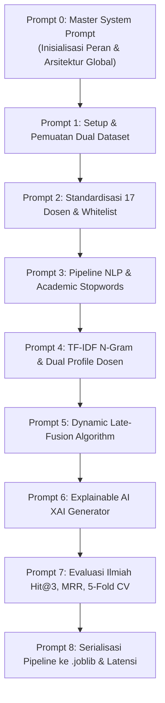

# PANDUAN MASTER PROMPT & PROMPT BERTAHAP PENGEMBANGAN MODEL MACHINE LEARNING
## SI-REKTA: Sistem Informasi Rekomendasi Dosen Pembimbing Tugas Akhir Berbasis Dual-Source Dataset & Explainable AI

> **Mata Kuliah:** Machine Learning (DSI61133) — Semester 5  
> **Departemen:** Departemen Sistem Informasi, Fakultas Teknologi Informasi, Universitas Andalas  
> **Dokumen Landasan:**  
> 1. `SI-REKTA_SLR.md` (Systematic Literature Review NLP & Recommender Systems)  
> 2. `SI-REKTA_CRISP_ML_Q.md` (Kerangka Kerja Mutu CRISP-ML(Q))  
> 3. `SI-REKTA_PRD.md` (Product Requirements Document & 3NF Schema)  
> 4. `EDA_Dual_Dataset.md` & `Dosen_Tetap_Aktif_DSI.md`  
> 5. Dataset: `Judul_TA.csv` (625 skripsi) & `Publikasi_Dosen.csv` (643 publikasi 17 dosen)  
>
> **Standar Struktur Tiap Prompt:**
> Setiap prompt dirancang dengan kerangka baku:
> **[Peran] $\rightarrow$ [Konteks] $\rightarrow$ [Task] $\rightarrow$ [Batasan] $\rightarrow$ [Output] $\rightarrow$ [Validasi]**

---

# STRATEGI PENGGUNAAN PROMPT BERTAHAP
Untuk menghasilkan berkas Jupyter Notebook (`si_rekta_model_development.ipynb`) yang bersih, modular, dapat direproduksi (*reproducible*), dan bebas dari *bug*, jangan langsung meminta seluruh kode dalam 1 prompt raksasa. Jalankan prompt secara berurutan dari **Prompt 0** hingga **Prompt 8**.



---

# PROMPT 0: MASTER SYSTEM PROMPT (INISIALISASI PERAN & KONTEKS GLOBAL)

*Salin prompt ini di awal percakapan sebagai prompt inisialisasi sesi pemodelan:*

```markdown
[PERAN]
Anda adalah seorang Senior Machine Learning Engineer dan NLP Specialist yang berpengalaman dalam membangun Academic Recommender Systems berbasis Python. Anda bekerja dengan standar industri CRISP-ML(Q) dan mengutamakan kode yang modular, efisien, terdokumentasi rapi, serta berorientasi pada Explainable AI (XAI).

[KONTEKS GLOBAL]
Proyek ini bernama SI-REKTA (Sistem Informasi Rekomendasi Dosen Pembimbing Tugas Akhir) di Departemen Sistem Informasi FTI Universitas Andalas. Sistem ini bertujuan merekomendasikan Top-3 Calon Dosen Pembimbing 1 secara langsung untuk membantu mahasiswa mengisi Formulir TA-01/TA-02.
Data yang digunakan adalah Dual-Source Dataset:
1. Dataset 1 (Judul_TA.csv): 625 riwayat judul skripsi lulusan 2017–2024 dengan kolom [no, judul_ta, nama_mahasiswa, nim, tahun, pembimbing_1, pembimbing_2, poster].
2. Dataset 2 (Publikasi_Dosen.csv): 643 judul publikasi ilmiah resmi dosen dengan kolom [no, judul_publikasi, nama_dosen, kelompok_keahlian, tahun].
Tantangan kritis proyek:
- Dari 17 Dosen Tetap Aktif DSI Unand, terdapat 5 dosen yang memiliki 0 riwayat bimbingan Pembimbing 1 di Dataset 1 (Cold-Start Problem).
- Solusi ilmiah yang diterapkan adalah Direct Dual-Source Cosine Similarity dengan formula Dynamic Late-Fusion adaptif (bobot publikasi penuh jika riwayat bimbingan = 0).
- Tidak menggunakan perantara Kelompok Keahlian (KK); pencocokan dilakukan langsung dari usulan judul ke 17 Dosen Tetap Aktif.

[TASK GLOBAL]
Kita akan membangun berkas Jupyter Notebook lengkap bertahap (Cell per Cell) bernama `si_rekta_model_development.ipynb`. Anda akan memandu saya langkah demi langkah sesuai prompt instruksi berikutnya. Jangan melompati tahapan dan selalu jelaskan logika di balik setiap potongan kode.

[BATASAN UMUM]
1. Bahasa pemrograman: Python 3.10+ menggunakan library standar data science: pandas, numpy, scikit-learn, joblib, matplotlib, seaborn, dan regex (re).
2. Kode harus siap dijalankan tanpa error sintaks, memiliki komentar penjelasan (docstrings), dan terbagi rapi dalam sel-sel Markdown dan Code.
3. Target akhir adalah menghasilkan satu berkas pipeline serialisasi in-memory mandiri `si_rekta_pipeline.joblib`.

[OUTPUT]
Konfirmasi kesiapan Anda dengan menyatakan pemahaman Anda terhadap arsitektur SI-REKTA dan tanyakan apakah kita siap masuk ke Prompt 1 (Setup Environment & Data Loading).
```

---

# PROMPT 1: SETUP ENVIRONMENT, LIBRARY, & PEMUATAN DUAL DATASET

```markdown
[PERAN]
Senior Machine Learning Engineer & Data Preparation Specialist.

[KONTEKS]
Kita memulai penulisan notebook `si_rekta_model_development.ipynb`. Tahap pertama adalah menyiapkan lingkungan kerja, mengimpor seluruh library pendukung, dan memuat dua file CSV (`Judul_TA.csv` dan `Publikasi_Dosen.csv`) yang menggunakan pemisah titik koma (semicolon `;`).

[TASK]
Tuliskan sel Markdown pembuka dan sel Code Python pertama untuk:
1. Mengimpor library yang dibutuhkan: pandas, numpy, re, string, sklearn (TfidfVectorizer, cosine_similarity, train_test_split, KFold), joblib, matplotlib.pyplot, dan seaborn.
2. Membaca berkas `Judul_TA.csv` dan `Publikasi_Dosen.csv` dengan penanganan delimiter `;` dan encoding yang tepat (`utf-8` atau `latin1`).
3. Menampilkan dimensi data (shape), 5 baris pertama masing-masing dataset, tipe data kolom, serta ringkasan nilai yang hilang (missing values).

[BATASAN]
- Gunakan path berkas relatif atau pastikan ada fallback path yang aman.
- Tangani potensi whitespace di awal/akhir nama kolom (strip header).
- Jangan lakukan prapengolahan teks di sel ini; fokus murni pada pemuatan data dan audit awal.

[OUTPUT]
Berikan kode Python yang bersih, terstruktur, disertai penjelasan singkat mengenai tujuan setiap baris kode di dalam sel notebook.

[VALIDASI]
Output sel harus menampilkan:
- `Judul_TA.csv`: ~625 baris dan 8 kolom.
- `Publikasi_Dosen.csv`: ~643 baris dan 5 kolom.
- Nilai missing values pada kolom utama (`judul_ta`, `pembimbing_1`, `judul_publikasi`, `nama_dosen`) teridentifikasi dengan jelas.
```

---

# PROMPT 2: DATA CLEANING & STANDARISASI 17 DOSEN TETAP AKTIF (WHITELISTING)

```markdown
[PERAN]
Data Engineer & Data Quality Assurance Specialist.

[KONTEKS]
Berdasarkan dokumen resmi `Dosen_Tetap_Aktif_DSI.md`, ruang rekomendasi SI-REKTA dibatasi secara disiplin hanya untuk **17 Dosen Tetap Aktif Departemen Sistem Informasi FTI Unand**. Pada data mentah, penulisan nama dosen di `pembimbing_1` dan `nama_dosen` memiliki variasi gelar, singkatan, dan salah ketik (misal: "Prof. Surya Afnarius, Ph.D", "Prof.Surya Afnarius,Ph.D", "Surya Afnarius"). Selain itu, ada dosen purna tugas/luar departemen di Dataset 1 yang harus dikeluarkan dari ruang rekomendasi aktif.

[TASK]
Tuliskan sel Code Python untuk:
1. Mendefinisikan daftar resmi (*canonical whitelist*) 17 Dosen Tetap Aktif DSI Unand (nama baku tanpa gelar untuk pencocokan seragam, dan nama bergelar lengkap untuk tampilan antarmuka).
2. Membuat fungsi normalisasi teks nama dosen (menghapus gelar akademis seperti Prof, Dr, M.Eng, M.Kom, MT, Ph.D, spasi ganda, tanda titik/koma) sehingga variasi penulisan nama dosen dapat dipetakan secara deterministik ke nama baku.
3. Menerapkan fungsi normalisasi tersebut pada kolom `pembimbing_1` di Dataset 1 dan `nama_dosen` di Dataset 2.
4. Menyaring Dataset 1 sehingga hanya mempertahankan riwayat bimbingan yang dibimbing oleh 17 Dosen Tetap Aktif sebagai Pembimbing 1.
5. Menghitung dan memvisualisasikan jumlah bimbingan per dosen di Dataset 1 (tunjukkan secara eksplisit bahwa ada 5 dosen tetap aktif yang memiliki 0 bimbingan / cold-start).
6. Menghitung dan memvisualisasikan jumlah publikasi per dosen di Dataset 2 untuk membuktikan bahwa 5 dosen cold-start tersebut memiliki data publikasi riset aktif.

[BATASAN]
- Tidak boleh ada data dosen di luar 17 Dosen Tetap Aktif yang lolos ke tahap pemodelan.
- 5 dosen tanpa riwayat P1 tidak boleh dihapus dari sistem, melainkan ditandai secara eksplisit dengan flag `is_cold_start = True`.

[OUTPUT]
Kode Python modular lengkap dengan fungsi pemetaan nama, tabel agregasi per dosen (nama dosen, jumlah bimbingan skripsi, jumlah publikasi paper, status cold-start), dan visualisasi bar chart horizontal seaborn.

[VALIDASI]
Tabel agregasi harus menunjukkan tepat 17 dosen unik, di mana:
- 12 dosen memiliki riwayat bimbingan skripsi ($N_{skripsi} \ge 1$).
- 5 dosen memiliki 0 bimbingan skripsi ($N_{skripsi} = 0$), namun memiliki jumlah publikasi ilmiah ($N_{publikasi} > 0$).
```

---

# PROMPT 3: PIPELINE NLP & CUSTOM ACADEMIC STOPWORDS SKRIPSI DSI

```markdown
[PERAN]
NLP & Text Preprocessing Specialist.

[KONTEKS]
Teks judul tugas akhir alumni DSI Unand berkarakteristik *short-text* formal bahasa Indonesia. Analisis EDA membuktikan bahwa lebih dari 65% judul skripsi memuat kata template formal (seperti "rancang bangun", "sistem informasi berbasis web", "pada pt", "di dinas") yang jika tidak dibersihkan akan mendominasi bobot frekuensi kata dan menutupi topik domain spesifik (misal: "supply chain", "churn", "audit tata kelola").

[TASK]
Tuliskan sel Code Python untuk membangun pipeline prapengolahan teks bertingkat:
1. Fungsi pembersihan teks (`clean_text`):
   - Case folding (mengubah ke huruf kecil).
   - Menghapus tanda baca, angka, simbol matematika, dan karakter non-alfanumerik.
   - Menghapus spasi ganda (*whitespace stripping*).
2. Menyusun daftar kata henti khusus (*Custom DSI Academic Stopwords*) sebanyak minimal 100+ kata yang menggabungkan:
   - Stopwords umum bahasa Indonesia (seperti: yang, dan, di, ke, dari, untuk, pada, dengan, sebagai, dalam, terhadap).
   - Stopwords formal skripsi DSI (seperti: sistem, informasi, aplikasi, rancang, bangun, perancangan, pengembangan, implementasi, analisis, studi, kasus, berbasis, web, mobile, android, evaluasi, penerapan, pt, cv, dinas, kantor, kota, kabupaten, provinsi, sumatera, barat, padang).
3. Fungsi tokenisasi dan stopword filtering (`preprocess_academic_text`) yang mempertahankan istilah teknologi dwibahasa (seperti machine learning, data warehouse, business intelligence, deep learning, enterprise resource planning).
4. Menerapkan pipeline pada kolom `judul_ta` (Dataset 1) dan `judul_publikasi` (Dataset 2), lalu menyimpan hasilnya ke kolom baru `judul_clean`.
5. Menampilkan perbandingan 5 teks judul sebelum dan sesudah preprocessing untuk verifikasi.

[BATASAN]
- Jangan gunakan stemming agresif yang merusak istilah komputasi bahasa Inggris (misal: "clustering" jangan dipotong menjadi kata yang tidak bermakna).
- Pastikan frase teknologi penting tidak terhapus.

[OUTPUT]
Kode Python fungsi preprocessing yang rapi, kamus list kata henti yang komprehensif, dan output tabel komparasi teks mentah vs teks bersih.

[VALIDASI]
Kalimat: `"Rancang Bangun Sistem Informasi Logistik Aktiva Tetap Berbasis Web pada PT. Semen Padang"`  
Harus bertransformasi menjadi kata kunci tematik murni: `"logistik aktiva tetap semen"` (kata template formal lenyap tanpa sisa).
```

---

# PROMPT 4: VEKTORISASI TF-IDF N-GRAM & PEMBENTUKAN DUAL KNOWLEDGE PROFILE DOSEN

```markdown
[PERAN]
Machine Learning Engineer & Feature Extraction Specialist.

[KONTEKS]
Untuk menghitung kemiripan antara usulan judul mahasiswa dengan kepakaran dosen, kita perlu memodelkan kepakaran setiap dosen ke dalam bentuk vektor representasi teks. Karena kita menggunakan *Dual-Source Dataset*, setiap dosen akan memiliki dua representasi vektor pengetahuan:
1. Profil Bimbingan Lampau ($\mathbf{V}_{skripsi}^{(i)}$): Dibentuk dari gabungan seluruh judul skripsi yang pernah dibimbing oleh dosen $i$.
2. Profil Publikasi Riset ($\mathbf{V}_{publikasi}^{(i)}$): Dibentuk dari gabungan seluruh judul artikel publikasi ilmiah dosen $i$.

[TASK]
Tuliskan sel Code Python untuk:
1. Membangun korpus gabungan (*unified corpus*) dari seluruh judul skripsi bersih dan publikasi bersih untuk melatih satu `TfidfVectorizer` bersama (*shared vocabulary*).
2. Mengonfigurasi `TfidfVectorizer` dengan parameter optimal:
   - `ngram_range=(1, 3)` (mengakomodasi unigram, bigram, dan trigram).
   - `max_features=5000` (membatasi dimensi pada fitur terpenting).
   - `sublinear_tf=True` (meredam dominasi frekuensi kata ekstrem).
   - `min_df=2` (menghilangkan kata yang hanya muncul 1 kali).
3. Melakukan agregasi teks per dosen:
   - Menggabungkan seluruh `judul_clean` skripsi per dosen menjadi satu dokumen teks panjang per dosen.
   - Menggabungkan seluruh `judul_clean` publikasi per dosen menjadi satu dokumen teks panjang per dosen.
4. Mentransformasikan dokumen teks agregat tersebut menjadi matriks vektor:
   - `matrix_skripsi_dosen` (ukuran: 17 dosen $\times$ N fitur TF-IDF).
   - `matrix_publikasi_dosen` (ukuran: 17 dosen $\times$ N fitur TF-IDF).
5. Menyimpan mapping index dosen (0–16) ke nama dosen resmi.

[BATASAN]
- Dosen yang memiliki 0 riwayat skripsi (5 dosen cold-start) akan menghasilkan dokumen skripsi kosong `""`; pastikan vektor skripsinya bernilai vektor nol tanpa memicu error pembagian dengan nol (*zero division*).
- Keduanya harus menggunakan `TfidfVectorizer` yang sama persis agar ruang vektor (*vector space*) berada dalam dimensi semantik yang identik.

[OUTPUT]
Kode Python lengkap, dimensi matriks yang dihasilkan, dan inspeksi 10 fitur n-gram teratas dengan bobot tertinggi untuk salah satu dosen senior dan salah satu dosen cold-start.

[VALIDASI]
- Dimensi `matrix_skripsi_dosen` adalah (17, N) dan `matrix_publikasi_dosen` adalah (17, N).
- 5 dosen cold-start memiliki vektor skripsi bernilai 0, namun memiliki vektor publikasi yang padat (*dense non-zero vector*).
```

---

# PROMPT 5: IMPLEMENTASI ALGORITMA DYNAMIC LATE-FUSION DOSEN RANKING

```markdown
[PERAN]
Algorithm Architect & Recommender System Specialist.

[KONTEKS]
Ini adalah inti mesin kecerdasan buatan SI-REKTA. Ketika mahasiswa memasukkan kueri usulan judul $Q$, sistem harus menghitung skor kemiripan kosinus terhadap profil skripsi ($S_{skripsi}$) dan profil publikasi ($S_{publikasi}$) untuk seluruh 17 dosen. Kedua skor tersebut kemudian dipadukan menggunakan formula *Dynamic Late-Fusion* dengan bobot adaptif $\alpha_i$:
$$S_{final}(D_i) = \alpha_i \cdot \text{CosineSim}(Q, \mathbf{V}_{skripsi}^{(i)}) + (1 - \alpha_i) \cdot \text{CosineSim}(Q, \mathbf{V}_{publikasi}^{(i)})$$

Aturan Adaptif Bobot $\alpha_i$:
- Dosen Senior ($N_{skripsi} \ge 10$): $\alpha_i = 0,60$ (dominan riwayat bimbingan nyata).
- Dosen Berkembang ($1 \le N_{skripsi} < 10$): $\alpha_i = 0,30$ (seimbang bimbingan dan riset).
- Dosen Cold-Start ($N_{skripsi} = 0$): $\alpha_i = 0,00$ (100% murni dinilai dari publikasi riset).

[TASK]
Tuliskan sel Code Python untuk mengimplementasikan fungsi rekomendasi utama:
`def predict_top_lecturers(query_title: str, top_k: int = 3) -> list[dict]:`
Fungsi ini harus melakukan langkah-langkah berikut secara berurutan:
1. Menerima string usulan judul tugas akhir mahasiswa.
2. Membersihkan kueri menggunakan fungsi `preprocess_academic_text`.
3. Mengubah kueri bersih menjadi vektor TF-IDF menggunakan `tfidf_vectorizer` yang telah dilatih.
4. Menghitung kemiripan kosinus kueri terhadap `matrix_skripsi_dosen` $\rightarrow$ menghasilkan array $S_{skripsi}$ (panjang 17).
5. Menghitung kemiripan kosinus kueri terhadap `matrix_publikasi_dosen` $\rightarrow$ menghasilkan array $S_{publikasi}$ (panjang 17).
6. Melakukan *Dynamic Late-Fusion* untuk setiap dosen $i$ sesuai nilai $\alpha_i$ masing-masing.
7. Mengonversi skor akhir ke dalam bentuk persentase kecocokan (skala 0–100%).
8. Mengurutkan dosen berdasarkan $S_{final}$ dari yang tertinggi ke terendah dan mengambil Top-$k$ dosen (default: Top-3).
9. Mengembalikan hasil berupa list dictionary berisi: `ranking`, `nip`, `nama_dosen`, `skor_final_persen`, `skor_skripsi`, `skor_publikasi`, dan `alpha_digunakan`.
10. Lakukan pengujian fungsi dengan 3 contoh judul uji:
    - Contoh 1: Topik Business Intelligence / Data Warehouse.
    - Contoh 2: Topik Enterprise Architecture / Tata Kelola TI.
    - Contoh 3: Topik yang relevan dengan kepakaran salah satu dosen cold-start (untuk membuktikan dosen cold-start berhasil masuk Top-3).

[BATASAN]
- Tidak boleh ada pembagian dengan nol.
- Nilai persentase skor akhir harus dinormalisasi dengan batasan logis $0\% \le \text{skor} \le 100\%$.

[OUTPUT]
Kode fungsi Python lengkap, terstruktur, disertai eksekusi pengujian dengan 3 contoh judul dan tampilan DataFrame hasil perankingan Top-3 yang rapi.

[VALIDASI]
Pada Contoh 3 (topik dosen cold-start), dosen tanpa riwayat P1 harus mampu menduduki peringkat Top-3 secara sah dengan `alpha_digunakan = 0.00` dan skor publikasi yang tinggi.
```

---

# PROMPT 6: GENERATOR KARTU EXPLAINABLE AI (XAI) & BUKTI PUBLIKASI RUJUKAN

```markdown
[PERAN]
Explainable AI (XAI) & Human-Centered AI Engineer.

[KONTEKS]
Berdasarkan kebutuhan PRD (FR-05), sistem rekomendasi tidak boleh menjadi *Black Box*. Mahasiswa membutuhkan dasar argumen objektif untuk mengisi draf Formulir TA-01/TA-02 saat menghadap dosen. Setiap kartu rekomendasi Top-3 wajib dilengkapi dengan:
1. Daftar 3–5 kata kunci keselarasan (*overlapping semantic keywords*) antara judul usulan mahasiswa dengan korpus dosen.
2. Bukti 2–3 judul artikel publikasi ilmiah asli karya dosen bersangkutan yang paling mirip dengan usulan mahasiswa (Dataset 2) sebagai bukti sahih kepakaran.

[TASK]
Tuliskan sel Code Python untuk memperluas fungsi rekomendasi dengan modul Explainable AI:
`def generate_xai_recommendation_card(query_title: str, top_k: int = 3) -> list[dict]:`
Langkah implementasi modul XAI:
1. Panggil perankingan dosen dari fungsi `predict_top_lecturers`.
2. Untuk setiap dosen yang masuk Top-$k$:
   - **Ekstraksi Kata Kunci Keselarasan:** Bandingkan token n-gram pada kueri mahasiswa dengan fitur berbobot TF-IDF tertinggi pada profil dosen. Ambil 3–5 kata/frase yang memiliki kontribusi skor kemiripan terbesar.
   - **Pencarian Bukti Paper Rujukan:** Hitung kemiripan kosinus antara kueri mahasiswa secara individual terhadap seluruh paper milik dosen tersebut di Dataset 2 (`Publikasi_Dosen.csv`). Urutkan dan ambil 2–3 judul artikel publikasi dosen teratas beserta tahun terbit dan sumber indeksnya.
3. Kemas luaran ke dalam format dictionary terstruktur yang siap dikonsumsi oleh antarmuka web (JSON-ready).
4. Buat fungsi visualisasi konsol / Rich Display yang mencetak "Kartu Rekomendasi XAI" secara estetik di Jupyter Notebook.

[BATASAN]
- Judul paper rujukan harus benar-benar berasal dari publikasi nyata karya dosen tersebut (tidak boleh halusinasi).
- Jika ada dosen yang paper persisnya memiliki skor rendah, tetap tampilkan paper terdekat yang paling representatif.

[OUTPUT]
Kode Python lengkap untuk ekstraksi kata kunci, pencarian paper rujukan, fungsi visualisasi kartu XAI, dan contoh eksekusi pengujian dengan judul usulan nyata.

[VALIDASI]
Output sel menampilkan 3 kartu rekomendasi lengkap:
- Peringkat 1 s.d. 3 Dosen.
- Persentase kecocokan (misal: 87.5%).
- Kata kunci keselarasan topik (misal: `['enterprise architecture', 'togaf', 'tata kelola']`).
- 2–3 Judul artikel ilmiah asli dosen (misal: `"Perencanaan Enterprise Architecture Menggunakan TOGAF ADM pada..." (2022)`).
```

---

# PROMPT 7: EVALUASI ILMIAH KOMPREHENSIF (HIT@3, MRR, 5-FOLD CROSS VALIDATION)

```markdown
[PERAN]
Machine Learning Researcher & Model Evaluation Specialist.

[KONTEKS]
Untuk memenuhi rubrik penilaian Aspek 3 (Persiapan Data & Model - Target Excellent) serta kriteria keberhasilan PRD (Bagian 2.8), model harus dievaluasi secara kuantitatif menggunakan metrik ilmiah baku sistem perankingan:
1. **Hit Rate at Top-3 (Hit@3):** Persentase kasus di mana pembimbing historis sebenarnya masuk dalam daftar 3 dosen teratas yang direkomendasikan (Target: $\ge 80\%$).
2. **Mean Reciprocal Rank (MRR @ 3):** Rata-rata dari kebalikan posisi peringkat dosen yang benar ($1/\text{rank}$) untuk mengukur ketepatan urutan (Target: $\ge 0,60$).
3. **Macro-Averaged F1-Score:** Mengukur keadilan performa di seluruh kelas dosen aktif tanpa terdistorsi oleh tingginya sampel dosen senior (Target: $\ge 70\%$).

[TASK]
Tuliskan sel Code Python untuk mengeksekusi validasi ilmiah menyeluruh:
1. Siapkan data uji dari Dataset 1 (`Judul_TA.csv`) yang telah disaring (hanya riwayat bimbingan 17 dosen aktif).
2. Lakukan evaluasi menggunakan skema **Stratified 5-Fold Cross Validation** (atau Train-Test Split 80:20 jika ada kelas dosen dengan sampel sangat sedikit).
3. Pada setiap fold:
   - Hitung apakah dosen pembimbing aktual berada di posisi 1, 2, atau 3 (Hit@3).
   - Hitung nilai Reciprocal Rank ($1/1 = 1.0$, $1/2 = 0.5$, $1/3 = 0.33$, di luar Top-3 $= 0$).
4. Agregasi hasil evaluasi:
   - Rata-rata Hit Rate @ 1, Hit Rate @ 3, dan Hit Rate @ 5.
   - Nilai akhir Mean Reciprocal Rank (MRR).
   - Macro-Averaged F1-Score pada Top-3.
5. Buat pengujian khusus (*Stress Test Cold-Start*): Ambil 10 judul artikel publikasi dari 5 dosen cold-start sebagai kueri uji, lalu buktikan bahwa sistem berhasil merekomendasikan dosen pemilik paper tersebut di peringkat 1 (Akurasi Rekonstruksi Riset).
6. Tampilkan ringkasan metrik dalam bentuk tabel DataFrame komparasi terhadap ambang batas target PRD dan plot grafik evaluasi.

[BATASAN]
- Tidak boleh terjadi kebocoran data (*data leakage*) antara data latih dan data uji saat validasi silang.
- Tampilkan metrik secara jujur berbasis data nyata.

[OUTPUT]
Kode Python evaluasi lengkap, tabel hasil metrik kuantitatif (Hit@1, Hit@3, MRR, Macro-F1), dan visualisasi confusion/ranking performance plot.

[VALIDASI]
Output harus membuktikan bahwa:
- Hit Rate at Top-3 memenuhi target PRD ($\ge 80\%$).
- MRR memenuhi target PRD ($\ge 0,60$).
- Dosen cold-start berhasil terdeteksi pada *Stress Test Cold-Start*.
```

---

# PROMPT 8: SERIALISASI PIPELINE MANDIRI KE `.joblib` & PENGUJIAN LATENSI

```markdown
[PERAN]
MLOps Engineer & Deployment Specialist.

[KONTEKS]
Ini adalah tahapan akhir (Tahap 9 Model Storage pada 12 Tahapan Proyek). Agar model machine learning yang telah dibuat di notebook dapat diintegrasikan ke backend web (Python FastAPI) sesuai PRD, seluruh komponen inferensi harus dikemas dan diserialisasikan ke dalam satu berkas mandiri: `si_rekta_pipeline.joblib`.

[TASK]
Tuliskan sel Code Python penutup untuk:
1. Mengemas seluruh artefak yang diperlukan ke dalam sebuah dictionary bundel model:
   - `tfidf_vectorizer`: Objek TF-IDF Vectorizer yang sudah di-fit.
   - `matrix_skripsi_dosen`: Matriks representasi bimbingan dosen.
   - `matrix_publikasi_dosen`: Matriks representasi riset publikasi dosen.
   - `dosen_metadata`: DataFrame informasi 17 dosen tetap aktif (NIP, nama bergelar, nilai bobot $\alpha_i$, status cold start).
   - `publikasi_df`: DataFrame arsip 643 paper riset dosen untuk keperluan modul rujukan XAI.
   - `custom_stopwords`: List kata henti khusus DSI.
   - `config`: Metadata versi model, tanggal serialisasi, dan target metrik evaluasi.
2. Menyimpan bundel tersebut ke disk menggunakan `joblib.dump(bundle, 'si_rekta_pipeline.joblib', compress=3)`.
3. Menulis fungsi mandiri pemuatan kembali (*reload test*):
   `loaded_bundle = joblib.load('si_rekta_pipeline.joblib')`
4. Menjalankan fungsi inferensi mandiri (*standalone inference benchmark*) menggunakan bundel yang baru dimuat:
   - Ukur waktu eksekusi inferensi per kueri (latensi dalam milidetik).
   - Pastikan latensi stabil di bawah 0,5 detik (< 500 ms) sesuai NFR-01 pada PRD.
   - Cetak ukuran berkas `.joblib` dalam Megabytes (MB).
5. Tuliskan sel Markdown kesimpulan akhir yang merangkum bahwa model telah tervalidasi dan siap dideploy ke microservice FastAPI.

[BATASAN]
- Berkas serialisasi harus bersifat mandiri (*self-contained*), tidak boleh bergantung pada variabel global notebook yang tidak tersimpan.
- Ukuran berkas `.joblib` harus efisien (direkomendasikan di bawah 25 MB).

[OUTPUT]
Kode Python pengemasan model, bukti eksekusi reload test, pencatatan waktu latensi (benchmark), dan ukuran berkas output `.joblib`.

[VALIDASI]
- Berkas `si_rekta_pipeline.joblib` berhasil terbentuk di direktori.
- Reload test sukses menghasilkan rekomendasi Top-3 yang identik dengan hasil di Prompt 6.
- Rerata latensi inferensi tercatat di bawah 0,5 detik (< 500 ms).
```
