# PANDUAN MASTER PROMPT & PROMPT BERTAHAP PENGEMBANGAN MODEL MACHINE LEARNING
## SI-REKTA: Sistem Informasi Rekomendasi Dosen Pembimbing Tugas Akhir Berbasis Dual-Source Dataset & Explainable AI

> **Mata Kuliah:** Machine Learning (DSI61133) — Semester 5  
> **Departemen:** Departemen Sistem Informasi, Fakultas Teknologi Informasi, Universitas Andalas  
> **Dokumen Landasan:**  
> 1. `SI-REKTA_SLR.md` (Systematic Literature Review NLP & Recommender Systems)  
> 2. `SI-REKTA_CRISP_ML_Q.md` (Kerangka Kerja Mutu CRISP-ML(Q) & 12 Tahapan Proyek ML 2026)  
> 3. `SI-REKTA_PRD.md` (Product Requirements Document & 3NF Database Schema)  
> 4. `EDA_Dual_Dataset.md` & `Dosen_Tetap_Aktif_DSI.md`  
> 5. Dataset: `Judul_TA.csv` (625 skripsi) & `Publikasi_Dosen.csv` (643 publikasi 17 dosen)  

---

# STANDAR STRUKTUR KELUARAN (PRINSIP "ANTI-BERAT": 1 CODE CELL = 1 OUTPUT TUNGGAL)

Berdasarkan evaluasi rekayasa perangkat lunak dan kenyamanan *pair-programming* dengan model AI, pembuatan Jupyter Notebook (`si_rekta_model_development.ipynb`) **dilarang menumpuk banyak tugas ke dalam satu sel kode** (misalnya: dilarang mencampur kode pembersihan, tabel DataFrame, dan diagram grafik dalam satu sel sekaligus).

### Prinsip Baku yang Diterapkan:
1. **Prompt 0 (Master Inisialisasi):**
   - Menghasilkan **HANYA 1 Sel Markdown Pertama (Cell 1)** untuk notebook.
   - Tepat di bawah judul utama notebook, **wajib mencantumkan daftar 12 tahapan resmi proyek**:
     ```markdown
     The project consists of the following stages:
     • Problem Identification
     • System Requirements Analysis
     • Data Analysis
     • Data Preprocessing
     • Data Processing Procedures
     • Machine Learning Algorithm Selection
     • Model Development
     • Model Evaluation
     • Model Storage
     • Information System Design
     • Model Integration into the System
     • User Interface Implementation
     ```
     diikuti oleh Tabel Penyelarasan CRISP-ML(Q) dan daftar 17 Dosen Tetap Aktif DSI Unand.
   - **Tanpa kode Python** sama sekali pada Prompt 0.

2. **Prompt 1 s/d Prompt 17 (Prompt Bertahap / Modular):**
   - Setiap prompt dipecah secara atomik (*fine-grained*) sehingga **1 Sel Kode = Tepat 1 Output Tunggal** (atau tanpa output untuk import).
   - Format respons AI wajib terdiri dari 3 bagian:
     1. `[Sel Markdown Pengantar]`: 1–2 paragraf penjelasan konsep/teori ringkas sebelum sel kode.
     2. `[Sel Kode Python]`: 1 blok kode Python utuh dan siap dieksekusi dalam 1 sel notebook.
     3. `[Interpretasi Hasil]`: 1 paragraf singkat yang memandu cara memvalidasi output tunggal tersebut (jika ada outputnya).

---

# PETA ALIR 17 TAHAPAN MODULAR NOTEBOOK

```mermaid
graph TD
    P0["Prompt 0: Master Setup & Sel Markdown 1 Notebook<br><i>Output: 1 Sel Markdown Cover + 12 Tahapan Proyek</i>"]
    
    subgraph S1 ["Fase 1: Data Understanding & Audit"]
        P1["Prompt 1: Setup & Import Library<br><i>Output: Silent (No Output)</i>"]
        P2["Prompt 2: Load & Audit Dataset 1 Skripsi<br><i>Output: 1 Tabel 5 Baris Skripsi</i>"]
        P3["Prompt 3: Load & Audit Dataset 2 Publikasi<br><i>Output: 1 Tabel 5 Baris Publikasi</i>"]
    end

    subgraph S2 ["Fase 2: Data Preprocessing & Whitelisting"]
        P4["Prompt 4: Canonical Name Mapping 17 Dosen<br><i>Output: 1 Ringkasan Status Filter (506 data)</i>"]
        P5["Prompt 5: Tabel Distribusi 17 Dosen<br><i>Output: 1 Tabel Summary Dosen</i>"]
        P6["Prompt 6: Visualisasi Bimbingan vs Publikasi<br><i>Output: 1 Grafik Bar Horizontal</i>"]
        P7["Prompt 7: Kamus Stopwords Khusus DSI<br><i>Output: 1 Hasil Uji Teks Bersih</i>"]
        P8["Prompt 8: Transformasi Preprocessing Teks<br><i>Output: 1 Tabel Komparasi 5 Judul</i>"]
    end

    subgraph S3 ["Fase 3: Feature Engineering & Modeling"]
        P9["Prompt 9: TF-IDF N-gram (1,3) Vectorizer<br><i>Output: 1 Ringkasan Statistik Vocab</i>"]
        P10["Prompt 10: Matriks Profil Ganda Dosen (17 x N)<br><i>Output: 1 Ringkasan Dimensi Matriks</i>"]
        P11["Prompt 11: Algoritma Dynamic Late-Fusion<br><i>Output: 1 Tabel Rekomendasi Top-3</i>"]
        P12["Prompt 12: Stress Test Dosen Cold-Start<br><i>Output: 1 Tabel Bukti Cold-Start Lolos Top-3</i>"]
        P13["Prompt 13: Generator Kartu Explainable AI (XAI)<br><i>Output: 1 Tampilan Kartu Rekomendasi XAI</i>"]
    end

    subgraph S4 ["Fase 4: Evaluasi Ilmiah & Model Storage"]
        P14["Prompt 14: Stratified 5-Fold Cross Validation<br><i>Output: 1 Tabel Metrik Hit@3 & MRR</i>"]
        P15["Prompt 15: Visualisasi Grafik Performa Evaluasi<br><i>Output: 1 Grafik Kurva Metrik</i>"]
        P16["Prompt 16: Serialisasi ke .joblib Mandiri<br><i>Output: 1 Info Metadata File Artefak</i>"]
        P17["Prompt 17: Uji Reload & Benchmark Latensi NFR<br><i>Output: 1 Info Waktu Latensi (<500ms)</i>"]
    end

    P0 --> P1 --> P2 --> P3 --> P4 --> P5 --> P6 --> P7 --> P8 --> P9 --> P10 --> P11 --> P12 --> P13 --> P14 --> P15 --> P16 --> P17
```



---

# PROMPT 0: MASTER SYSTEM PROMPT & INISIALISASI NOTEBOOK (SEL MARKDOWN PERTAMA)

*Salin prompt ini di awal sesi untuk menghasilkan Sel Markdown Pembuka Notebook yang memuat Metadata dan Tabel 12 Tahapan Proyek:*

````markdown
[PERAN]
Anda adalah seorang Senior Machine Learning Engineer dan NLP Specialist yang berpengalaman dalam membangun Academic Recommender Systems berbasis Python. Anda bekerja dengan standar industri CRISP-ML(Q) dan mengutamakan kode yang modular, efisien, terdokumentasi rapi, serta berorientasi pada Explainable AI (XAI).

[KONTEKS GLOBAL]
Proyek ini bernama SI-REKTA (Sistem Informasi Rekomendasi Dosen Pembimbing Tugas Akhir) di Departemen Sistem Informasi FTI Universitas Andalas. Sistem ini bertujuan merekomendasikan Top-3 Calon Dosen Pembimbing 1 secara langsung untuk membantu mahasiswa mengisi Formulir TA-01/TA-02.
Data yang digunakan adalah Dual-Source Dataset:
1. Dataset 1 (Judul_TA.csv): 625 riwayat judul skripsi lulusan 2017–2024 dengan kolom [no, judul_ta, nama_mahasiswa, nim, tahun, pembimbing_1, pembimbing_2, poster].
2. Dataset 2 (Publikasi_Dosen.csv): 643 judul publikasi ilmiah resmi dosen dengan kolom [no, judul_publikasi, nama_dosen, kelompok_keahlian, tahun].

Tantangan kritis proyek:
- Dari 17 Dosen Tetap Aktif DSI Unand, terdapat 5 dosen yang memiliki 0 riwayat bimbingan Pembimbing 1 di Dataset 1 (Cold-Start Problem).
- Solusi ilmiah yang diterapkan adalah Direct Dual-Source Cosine Similarity dengan formula Dynamic Late-Fusion adaptif (bobot publikasi penuh jika riwayat bimbingan = 0).
- Tidak menggunakan perantara Kelompok Keahlian (KK); pencocokan dilakukan langsung dari usulan judul mahasiswa ke 17 Dosen Tetap Aktif.

[TASK]
Tuliskan HANYA Sel Markdown Pembuka (Cell 1) untuk berkas Jupyter Notebook `si_rekta_model_development.ipynb`.
Sel Markdown ini harus memuat secara lengkap:
1. Judul Utama Proyek SI-REKTA dan Subjudul Ilmiah.
2. Tepat setelah judul utama, cantumkan teks 12 tahapan resmi proyek:
   "The project consists of the following stages:
   • Problem Identification
   • System Requirements Analysis
   • Data Analysis
   • Data Preprocessing
   • Data Processing Procedures
   • Machine Learning Algorithm Selection
   • Model Development
   • Model Evaluation
   • Model Storage
   • Information System Design
   • Model Integration into the System
   • User Interface Implementation"
3. Metadata Akademik: Mata Kuliah Machine Learning (DSI61133), Semester 5, Departemen Sistem Informasi, Fakultas Teknologi Informasi, Universitas Andalas.
4. Ringkasan Latar Belakang Masalah (Kendala pemilihan pembimbing, ketimpangan bimbingan, dan masalah cold-start 5 dosen).
5. Konsep Solusi Teknis: Direct Recommendation 17 Dosen Tetap Aktif via Dual-Source Late-Fusion TF-IDF & Explainable AI (XAI).
6. Tabel Penyelarasan 12 Tahapan Resmi Proyek Machine Learning 2026 dengan CRISP-ML(Q) dan letak implementasinya (Tahap 1–9 di dalam Notebook ini; Tahap 10–12 pada aplikasi web & deployment).
7. Daftar resmi 17 Dosen Tetap Aktif DSI Unand (12 dosen bimbingan aktif + 5 dosen cold-start).

[BATASAN]
- JANGAN menulis kode Python apa pun pada prompt ini.
- Output harus murni berupa teks Markdown siap salin ke Cell 1 notebook.
- Format rapi, profesional, dan menggunakan tabel Markdown yang terstruktur.

[OUTPUT]
Berikan HANYA 1 blok Markdown utuh untuk Sel 1 Notebook, lalu akhiri dengan 1 kalimat singkat penutup: "Sel Markdown 1 siap disalin ke notebook. Silakan masukkan Prompt 1 jika Anda siap melanjutkan."
````

---

# PROMPT 1: SETUP ENVIRONMENT & IMPORT LIBRARY PENDUKUNG

````markdown
[PERAN]
Senior Machine Learning Engineer & Environment Setup Specialist.

[KONTEKS]
Kita memulai penulisan sel kode pertama di notebook `si_rekta_model_development.ipynb`. Sel ini khusus digunakan untuk menyiapkan lingkungan eksekusi dan mengimpor seluruh dependensi yang diperlukan di seluruh tahapan proyek.

[TASK]
Tuliskan sel kode Python untuk:
1. Mengimpor pustaka manipulasi data: `pandas` dan `numpy`.
2. Mengimpor pustaka pemrosesan teks: `re` dan `string`.
3. Mengimpor pustaka Machine Learning (scikit-learn): `TfidfVectorizer`, `cosine_similarity`, `train_test_split`, `KFold`, `StratifiedKFold`.
4. Mengimpor pustaka serialisasi & utilitas: `joblib`, `time`, `os`, `warnings`.
5. Mengimpor pustaka visualisasi: `matplotlib.pyplot` dan `seaborn`.
6. Mengatur konfigurasi visualisasi grafik (gaya seaborn, palet warna, ukuran font, dan suppress warnings yang tidak relevan).

[BATASAN]
- Fokus murni pada persiapan dependensi dan konfigurasi dasar.
- JANGAN memuat file CSV atau memproses data di sel ini.
- Sel kode ini TIDAK menghasilkan output tampilan (silent execution yang bersih).

[OUTPUT]
Format respon tepat 3 bagian:
1. `[Sel Markdown Pengantar]`: 1 paragraf penjelasan daftar pustaka data science dan NLP yang digunakan.
2. `[Sel Kode Python]`: 1 blok kode Python import library utuh.
3. `[Interpretasi Hasil]`: 1 kalimat ringkas konfirmasi bahwa library berhasil dimuat tanpa error.

[VALIDASI]
Sel kode dieksekusi dengan status selesai tanpa menghasilkan error import.
````

---

# PROMPT 2: PEMUATAN DATASET 1 (ARSIP SKRIPSI 625 DATA) & AUDIT DATA

````markdown
[PERAN]
Data Preparation Specialist & Data Quality Auditor.

[KONTEKS]
Kita masuk ke Tahap 3 (Data Analysis) pada 12 Tahapan Proyek. Kita memuat Dataset 1 (`Judul_TA.csv`) yang berisi 625 riwayat skripsi alumni DSI Unand tahun 2017–2024 dengan delimiter titik koma (`;`).

[TASK]
Tuliskan sel kode Python untuk:
1. Membaca berkas `Judul_TA.csv` dengan delimiter `;` dan encoding fallback (`utf-8` / `latin1`).
2. Menghilangkan whitespace pada nama kolom (`df_skripsi.columns.str.strip()`).
3. Menampilkan informasi dimensi data (shape), ringkasan missing values pada kolom utama (`judul_ta`, `pembimbing_1`), serta 5 baris pertama DataFrame.

[BATASAN]
- Output tampilan HANYA 1 buah: Tepat 1 tampilan DataFrame / ringkasan audit data skripsi.
- JANGAN memuat Dataset 2 di sel ini (jaga agar sel tetap ringan dan terfokus).

[OUTPUT]
Format respon tepat 3 bagian:
1. `[Sel Markdown Pengantar]`: 1 paragraf pengantar audit struktur data historis skripsi alumni.
2. `[Sel Kode Python]`: 1 blok kode Python pemuatan dan pratinjau Dataset 1.
3. `[Interpretasi Hasil]`: 1 paragraf ringkas cara membaca dimensi data (~625 baris) dan temuan kolom pembimbing.

[VALIDASI]
Output menampilkan tabel pratinjau `Judul_TA.csv` dengan 8 kolom dan terdeteksi ~625 baris data.
````

---

# PROMPT 3: PEMUATAN DATASET 2 (PUBLIKASI 643 DATA 17 DOSEN) & AUDIT DATA

````markdown
[PERAN]
Data Preparation Specialist & Data Quality Auditor.

[KONTEKS]
Kita melanjutkan audit data pada Dataset 2 (`Publikasi_Dosen.csv`) yang memuat 643 judul artikel publikasi ilmiah resmi dari dosen tetap DSI Unand dengan delimiter titik koma (`;`).

[TASK]
Tuliskan sel kode Python untuk:
1. Membaca berkas `Publikasi_Dosen.csv` dengan delimiter `;` dan encoding fallback.
2. Menghilangkan whitespace pada nama kolom (`df_publikasi.columns.str.strip()`).
3. Menampilkan informasi dimensi data (shape), ringkasan missing values pada kolom utama (`judul_publikasi`, `nama_dosen`), serta 5 baris pertama DataFrame.

[BATASAN]
- Output tampilan HANYA 1 buah: Tepat 1 tampilan DataFrame / ringkasan audit data publikasi.
- JANGAN melakukan pembersihan teks di sel ini.

[OUTPUT]
Format respon tepat 3 bagian:
1. `[Sel Markdown Pengantar]`: 1 paragraf pengantar audit data rekam jejak riset resmi dosen.
2. `[Sel Kode Python]`: 1 blok kode Python pemuatan dan pratinjau Dataset 2.
3. `[Interpretasi Hasil]`: 1 paragraf ringkas membaca dimensi data (~643 baris) dan kolom kepakaran dosen.

[VALIDASI]
Output menampilkan tabel pratinjau `Publikasi_Dosen.csv` dengan 5 kolom dan terdeteksi ~643 baris data.
````

---

# PROMPT 4: EKSTRAKSI WHITELIST 17 DOSEN & CANONICAL NAME MAPPING

````markdown
[PERAN]
Data Engineer & Entity Canonicalization Specialist.

[KONTEKS]
Ini adalah Tahap 4 & 5 (Data Preprocessing & Procedures). Dataset 2 (`Publikasi_Dosen.csv`) memuat daftar resmi 17 Dosen Tetap Aktif DSI bergelar lengkap. Sementara pada Dataset 1 (`Judul_TA.csv`), kolom `pembimbing_1` memiliki variasi penulisan, singkatan marga/nama belakang, serta dosen luar/purna tugas. Kita mengekstrak whitelist 17 dosen secara dinamis dari Dataset 2 dan memetakan nama di Dataset 1.

[TASK]
Tuliskan sel kode Python untuk:
1. Mengekstrak 17 nama resmi dosen dari Dataset 2: `whitelist_17_dosen = sorted(df_publikasi['nama_dosen'].dropna().unique())`.
2. Membuat fungsi normalisasi teks nama (`clean_name_key`) yang membuang gelar akademis, tanda baca, spasi berlebih, dan mengubah ke huruf kecil.
3. Membangun kamus pemetaan nama (*canonical mapping dictionary*) otomatis dari `clean_name_key` ke nama resmi di whitelist, termasuk aturan singkatan nama belakang di Dataset 1.
4. Menerapkan pemetaan ke kolom baru `pembimbing_1_resmi` pada Dataset 1, lalu menyaring Dataset 1 hanya untuk baris bimbingan 17 dosen aktif (`df_skripsi_clean`).
5. Mencetak ringkasan hasil filterisasi: Jumlah dosen di whitelist dan jumlah baris skripsi terverifikasi.

[BATASAN]
- Dilarang melakukan hardcoding manual 17 nama dosen; ambil dinamis dari `df_publikasi['nama_dosen'].unique()`.
- Output sel HANYA 1 buah: Teks/tabel ringkasan jumlah skripsi yang lolos validasi.
- JANGAN membuat diagram grafik di sel ini.

[OUTPUT]
Format respon tepat 3 bagian:
1. `[Sel Markdown Pengantar]`: 1 paragraf konsep entity canonicalization dinamis untuk standardisasi nama pembimbing.
2. `[Sel Kode Python]`: 1 blok kode Python whitelisting, fungsi mapping, filtering, dan verifikasi.
3. `[Interpretasi Hasil]`: 1 paragraf ringkas memvalidasi bahwa whitelist tepat 17 dosen dan skripsi terfilter menjadi ~506 baris.

[VALIDASI]
Output membuktikan: Tepat 17 dosen di whitelist dan tereliminasi pembimbing purna tugas/luar departemen.
````

---

# PROMPT 5: ANALISIS DISTRIBUSI BIMBINGAN VS PUBLIKASI (TABEL RINGKASAN 17 DOSEN)

````markdown
[PERAN]
Data Analyst & Recommender Systems Specialist.

[KONTEKS]
Kita perlu memeriksa secara kuantitatif distribusi beban bimbingan skripsi dan produktivitas publikasi riset untuk ke-17 dosen tetap aktif guna membuktikan fenomena *Workload Imbalance* dan masalah *Cold-Start* (5 dosen dengan 0 riwayat bimbingan P1).

[TASK]
Tuliskan sel kode Python untuk:
1. Menghitung jumlah bimbingan skripsi per dosen dari `df_skripsi_clean`.
2. Menghitung jumlah publikasi riset per dosen dari `df_publikasi`.
3. Menggabungkan kedua data tersebut ke dalam satu DataFrame ringkasan 17 dosen (`dosen_summary_df`) dengan kolom:
   - `nama_dosen`
   - `jumlah_skripsi`
   - `jumlah_publikasi`
   - `is_cold_start` (True jika `jumlah_skripsi == 0`, False jika `>= 1`)
4. Mengurutkan tabel berdasarkan `jumlah_skripsi` secara menurun (*descending*) dan menampilkannya.

[BATASAN]
- Output tampilan HANYA 1 buah: Tepat 1 tabel DataFrame `dosen_summary_df` (17 baris).
- JANGAN menggabungkan pembuatan grafik di sel ini (grafik akan dibuat di sel berikutnya).

[OUTPUT]
Format respon tepat 3 bagian:
1. `[Sel Markdown Pengantar]`: 1 paragraf penjelasan identifikasi 12 dosen bimbingan aktif vs 5 dosen cold-start.
2. `[Sel Kode Python]`: 1 blok kode Python pembentukan dan penampilan tabel ringkasan 17 dosen.
3. `[Interpretasi Hasil]`: 1 paragraf membaca tabel: dosen dengan beban bimbingan tertinggi dan pembuktian 5 dosen yang memiliki $N_{skripsi} = 0$.

[VALIDASI]
Tabel menampilkan tepat 17 baris, dengan 5 dosen bertanda `is_cold_start = True`.
````

---

# PROMPT 6: VISUALISASI KOMPARASI BIMBINGAN VS PUBLIKASI 17 DOSEN

````markdown
[PERAN]
Data Visualization Specialist.

[KONTEKS]
Untuk menyajikan bukti nyata ketimpangan bimbingan (*workload imbalance*) serta keberadaan data riset publikasi sebagai kompensasi bagi dosen cold-start, kita membuat visualisasi grafik komparasi.

[TASK]
Tuliskan sel kode Python untuk:
1. Menggunakan data dari `dosen_summary_df` yang telah dibuat sebelumnya.
2. Membuat sebuah gambar grafik **Horizontal Bar Chart** (Seaborn/Matplotlib) yang membandingkan `jumlah_skripsi` dan `jumlah_publikasi` berdampingan untuk setiap 17 dosen.
3. Menambahkan elemen grafik yang profesional: judul yang informatif, label sumbu X dan Y, legenda warna yang jelas, serta anotasi nilai angka di ujung batang.

[BATASAN]
- Output sel HANYA 1 buah: Tepat 1 gambar grafik visualisasi komparasi (plot).
- JANGAN memproses data teks atau menambahkan tabel di sel ini.

[OUTPUT]
Format respon tepat 3 bagian:
1. `[Sel Markdown Pengantar]`: 1 paragraf urgensi visualisasi data komparasi bimbingan vs riset publikasi.
2. `[Sel Kode Python]`: 1 blok kode visualisasi Seaborn / Matplotlib yang rapi.
3. `[Interpretasi Hasil]`: 1 paragraf membaca grafik: ketimpangan bimbingan dosen senior dan keberadaan publikasi pada dosen cold-start.

[VALIDASI]
Grafik bar horizontal ter-render sempurna menampilkan 17 dosen dengan 2 palet warna kontras untuk skripsi vs publikasi.
````

---

# PROMPT 7: PIPELINE NLP & CUSTOM DSI ACADEMIC STOPWORDS

````markdown
[PERAN]
NLP & Text Preprocessing Specialist.

[KONTEKS]
Ini adalah Tahap 4 (Data Preprocessing). Teks judul skripsi DSI Unand didominasi oleh kata-kata template formal (seperti "rancang bangun", "sistem informasi berbasis web", "pada pt", "di dinas") yang menutupi topik domain spesifik (misal: "supply chain", "churn", "audit tata kelola"). Kita membangun pipeline NLP khusus akademik DSI.

[TASK]
Tuliskan sel kode Python untuk:
1. Membuat fungsi pembersihan dasar (`clean_text`): case folding ke huruf kecil, menghapus angka, tanda baca, simbol non-alfanumerik, dan spasi ganda.
2. Mendefinisikan kamus kata henti khusus: `DSI_ACADEMIC_STOPWORDS` yang berisi gabungan:
   - Kata henti umum bahasa Indonesia (yang, dan, di, ke, dari, untuk, pada, dll.).
   - Kata henti template skripsi DSI (sistem, informasi, aplikasi, rancang, bangun, perancangan, pengembangan, berbasis, web, mobile, android, evaluasi, penerapan, dll.).
   - Kata henti entitas/lokasi umum (pt, cv, dinas, kantor, padang, sumatera, barat, universitas, dll.).
3. Membuat fungsi `preprocess_academic_text(text)` yang membersihkan teks dan menyaring kata henti tanpa merusak istilah komputasi bahasa Inggris (seperti machine learning, data warehouse, business intelligence, supply chain).
4. Menjalankan pengujian fungsi pada 1 contoh kalimat uji:
   `"Rancang Bangun Sistem Informasi Logistik Aktiva Tetap Berbasis Web pada PT. Semen Padang"`
   dan mencetak teks sebelum vs sesudah diproses.

[BATASAN]
- Dilarang menggunakan stemming agresif bahasa Indonesia yang memotong istilah asing.
- Output tampilan HANYA 1 buah: Hasil cetak teks mentah vs teks bersih kalimat uji.
- JANGAN mengaplikasikan ke seluruh DataFrame di sel ini (akan diaplikasikan di sel berikutnya).

[OUTPUT]
Format respon tepat 3 bagian:
1. `[Sel Markdown Pengantar]`: 1 paragraf filosofi desain custom stopwords akademik pada short-text tugas akhir.
2. `[Sel Kode Python]`: 1 blok kode Python fungsi `clean_text`, kamus stopwords, fungsi `preprocess_academic_text`, dan pengujian contoh kalimat.
3. `[Interpretasi Hasil]`: 1 paragraf membaca hasil uji: hilangnya kata template dan bertahannya kata kunci tematik murni (`logistik aktiva tetap semen`).

[VALIDASI]
Kalimat uji bertransformasi menjadi kata kunci tematik murni tanpa ada sisa kata template formal.
````

---

# PROMPT 8: TRANSFORMASI PREPROCESSING PADA KEDUA DATASET

````markdown
[PERAN]
Data Preparation Engineer.

[KONTEKS]
Setelah fungsi preprocessing tervalidasi pada contoh kalimat, kita menerapkannya secara serentak ke seluruh baris judul skripsi (Dataset 1) dan judul publikasi dosen (Dataset 2).

[TASK]
Tuliskan sel kode Python untuk:
1. Menerapkan fungsi `preprocess_academic_text` ke kolom `judul_ta` pada `df_skripsi_clean`, lalu menyimpannya ke kolom baru `judul_clean`.
2. Menerapkan fungsi `preprocess_academic_text` ke kolom `judul_publikasi` pada `df_publikasi`, lalu menyimpannya ke kolom baru `judul_clean`.
3. Memastikan tidak ada judul yang bernilai kosong (`NaN` atau string kosong `""`), isi dengan fallback `"umum"` jika terjadi string kosong.
4. Menampilkan perbandingan 5 judul skripsi mentah vs judul skripsi bersih dalam bentuk tabel DataFrame.

[BATASAN]
- Output tampilan HANYA 1 buah: Tepat 1 tabel perbandingan 5 judul sebelum vs sesudah diproses.
- JANGAN melakukan ekstraksi TF-IDF di sel ini.

[OUTPUT]
Format respon tepat 3 bagian:
1. `[Sel Markdown Pengantar]`: 1 paragraf penjelasan standardisasi korpus teks skripsi dan publikasi dosen.
2. `[Sel Kode Python]`: 1 blok kode transformasi kolom kedua dataset dan penampilan tabel sampel.
3. `[Interpretasi Hasil]`: 1 paragraf membaca tabel perbandingan 5 sampel judul.

[VALIDASI]
Tabel menampilkan 5 judul mentah berdampingan dengan 5 judul bersih yang telah terbebas dari kata template formal.
````

---

# PROMPT 9: PELATIHAN TF-IDF VECTORIZER BERSAMA (SHARED VOCABULARY)

````markdown
[PERAN]
Machine Learning Engineer & Feature Extraction Specialist.

[KONTEKS]
Ini adalah Tahap 5 & 6 (Data Processing Procedures & Algorithm Selection). Agar representasi vektor skripsi dan publikasi berada pada ruang semantik yang identik (*shared vector space*), kita membangun satu `TfidfVectorizer` bersama yang dilatih dari gabungan korpus judul skripsi dan publikasi.

[TASK]
Tuliskan sel kode Python untuk:
1. Menggabungkan seluruh teks `judul_clean` dari skripsi dan publikasi menjadi satu korpus gabungan (*unified corpus*).
2. Mengonfigurasi dan melatih objek `TfidfVectorizer` dengan parameter ilmiah:
   - `ngram_range=(1, 3)` (menangkap unigram, bigram, dan trigram).
   - `max_features=5000` (membatasi dimensi pada fitur paling informatif).
   - `sublinear_tf=True` (meredam dominasi kata frekuensi tinggi).
   - `min_df=2` (menghilangkan noise kata yang hanya muncul 1 kali).
3. Melakukan fitting vectorizer pada korpus gabungan.
4. Mencetak ringkasan statistik: Total ukuran kosakata (*vocabulary size*) dan 10 fitur n-gram teratas.

[BATASAN]
- Output tampilan HANYA 1 buah: Ringkasan statistik ukuran vocab dan daftar 10 contoh fitur n-gram teratas.
- JANGAN membuat matriks dosen di sel ini (dibuat di sel berikutnya).

[OUTPUT]
Format respon tepat 3 bagian:
1. `[Sel Markdown Pengantar]`: 1 paragraf konsep ruang vektor semantik bersama berbasis TF-IDF N-gram (1,3).
2. `[Sel Kode Python]`: 1 blok kode pembuatan korpus gabungan, fitting TfidfVectorizer, dan inspeksi vocab.
3. `[Interpretasi Hasil]`: 1 paragraf membaca total dimensi kosakata (~1.000–3.000 n-grams) dan contoh fitur n-gram yang terbentuk.

[VALIDASI]
Vectorizer berhasil di-fit dan menghasilkan ukuran kosakata di atas 1.000 fitur n-gram.
````

---

# PROMPT 10: PEMBENTUKAN MATRIKS PROFIL GANDA DOSEN (17 x N)

````markdown
[PERAN]
Knowledge Representation & NLP Specialist.

[KONTEKS]
Setiap dosen dimodelkan kepakarannya ke dalam dua representasi vektor pengetahuan:
1. **Profil Bimbingan Skripsi ($\mathbf{V}_{skripsi}^{(i)}$):** Agregasi seluruh judul skripsi bimbingan dosen $i$.
2. **Profil Riset Publikasi ($\mathbf{V}_{publikasi}^{(i)}$):** Agregasi seluruh judul artikel publikasi dosen $i$.

[TASK]
Tuliskan sel kode Python untuk:
1. Melakukan agregasi teks bersih per dosen:
   - Menggabungkan seluruh `judul_clean` skripsi per dosen menjadi 1 dokumen teks panjang per dosen.
   - Menggabungkan seluruh `judul_clean` publikasi per dosen menjadi 1 dokumen teks panjang per dosen.
2. Mentransformasikan dokumen agregat tersebut menggunakan `tfidf_vectorizer` yang telah dilatih:
   - Menghasilkan matriks skripsi: `matrix_skripsi_dosen` (ukuran 17 dosen $\times$ N fitur).
   - Menghasilkan matriks publikasi: `matrix_publikasi_dosen` (ukuran 17 dosen $\times$ N fitur).
3. Mengonversi kedua matriks ke format array / sparse matrix yang siap dihitung kemiripan kosinusnya.
4. Mencetak ringkasan dimensi matriks dan memeriksa apakah vektor skripsi 5 dosen cold-start bernilai nol tanpa memicu error.

[BATASAN]
- Untuk 5 dosen cold-start, dokumen skripsinya kosong `""`, pastikan vektornya terdefinisi bernilai nol (*zero vector*).
- Output tampilan HANYA 1 buah: Ringkasan dimensi kedua matriks (harus tepat (17, N)) dan konfirmasi vektor cold-start.

[OUTPUT]
Format respon tepat 3 bagian:
1. `[Sel Markdown Pengantar]`: 1 paragraf arsitektur representasi profil kepakaran ganda dosen.
2. `[Sel Kode Python]`: 1 blok kode agregasi teks, transformasi TF-IDF, dan verifikasi dimensi matriks.
3. `[Interpretasi Hasil]`: 1 paragraf memverifikasi dimensi matriks (17, N) dan karakteristik vektor dosen cold-start.

[VALIDASI]
Dimensi `matrix_skripsi_dosen` dan `matrix_publikasi_dosen` keduanya persis (17, N).
````

---

# PROMPT 11: IMPLEMENTASI ALGORITMA DYNAMIC LATE-FUSION DOSEN RANKING

````markdown
[PERAN]
Algorithm Architect & Recommender System Specialist.

[KONTEKS]
Ini adalah Tahap 7 (Model Development). Mesin inferensi SI-REKTA menghitung kemiripan kosinus usulan judul mahasiswa terhadap profil skripsi ($S_{skripsi}$) dan profil publikasi ($S_{publikasi}$) seluruh 17 dosen, lalu memadukannya dengan bobot adaptif $\alpha_i$:
$$S_{final}(D_i) = \alpha_i \cdot \text{CosineSim}(Q, \mathbf{V}_{skripsi}^{(i)}) + (1 - \alpha_i) \cdot \text{CosineSim}(Q, \mathbf{V}_{publikasi}^{(i)})$$
Aturan Bobot Adaptif:
- Dosen Senior ($N_{skripsi} \ge 10$): $\alpha_i = 0,60$
- Dosen Berkembang ($1 \le N_{skripsi} < 10$): $\alpha_i = 0,30$
- Dosen Cold-Start ($N_{skripsi} = 0$): $\alpha_i = 0,00$ (100% dinilai dari publikasi riset).

[TASK]
Tuliskan sel kode Python untuk:
1. Mengimplementasikan fungsi inferensi utama:
   `def predict_top_lecturers(query_title: str, top_k: int = 3) -> list[dict]:`
   yang membersihkan kueri, mengubah ke vektor TF-IDF, menghitung cosine similarity ke matriks skripsi dan publikasi, melakukan perpaduan Late-Fusion, menormalisasi skor akhir ke skala 0–100%, dan mengambil Top-$k$ dosen.
2. Menjalankan pengujian fungsi dengan 1 contoh judul tugas akhir:
   `"Penerapan Algoritma K-Means Clustering untuk Segmentasi Pelanggan pada Data Penjualan Retail"`
3. Menampilkan hasil perankingan Top-3 dosen dalam bentuk tabel DataFrame.

[BATASAN]
- Output tampilan HANYA 1 buah: Tepat 1 tabel hasil perankingan Top-3 dosen untuk kueri uji.
- Pastikan tidak ada potensi pembagian dengan nol (*zero division safe*).

[OUTPUT]
Format respon tepat 3 bagian:
1. `[Sel Markdown Pengantar]`: 1 paragraf perumusan formula Dynamic Late-Fusion dan aturan adaptif bobot $\alpha_i$.
2. `[Sel Kode Python]`: 1 blok kode implementasi fungsi `predict_top_lecturers` dan eksekusi pengujian kueri.
3. `[Interpretasi Hasil]`: 1 paragraf membaca tabel rekomendasi Top-3 (peringkat, nama dosen, skor akhir %, skor skripsi, skor publikasi, bobot alpha).

[VALIDASI]
Output menampilkan tabel Top-3 dosen dengan persentase skor kecocokan yang logis dan terurut menurun.
````

---

# PROMPT 12: STRESS TEST MITIGASI DOSEN COLD-START (ZERO-HISTORY VALIDATION)

````markdown
[PERAN]
Recommender System Tester & Evaluation Specialist.

[KONTEKS]
Salah satu kriteria keberhasilan kritis proyek SI-REKTA adalah membuktikan bahwa sistem mampu merekomendasikan 5 dosen yang memiliki 0 riwayat bimbingan skripsi (*Cold-Start Lecturers*). Kita melakukan uji stres (*stress test*) khusus menggunakan topik yang sangat relevan dengan keahlian riset publikasi salah satu dosen cold-start.

[TASK]
Tuliskan sel kode Python untuk:
1. Mengambil salah satu topik riset spesifik dari dosen cold-start (misalnya topik Bioinformatika / NLP / Game Development milik Febby Apri Wenando atau Aina Hubby Aziira).
2. Menjalankan fungsi `predict_top_lecturers` dengan kueri topik tersebut.
3. Menampilkan tabel hasil rekomendasi Top-3 beserta nilai $\alpha_i$ yang digunakan dan skor publikasinya.

[BATASAN]
- Output tampilan HANYA 1 buah: Tepat 1 tabel hasil perankingan Top-3 pengujian cold-start.
- Dosen cold-start yang diuji harus terbukti masuk ke daftar Top-3.

[OUTPUT]
Format respon tepat 3 bagian:
1. `[Sel Markdown Pengantar]`: 1 paragraf tujuan pengujian khusus mitigasi cold-start tanpa riwayat bimbingan.
2. `[Sel Kode Python]`: 1 blok kode eksekusi stress test cold-start dan pembuatan tabel hasil.
3. `[Interpretasi Hasil]`: 1 paragraf membaca hasil: pembuktian bahwa dosen cold-start berhasil masuk Top-3 dengan $\alpha_i = 0.00$ murni mengandalkan rekam jejak publikasi.

[VALIDASI]
Dosen cold-start berhasil menempati peringkat Top-3 secara sah dengan `alpha_digunakan = 0.00`.
````

---

# PROMPT 13: GENERATOR KARTU EXPLAINABLE AI (XAI) & BUKTI PUBLIKASI RUJUKAN

````markdown
[PERAN]
Explainable AI (XAI) & Human-Centered AI Engineer.

[KONTEKS]
Berdasarkan kebutuhan PRD (FR-05), rekomendasi SI-REKTA tidak boleh berupa *Black Box*. Mahasiswa membutuhkan bukti nyata untuk mengisi draf Formulir TA-01/TA-02. Setiap rekomendasi dosen wajib disertai:
1. Kata kunci keselarasan (*overlapping semantic keywords*).
2. Bukti 2–3 judul artikel publikasi ilmiah asli dosen bersangkutan yang paling relevan dari Dataset 2 (`Publikasi_Dosen.csv`).

[TASK]
Tuliskan sel kode Python untuk:
1. Mengimplementasikan fungsi modul XAI:
   `def generate_xai_recommendation_card(query_title: str, top_k: int = 3) -> list[dict]:`
   - Mengekstrak 3–5 kata kunci keselarasan antara kueri dan profil dosen.
   - Menghitung kemiripan kosinus kueri terhadap seluruh artikel publikasi milik dosen bersangkutan di Dataset 2 dan mengambil 2–3 judul teratas beserta tahun terbitnya.
2. Membuat fungsi cetak visualisasi "Kartu Rekomendasi XAI" yang estetik di Jupyter Notebook.
3. Menjalankan pengujian dengan 1 contoh judul skripsi nyata dan menampilkan kartu rekomendasinya.

[BATASAN]
- Judul paper rujukan harus benar-benar berasal dari publikasi nyata karya dosen tersebut (dilarang ada halusinasi data).
- Output tampilan HANYA 1 buah: Tampilan kartu visualisasi XAI Top-3 dosen.

[OUTPUT]
Format respon tepat 3 bagian:
1. `[Sel Markdown Pengantar]`: 1 paragraf prinsip XAI untuk transparansi akademik dan pengisian Formulir TA-01/TA-02.
2. `[Sel Kode Python]`: 1 blok kode implementasi modul XAI, perayapan paper rujukan, dan cetak kartu XAI.
3. `[Interpretasi Hasil]`: 1 paragraf memverifikasi elemen kartu XAI: persentase kecocokan, kata kunci, dan keaslian artikel publikasi dosen.

[VALIDASI]
Kartu rekomendasi menampilkan dosen Top-3 lengkap dengan persentase skor, kata kunci tematik, dan 2–3 rujukan artikel publikasi asli dosen.
````

---

# PROMPT 14: EVALUASI KUANTITATIF ILMIAH: STRATIFIED 5-FOLD CV (HIT@3 & MRR)

````markdown
[PERAN]
Machine Learning Researcher & Model Evaluation Specialist.

[KONTEKS]
Ini adalah Tahap 8 (Model Evaluation). Sesuai kriteria keberhasilan PRD (Bagian 2.8) dan rubrik penilaian Aspek 3 (Target Excellent), sistem dievaluasi secara kuantitatif menggunakan metrik ilmiah baku sistem perankingan:
1. **Hit Rate at Top-3 (Hit@3):** Target $\ge 80\%$.
2. **Mean Reciprocal Rank (MRR @ 3):** Target $\ge 0,60$.
3. **Macro-Averaged F1-Score:** Target $\ge 70\%$.

[TASK]
Tuliskan sel kode Python untuk:
1. Menyiapkan data evaluasi dari riwayat skripsi terverifikasi (`df_skripsi_clean`).
2. Menjalankan skema evaluasi **Stratified 5-Fold Cross Validation** (atau Train-Test Split 80:20 jika ada kelas dosen dengan sampel sangat kecil).
3. Menghitung capaian metrik: Hit@1, Hit@3, Hit@5, dan MRR@3 pada setiap iterasi pengujian.
4. Merangkum hasil evaluasi rata-rata ke dalam bentuk tabel DataFrame komparasi antara **Capaian Model SI-REKTA** vs **Ambang Batas Target PRD** beserta status kelolosannya.

[BATASAN]
- Evaluasi berbasis data riwayat nyata, tidak boleh ada manipulasi angka metrik.
- Output tampilan HANYA 1 buah: Tepat 1 tabel DataFrame perbandingan metrik evaluasi vs target PRD.
- JANGAN menyertakan plot grafik di sel ini (grafik dibuat di sel berikutnya).

[OUTPUT]
Format respon tepat 3 bagian:
1. `[Sel Markdown Pengantar]`: 1 paragraf penjelasan metodologi evaluasi sistem perankingan rekomendasi akademik (Hit@3 & MRR).
2. `[Sel Kode Python]`: 1 blok kode eksekusi validasi silang dan pembentukan tabel ringkasan metrik.
3. `[Interpretasi Hasil]`: 1 paragraf membandingkan nilai Hit@3 dan MRR model terhadap ambang batas PRD.

[VALIDASI]
Tabel evaluasi menunjukkan Hit@3 mencapai target $\ge 80\%$ dan MRR mencapai $\ge 0,60$.
````

---

# PROMPT 15: VISUALISASI GRAFIK PERFORMA EVALUASI (RANKING EVALUATION PLOT)

````markdown
[PERAN]
Data Visualization Specialist & ML Evaluator.

[KONTEKS]
Untuk menyajikan bukti performa evaluasi secara visual di laporan proyek, kita membuat grafik kurva metrik perankingan sistem rekomendasi.

[TASK]
Tuliskan sel kode Python untuk:
1. Menggunakan data hasil evaluasi yang telah dihitung sebelumnya.
2. Membuat sebuah gambar grafik garis atau batang (Seaborn/Matplotlib) yang memvisualisasikan:
   - Kurva Hit Rate pada berbagai nilai $k$ (Hit@1, Hit@3, Hit@5).
   - Nilai capaian Mean Reciprocal Rank (MRR).
   - Garis putus-putus merah sebagai ambang batas target PRD (80% untuk Hit@3).
3. Memberikan label, judul grafik, dan legenda yang rapi.

[BATASAN]
- Output tampilan HANYA 1 buah: Tepat 1 gambar grafik evaluasi model.
- JANGAN mengulang komputasi validasi silang di sel ini.

[OUTPUT]
Format respon tepat 3 bagian:
1. `[Sel Markdown Pengantar]`: 1 paragraf interpretasi visual kurva akumulasi akurasi perankingan (Hit@k).
2. `[Sel Kode Python]`: 1 blok kode visualisasi performa evaluasi.
3. `[Interpretasi Hasil]`: 1 paragraf membaca grafik evaluasi dan membuktikan terpenuhinya standar mutu model.

[VALIDASI]
Grafik visualisasi ter-render dengan jelas memperlihatkan lonjakan akurasi dari Hit@1 ke Hit@3 di atas garis target 80%.
````

---

# PROMPT 16: SERIALISASI SELURUH PIPELINE KE BERKAS MANDIRI `.joblib`

````markdown
[PERAN]
MLOps Engineer & Model Packaging Specialist.

[KONTEKS]
Ini adalah Tahap 9 (Model Storage). Agar model yang telah dibuat di notebook dapat diintegrasikan ke backend web (FastAPI) sesuai PRD, seluruh artefak inferensi harus dibundel dan disimpan ke dalam satu berkas serialisasi mandiri: `si_rekta_pipeline.joblib`.

[TASK]
Tuliskan sel kode Python untuk:
1. Mengemas seluruh artefak yang diperlukan ke dalam dictionary bundel model:
   - `tfidf_vectorizer`: Objek TF-IDF Vectorizer yang sudah di-fit.
   - `matrix_skripsi_dosen`: Matriks representasi bimbingan dosen.
   - `matrix_publikasi_dosen`: Matriks representasi riset publikasi dosen.
   - `dosen_metadata`: DataFrame 17 dosen tetap aktif (nama resmi, nilai bobot $\alpha_i$, status cold start).
   - `publikasi_df`: DataFrame arsip 643 paper riset dosen untuk keperluan modul rujukan XAI.
   - `custom_stopwords`: List kata henti khusus DSI.
   - `config`: Metadata versi model, tanggal pembuatan, dan ringkasan metrik evaluasi.
2. Menyimpan bundel tersebut ke disk: `joblib.dump(bundle, 'si_rekta_pipeline.joblib', compress=3)`.
3. Memeriksa dan mencetak informasi metadata berkas: Nama file, lokasi path absolut, dan ukuran berkas dalam Megabytes (MB).

[BATASAN]
- Bundel harus bersifat mandiri (*self-contained*).
- Output tampilan HANYA 1 buah: Teks/tabel ringkasan informasi berkas `.joblib` yang tersimpan.

[OUTPUT]
Format respon tepat 3 bagian:
1. `[Sel Markdown Pengantar]`: 1 paragraf konsep Model Storage (Tahap 9) dan transisi artefak model ke fase deployment.
2. `[Sel Kode Python]`: 1 blok kode pengemasan bundel model, serialisasi joblib, dan pengecekan ukuran file.
3. `[Interpretasi Hasil]`: 1 paragraf memverifikasi keberhasilan pembentukan berkas dan ukurannya yang sangat ringan (< 5 MB).

[VALIDASI]
Berkas `si_rekta_pipeline.joblib` berhasil terbentuk di direktori proyek dengan ukuran sangat efisien (~0.16–0.5 MB).
````

---

# PROMPT 17: UJI RELOAD MANDIRI & BENCHMARK LATENSI INFERENSI (NFR VALIDATION)

````markdown
[PERAN]
MLOps Engineer & Non-Functional Requirements Tester.

[KONTEKS]
Ini adalah tahap pengujian penutup di notebook. Kita memverifikasi persyaratan non-fungsional PRD (NFR-01: Waktu respons inferensi harus di bawah 0,5 detik atau < 500 ms) dengan memuat kembali berkas `.joblib` yang baru disimpan dan menjalankan pengujian inferensi mandiri tanpa bergantung pada variabel global notebook.

[TASK]
Tuliskan sel kode Python untuk:
1. Memuat kembali berkas serialisasi: `loaded_bundle = joblib.load('si_rekta_pipeline.joblib')`.
2. Menulis fungsi inferensi mandiri (`standalone_recommendation_benchmark`) yang murni menggunakan artefak dari `loaded_bundle`.
3. Menjalankan inferensi pada 1 contoh kueri sambil mengukur waktu eksekusi presisi (dalam milidetik).
4. Menampilkan hasil rekomendasi Top-3 dari model reload dan mencetak waktu latensi inferensi dalam format:
   `"Latensi Inferensi: XX.XX ms (Status: LOLOS NFR < 500 ms)"`.

[BATASAN]
- Inferensi harus murni membaca objek dari `loaded_bundle` (membuktikan portabilitas model).
- Output tampilan HANYA 1 buah: Tabel rekomendasi hasil reload disertai catatan waktu latensi inferensi.

[OUTPUT]
Format respon tepat 3 bagian:
1. `[Sel Markdown Pengantar]`: 1 paragraf urgensi pengujian reload mandiri dan validasi batas latensi NFR (< 500 ms).
2. `[Sel Kode Python]`: 1 blok kode pemuatan joblib, eksekusi inferensi mandiri, pengukuran waktu latensi, dan penampilan hasil.
3. `[Interpretasi Hasil]`: 1 paragraf membaca hasil reload: rekomendasi identik dan performa waktu respons sub-detik yang sangat kencang.

[VALIDASI]
Output menunjukkan rekomendasi Top-3 sukses dihasilkan dari berkas `.joblib` dengan waktu latensi inferensi jauh di bawah 500 ms (< 10 ms).
````

---

# CONTOH PERSIS OUTPUT UNTUK PROMPT 0 (SEL 1 NOTEBOOK)

Agar pengguna memiliki gambaran yang sangat jelas, berikut adalah wujud persis dari **Sel Markdown Pertama** yang akan dihasilkan oleh AI saat Prompt 0 dijalankan:

---

### *Wujud Sel 1 Notebook (Markdown Pembuka)*:
```markdown
# SI-REKTA: Sistem Informasi Rekomendasi Dosen Pembimbing Tugas Akhir
## Model Development & Academic Recommender System Berbasis Dual-Source Dataset & Explainable AI

The project consists of the following stages:
• Problem Identification
• System Requirements Analysis
• Data Analysis
• Data Preprocessing
• Data Processing Procedures
• Machine Learning Algorithm Selection
• Model Development
• Model Evaluation
• Model Storage
• Information System Design
• Model Integration into the System
• User Interface Implementation

---
- **Mata Kuliah:** Machine Learning (DSI61133) — Semester 5
- **Departemen:** Departemen Sistem Informasi, Fakultas Teknologi Informasi, Universitas Andalas
- **Standar Rekayasa:** CRISP-ML(Q) (Cross-Industry Standard Process for Machine Learning with Quality Assurance)
- **Data Primer:** `Judul_TA.csv` (625 skripsi) & `Publikasi_Dosen.csv` (643 publikasi resmi)
- **Ruang Lingkup Dosen:** 17 Dosen Tetap Aktif Departemen Sistem Informasi (Whitelisted)
---

### 1. Latar Belakang & Identifikasi Masalah
Proses penentuan calon dosen pembimbing tugas akhir di Departemen Sistem Informasi menghadapi tiga tantangan utama:
1. **Ketidaksesuaian Topik (*Topic Mismatch*):** Usulan judul tugas akhir mahasiswa kerap tidak selaras dengan bidang kepakaran riset dosen.
2. **Ketimpangan Beban Bimbingan (*Workload Imbalance*):** Terjadi penumpukan antrean bimbingan pada sejumlah dosen senior, sementara dosen lain minim bimbingan.
3. **Tantangan Dosen Tanpa Riwayat Pembimbing 1 (*Zero-History Cold-Start*):** Terdapat 5 dosen tetap aktif yang belum memiliki riwayat sebagai Pembimbing 1 pada data historis skripsi, sehingga tidak akan pernah direkomendasikan jika model hanya mengandalkan riwayat masa lalu.

### 2. Pendekatan Solusi: Direct Dual-Source Dynamic Late-Fusion
SI-REKTA memetakan usulan judul tugas akhir mahasiswa secara langsung ke **17 Dosen Tetap Aktif DSI Unand** tanpa melalui perantara Kelompok Keahlian (KK). Kepakaran setiap dosen dimodelkan dari dua sumber pengetahuan:
$$\mathbf{V}_{dosen}^{(i)} = \{\mathbf{V}_{skripsi}^{(i)}, \mathbf{V}_{publikasi}^{(i)}\}$$

Skor akhir dihitung menggunakan formula adaptif *Dynamic Late-Fusion*:
$$S_{final}(D_i) = \alpha_i \cdot \text{CosineSim}(Q, \mathbf{V}_{skripsi}^{(i)}) + (1 - \alpha_i) \cdot \text{CosineSim}(Q, \mathbf{V}_{publikasi}^{(i)})$$
- **Dosen Senior ($N_{skripsi} \ge 10$):** $\alpha_i = 0,60$
- **Dosen Berkembang ($1 \le N_{skripsi} < 10$):** $\alpha_i = 0,30$
- **Dosen Cold-Start ($N_{skripsi} = 0$):** $\alpha_i = 0,00$ (100% dinilai dari rekam jejak publikasi riset)

---

### 3. Penyelarasan 12 Tahapan Proyek Machine Learning 2026 dengan CRISP-ML(Q)

| No | 12 Tahapan Proyek ML 2026 | Siklus CRISP-ML(Q) | Implementasi pada Proyek SI-REKTA | Pemetaan di Notebook / Sistem |
|:--:|:---|:---|:---|:---|
| 1 | **Problem Identification** | Business & Data Understanding | Identifikasi topic mismatch, workload imbalance, dan cold-start 5 dosen. | Sel 1 (Markdown Konteks) |
| 2 | **System Requirements Analysis** | Business & Data Understanding | Spesifikasi batasan 17 dosen tetap aktif dan metrik evaluasi Top-3 Accuracy & MRR. | Sel 1 (Markdown Konteks & PRD) |
| 3 | **Data Analysis** | Business & Data Understanding | Audit eksploratif terhadap `Judul_TA.csv` (625 data) dan `Publikasi_Dosen.csv` (643 data). | Sel 2–6 (Data Loading & EDA Summary) |
| 4 | **Data Preprocessing** | Data Preparation | Normalisasi teks, case folding, regex stripping, dan custom DSI academic stopwords. | Sel 7–8 (NLP Cleaning Pipeline) |
| 5 | **Data Processing Procedures** | Data Preparation | Standarisasi entitas dosen (whitelisting 17 dosen) dan ekstraksi fitur TF-IDF N-gram (1,3). | Sel 4, 9–10 (Canonical Mapping & TF-IDF) |
| 6 | **Algorithm Selection** | Model Engineering | Pemilihan Cosine Similarity dengan Late-Fusion adaptif vs Baseline Classifiers. | Sel 11 (Late-Fusion Architecture) |
| 7 | **Model Development** | Model Engineering | Pembangunan modul perankingan `predict_top_lecturers` & modul Explainable AI (XAI). | Sel 11–13 (Core Inference & XAI Cards) |
| 8 | **Model Evaluation** | Model Evaluation & QA | Pengujian ilmiah Stratified 5-Fold CV, Hit@1, Hit@3, MRR, dan Stress Test Cold-Start. | Sel 14–15 (Scientific Evaluation) |
| 9 | **Model Storage** | Model Deployment | Serialisasi seluruh artefak model ke dalam berkas tunggal mandiri `si_rekta_pipeline.joblib`. | Sel 16–17 (Export Pipeline & Benchmark) |
| 10 | **Information System Design** | Model Deployment | Perancangan arsitektur web Three-Tier (FastAPI Backend + Modern Frontend + PostgreSQL). | Modul Web App (Dokumen PRD) |
| 11 | **Model Integration** | Model Deployment | Integrasi model `.joblib` ke REST API `/api/recommend` dengan latensi sub-detik (< 500 ms). | Modul Web App (FastAPI Engine) |
| 12 | **User Interface Implementation** | Model Deployment | Antarmuka interaktif rekomendasi dosen, kartu bukti XAI, direktori dosen, dan panduan TA. | Modul Web App (User Interface) |

---

### 4. Daftar Resmi 17 Dosen Tetap Aktif Departemen Sistem Informasi
1. Prof. Surya Afnarius, Ph.D.
2. Febby Apri Wenando, S.Kom., M.Eng., Ph.D. *(Cold-Start / Prioritas Riset)*
3. Rahmatika Pratama Santi, S.T., M.T.
4. Aina Hubby Aziira, S.Kom., M.Eng. *(Cold-Start / Prioritas Riset)*
5. Husnil Kamil, M.T.
6. Afriyanti Dwi Kartika, S.Pd., M.T.
7. Dwi Welly Sukma Nirad, M.T.
8. Nisa Dwi Angresti, S.Kom., M.Kom. *(Cold-Start / Prioritas Riset)*
9. Hafzatin Nurlatifa, S.Kom., M.Eng. *(Cold-Start / Prioritas Riset)*
10. Hafizah Hanim, S.T., M.Kom.
11. Haris Suryamen, S.Kom., M.Sc.
12. Ricky Akbar, M.Kom.
13. Jefril Rahmadoni, M.Kom.
14. Ullya Mega Wahyuni, S.Kom., M.Kom.
15. Adi Arga Arifnur, S.Kom., M.Kom. *(Cold-Start / Prioritas Riset)*
16. Fajril Akbar, M.Sc.
17. Hasdi Putra, M.T.
```
