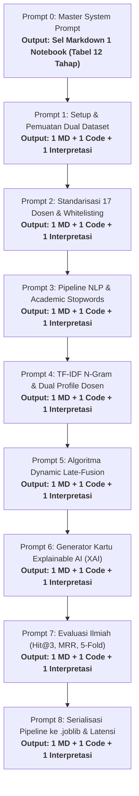

# PANDUAN MASTER PROMPT & PROMPT BERTAHAP PENGEMBANGAN MODEL MACHINE LEARNING
## SI-REKTA: Sistem Informasi Rekomendasi Dosen Pembimbing Tugas Akhir Berbasis Dual-Source Dataset & Explainable AI

> **Mata Kuliah:** Machine Learning (DSI61133) — Semester 5  
> **Departemen:** Departemen Sistem Informasi, Fakultas Teknologi Informasi, Universitas Andalas  
> **Dokumen Landasan:**  
> 1. `SI-REKTA_SLR.md` (Systematic Literature Review NLP & Recommender Systems)  
> 2. `SI-REKTA_CRISP_ML_Q.md` (Kerangka Kerja Mutu CRISP-ML(Q) & 12 Tahapan Proyek ML 2026)  
> 3. `SI-REKTA_PRD.md` (Product Requirements Document & 3NF Schema)  
> 4. `EDA_Dual_Dataset.md` & `Dosen_Tetap_Aktif_DSI.md`  
> 5. Dataset: `Judul_TA.csv` (625 skripsi) & `Publikasi_Dosen.csv` (643 publikasi 17 dosen)  

---

# STANDAR STRUKTUR KELUARAN PROMPT (PRINSIP LIGHTWEIGHT & MODULAR)

Untuk memastikan pembuatan berkas Jupyter Notebook (`si_rekta_model_development.ipynb`) berjalan mulus, rapi, dan tidak membebani model AI (*anti-berat* / tidak menghasilkan teks bertele-tele), seluruh prompt dalam panduan ini dirancang dengan aturan keluaran yang sangat ketat:

### 1. Aturan Khusus Prompt 0 (Master Inisialisasi)
- **Keluaran:** **HANYA 1 Sel Markdown Pembuka Notebook** (Cell 1).
- **Isi Sel 1:** Judul Proyek, Metadata Akademik, Latar Belakang Singkat, Solusi Direct Recommendation 17 Dosen, dan **Tabel 12 Tahapan Proyek Machine Learning 2026** (Roadmap CRISP-ML(Q)).
- **Tanpa Kode Python:** Tidak ada sel kode pada Prompt 0; murni untuk menyiapkan sampul dan navigasi metodologis notebook.

### 2. Aturan Baku Prompt 1 hingga Prompt 8 (Prompt Bertahap)
Setiap prompt tahap hanya mengeluarkan **tepat 3 elemen berurutan** (1 Markdown + 1 Code + 1 Interpretasi):
1. `[Sel Markdown Pengantar]`: 1–2 paragraf ringkas yang menjelaskan konsep teori dan tujuan tahap sebelum kode dieksekusi.
2. `[Sel Kode Python]`: Tepat 1 blok kode Python utuh yang siap dieksekusi dalam 1 sel notebook tanpa galat (*zero-error runnable code*).
3. `[Interpretasi Hasil]`: 1 paragraf singkat yang memandu cara membaca output eksekusi sel tersebut dan memvalidasi kebenarannya (jika sel menghasilkan output data/visualisasi).



---

# PROMPT 0: MASTER SYSTEM PROMPT & INISIALISASI NOTEBOOK (SEL MARKDOWN PERTAMA)

*Salin prompt ini di awal sesi untuk menghasilkan Sel Markdown Pembuka Notebook yang memuat Metadata dan Tabel 12 Tahapan Proyek:*

````markdown
[PERAN]
Anda adalah seorang Senior Machine Learning Engineer dan NLP Specialist yang berpengalaman dalam membangun Academic Recommender Systems berbasis Python. Anda bekerja dengan standar industri CRISP-ML(Q) dan mengutamakan kode yang modular, efisien, terdokumentasi rapi, serta berorientasi pada Explainable AI (XAI).

[KONTEKS GLOBAL]
Proyek ini bernama SI-REKTA (Sistem Informasi Rekomendasi Dosen Pembimbing Tugas Akhir) di Departemen Sistem Informasi FTI Universitas Andalas. Sistem ini bertujuan merekomendasikan Top-3 Calon Dosen Pembimbing 1 secara langsung untuk membantu mahasiswa mengisi Formulir TA-01/TA-02.
Data yang digunakan adalah Dual-Source Dataset:
1. Dataset 1 (Judul_TA.csv): 625 riwayat judul skripsi lulusan 2017–2024 dengan kolom [no, judul_ta, nama_mahasiswa, nim, tahun, pembimbing_1, pembimbing_2, poster].
2. Dataset 2 (Publikasi_Dosen.csv): 643 judul publikasi ilmiah resmi dosen dengan kolom [no, judul_publikasi, nama_dosen, kelompok_keahlian, tahun].

Tantangan kritis proyek:
- Dari 17 Dosen Tetap Aktif DSI Unand, terdapat 5 dosen yang memiliki 0 riwayat bimbingan Pembimbing 1 di Dataset 1 (Cold-Start Problem).
- Solusi ilmiah yang diterapkan adalah Direct Dual-Source Cosine Similarity dengan formula Dynamic Late-Fusion adaptif (bobot publikasi penuh jika riwayat bimbingan = 0).
- Tidak menggunakan perantara Kelompok Keahlian (KK); pencocokan dilakukan langsung dari usulan judul mahasiswa ke 17 Dosen Tetap Aktif.

[TASK]
Tuliskan HANYA Sel Markdown Pembuka (Cell 1) untuk berkas Jupyter Notebook `si_rekta_model_development.ipynb`.
Sel Markdown ini harus memuat secara lengkap:
1. Judul Utama Proyek SI-REKTA dan Subjudul Ilmiah.
2. Metadata Akademik: Mata Kuliah Machine Learning (DSI61133), Semester 5, Departemen Sistem Informasi, Fakultas Teknologi Informasi, Universitas Andalas.
3. Ringkasan Latar Belakang Masalah (Kendala pemilihan pembimbing, ketimpangan bimbingan, dan masalah cold-start 5 dosen).
4. Solusi Teknis: Direct Recommendation 17 Dosen Tetap Aktif via Dual-Source Late-Fusion TF-IDF & Explainable AI (XAI).
5. **Tabel 12 Tahapan Resmi Proyek Machine Learning 2026** yang diselaraskan dengan 6 fase CRISP-ML(Q) dan pemetaan status implementasinya pada SI-REKTA (Tahap 1–9 di dalam Notebook ini; Tahap 10–12 pada aplikasi web & deployment).
6. Daftar resmi 17 Dosen Tetap Aktif DSI Unand (12 dosen bimbingan aktif + 5 dosen cold-start).

[BATASAN]
- JANGAN menulis kode Python apa pun pada prompt ini.
- Output harus murni berupa teks Markdown siap salin ke Cell 1 notebook.
- Format rapi, profesional, dan menggunakan tabel Markdown yang terstruktur.

[OUTPUT]
Berikan HANYA 1 blok Markdown utuh untuk Sel 1 Notebook, lalu akhiri dengan 1 kalimat singkat penutup: "Sel Markdown 1 siap disalin ke notebook. Silakan masukkan Prompt 1 jika Anda siap melanjutkan."
````

---

# PROMPT 1: SETUP ENVIRONMENT, LIBRARY, & PEMUATAN DUAL DATASET

````markdown
[PERAN]
Senior Machine Learning Engineer & Data Preparation Specialist.

[KONTEKS]
Kita memulai penulisan kode untuk notebook `si_rekta_model_development.ipynb`. Tahap pertama adalah menyiapkan lingkungan kerja, mengimpor seluruh library pendukung, dan memuat dua file CSV (`Judul_TA.csv` dan `Publikasi_Dosen.csv`) yang menggunakan pemisah titik koma (semicolon `;`).

[TASK]
Tuliskan langkah pemuatan data yang mencakup:
1. Mengimpor library: pandas, numpy, re, string, sklearn (TfidfVectorizer, cosine_similarity, train_test_split, KFold), joblib, matplotlib.pyplot, dan seaborn.
2. Membaca berkas `Judul_TA.csv` dan `Publikasi_Dosen.csv` dengan penanganan delimiter `;` dan encoding yang tepat (`utf-8` atau `latin1`).
3. Menampilkan dimensi data (shape), 5 baris pertama masing-masing dataset, tipe data kolom, serta ringkasan nilai yang hilang (missing values).

[BATASAN]
- Gunakan path berkas relatif dengan fallback path yang aman.
- Bersihkan whitespace pada header kolom (`df.columns = df.columns.str.strip()`).
- Jaga agar keluaran tetap ringan: jangan memecah menjadi banyak sel kode terpisah.

[OUTPUT]
Berikan keluaran yang terstruktur dalam tepat 3 bagian:
1. `[Sel Markdown Pengantar]`: 1–2 paragraf penjelasan tujuan setup environment dan audit awal dataset.
2. `[Sel Kode Python]`: Tepat 1 blok kode Python utuh yang siap dieksekusi.
3. `[Interpretasi Hasil]`: 1 paragraf ringkas cara membaca output shape, struktur kolom, dan verifikasi missing values.

[VALIDASI]
Output eksekusi sel harus menunjukkan:
- `Judul_TA.csv`: ~625 baris dan 8 kolom.
- `Publikasi_Dosen.csv`: ~643 baris dan 5 kolom.
- Kolom penting (`judul_ta`, `pembimbing_1`, `judul_publikasi`, `nama_dosen`) teridentifikasi dengan jelas.
````

---

# PROMPT 2: DATA CLEANING & STANDARISASI 17 DOSEN TETAP AKTIF (WHITELIST DARI DATASET 2)

````markdown
[PERAN]
Data Engineer & Data Quality Assurance Specialist.

[KONTEKS]
Berdasarkan audit data, Dataset 2 (`Publikasi_Dosen.csv`) telah memuat tepat **17 nama Dosen Tetap Aktif DSI Unand** dengan penulisan resmi bergelar lengkap pada kolom `nama_dosen`. Sementara itu, pada Dataset 1 (`Judul_TA.csv`), kolom `pembimbing_1` memiliki variasi penulisan nama, singkatan marga/nama belakang (misal: "Rahmatika Pratama S, MT", "Dwi Welly Sukma N, MT", "Jefril Ramadoni,M.Kom"), serta mencakup dosen purna tugas/luar departemen yang harus dikeluarkan dari ruang rekomendasi aktif.
Kita ingin memanfaatkan kolom `nama_dosen` di Dataset 2 sebagai sumber *canonical whitelist* secara dinamis tanpa melakukan *hardcoding* manual 17 nama dosen (mencegah pemborosan kode).

[TASK]
Tuliskan langkah pembersihan dan standardisasi entitas dosen:
1. Mengekstrak daftar resmi 17 Dosen Tetap Aktif langsung dari Dataset 2 secara dinamis:
   `whitelist_17_dosen = sorted(df_publikasi['nama_dosen'].dropna().unique())`
2. Membuat fungsi normalisasi teks nama (`clean_name_key`) yang membuang gelar akademis (Prof, Dr, M.Eng, M.Kom, MT, Ph.D, dsb.), tanda baca, dan spasi ganda, lalu mengubahnya ke huruf kecil.
3. Membangun kamus pemetaan nama (*canonical mapping dictionary*) otomatis dari `clean_name_key` ke nama bergelar resmi di `whitelist_17_dosen`, dilengkapi penanganan singkatan nama belakang di Dataset 1 (seperti "rahmatika pratama s" -> "Rahmatika Pratama Santi, M.T.", "dwi welly sukma n" -> "Dwi Welly Sukma Nirad, M.T.", "jefril ramadoni" -> "Jefril Rahmadoni, M.Kom.").
4. Menerapkan pemetaan tersebut pada kolom `pembimbing_1` di Dataset 1 ke kolom baru `pembimbing_1_resmi`.
5. Memfilter Dataset 1 sehingga hanya mempertahankan baris skripsi yang dibimbing oleh 17 Dosen Tetap Aktif (`df_skripsi_clean = df_skripsi[df_skripsi['pembimbing_1_resmi'].notnull()].copy()`).
6. Membuat tabel ringkasan gabungan (*dosen_summary_df*) untuk ke-17 dosen:
   - `nama_dosen` (nama resmi)
   - `jumlah_skripsi` (jumlah bimbingan P1 di Dataset 1)
   - `jumlah_publikasi` (jumlah paper di Dataset 2)
   - `is_cold_start` (True jika `jumlah_skripsi == 0`, False jika `>= 1`)
7. Menampilkan visualisasi bar chart horizontal seaborn yang membandingkan `jumlah_skripsi` dan `jumlah_publikasi` untuk ke-17 dosen.

[BATASAN]
- Jangan melakukan hardcoding daftar 17 string nama secara manual di kode; ekstrak langsung dari `df_publikasi['nama_dosen'].unique()`.
- Dosen purna tugas/luar departemen di Dataset 1 (seperti Meza Silvana, Alizar Hasan, Syafii, Wahyudi, Difana Meilani) otomatis tereliminasi karena tidak ada di Dataset 2.
- 5 dosen tanpa riwayat P1 harus tetap ada di tabel ringkasan dengan `jumlah_skripsi = 0`.

[OUTPUT]
Berikan keluaran yang terstruktur dalam tepat 3 bagian:
1. `[Sel Markdown Pengantar]`: 1–2 paragraf penjelasan metode entity canonicalization dinamis berbasis Dataset 2.
2. `[Sel Kode Python]`: Tepat 1 blok kode Python utuh yang siap dieksekusi.
3. `[Interpretasi Hasil]`: 1 paragraf ringkas cara membaca hasil tabel ringkasan 17 dosen dan interpretasi grafik barchart (distribusi bimbingan vs publikasi).

[VALIDASI]
Output sel harus membuktikan:
- `len(whitelist_17_dosen)` tepat 17 dosen.
- Dataset 1 terfilter menjadi ~506 riwayat skripsi terverifikasi.
- Tabel ringkasan menampilkan tepat 12 dosen dengan $N_{skripsi} \ge 1$ dan 5 dosen cold-start dengan $N_{skripsi} = 0$ (Febby Apri Wenando, Aina Hubby Aziira, Nisa Dwi Angresti, Hafzatin Nurlatifa, Adi Arga Arifnur) yang memiliki $N_{publikasi} > 0$.
````

---

# PROMPT 3: PIPELINE NLP & CUSTOM ACADEMIC STOPWORDS SKRIPSI DSI

````markdown
[PERAN]
NLP & Text Preprocessing Specialist.

[KONTEKS]
Teks judul tugas akhir alumni DSI Unand berkarakteristik *short-text* formal bahasa Indonesia. Analisis EDA membuktikan bahwa lebih dari 65% judul skripsi memuat kata template formal (seperti "rancang bangun", "sistem informasi berbasis web", "pada pt", "di dinas") yang jika tidak dibersihkan akan mendominasi bobot frekuensi kata dan menutupi topik domain spesifik (misal: "supply chain", "churn", "audit tata kelola").

[TASK]
Tuliskan sel implementasi pipeline prapengolahan teks bertingkat:
1. Fungsi pembersihan teks (`clean_text`):
   - Case folding (mengubah ke huruf kecil).
   - Menghapus tanda baca, angka, simbol matematika, dan karakter non-alfanumerik.
   - Menghapus spasi ganda (*whitespace stripping*).
2. Menyusun daftar kata henti khusus (*Custom DSI Academic Stopwords*) yang menyaring kata formal tanpa merusak istilah teknologi:
   - Stopwords umum bahasa Indonesia (yang, dan, di, ke, dari, untuk, pada, dengan, dll.).
   - Stopwords template formal skripsi DSI (sistem, informasi, aplikasi, rancang, bangun, perancangan, pengembangan, berbasis, web, mobile, android, evaluasi, penerapan, dll.).
   - Stopwords lokasi/entitas umum (pt, cv, dinas, kantor, sumatera, barat, padang, universitas, dll.).
3. Fungsi tokenisasi dan stopword filtering (`preprocess_academic_text`) yang mempertahankan istilah teknologi dwibahasa (seperti machine learning, data warehouse, business intelligence, deep learning, enterprise resource planning).
4. Menerapkan pipeline pada kolom `judul_ta` (Dataset 1) dan `judul_publikasi` (Dataset 2), lalu menyimpan hasilnya ke kolom baru `judul_clean`.
5. Menampilkan perbandingan 5 teks judul sebelum dan sesudah preprocessing untuk verifikasi.

[BATASAN]
- Jangan gunakan stemming agresif yang merusak istilah komputasi bahasa Inggris (misal: "clustering" jangan dipotong menjadi kata yang tidak bermakna).
- Pastikan frase teknologi penting tidak terhapus.
- Gabungkan seluruh langkah ke dalam 1 sel kode utuh.

[OUTPUT]
Berikan keluaran yang terstruktur dalam tepat 3 bagian:
1. `[Sel Markdown Pengantar]`: 1–2 paragraf penjelasan alasan eliminasi kata template akademik pada short-text skripsi.
2. `[Sel Kode Python]`: Tepat 1 blok kode Python utuh yang memuat fungsi preprocessing, kamus stopwords, dan transformasi dataset.
3. `[Interpretasi Hasil]`: 1 paragraf ringkas cara memeriksa tabel komparasi sebelum vs sesudah teks dibersihkan.

[VALIDASI]
Kalimat: `"Rancang Bangun Sistem Informasi Logistik Aktiva Tetap Berbasis Web pada PT. Semen Padang"`  
Harus bertransformasi menjadi kata kunci tematik murni: `"logistik aktiva tetap semen"` (kata template formal lenyap tanpa sisa).
````

---

# PROMPT 4: VEKTORISASI TF-IDF N-GRAM & PEMBENTUKAN DUAL KNOWLEDGE PROFILE DOSEN

````markdown
[PERAN]
Machine Learning Engineer & Feature Extraction Specialist.

[KONTEKS]
Untuk menghitung kemiripan antara usulan judul mahasiswa dengan kepakaran dosen, kita perlu memodelkan kepakaran setiap dosen ke dalam bentuk vektor representasi teks. Karena kita menggunakan *Dual-Source Dataset*, setiap dosen akan memiliki dua representasi vektor pengetahuan:
1. Profil Bimbingan Lampau ($\mathbf{V}_{skripsi}^{(i)}$): Dibentuk dari gabungan seluruh judul skripsi yang pernah dibimbing oleh dosen $i$.
2. Profil Publikasi Riset ($\mathbf{V}_{publikasi}^{(i)}$): Dibentuk dari gabungan seluruh judul artikel publikasi ilmiah dosen $i$.

[TASK]
Tuliskan langkah ekstraksi fitur TF-IDF dan pemodelan profil dosen:
1. Membangun korpus gabungan (*unified corpus*) dari seluruh judul skripsi bersih dan publikasi bersih untuk melatih satu `TfidfVectorizer` bersama (*shared vocabulary*).
2. Mengonfigurasi `TfidfVectorizer` dengan parameter optimal:
   - `ngram_range=(1, 3)` (mengakomodasi unigram, bigram, dan trigram).
   - `max_features=5000` (membatasi dimensi pada fitur terpenting).
   - `sublinear_tf=True` (meredam dominasi frekuensi kata ekstrem).
   - `min_df=2` (menghilangkan kata yang hanya muncul 1 kali).
3. Melakukan agregasi teks per dosen:
   - Menggabungkan seluruh `judul_clean` skripsi per dosen menjadi satu dokumen teks panjang per dosen.
   - Menggabungkan seluruh `judul_clean` publikasi per dosen menjadi satu dokumen teks panjang per dosen.
4. Mentransformasikan dokumen teks agregat tersebut menjadi matriks vektor:
   - `matrix_skripsi_dosen` (ukuran: 17 dosen $\times$ N fitur TF-IDF).
   - `matrix_publikasi_dosen` (ukuran: 17 dosen $\times$ N fitur TF-IDF).
5. Menyimpan mapping index dosen (0–16) ke nama dosen resmi.

[BATASAN]
- Dosen yang memiliki 0 riwayat skripsi (5 dosen cold-start) akan menghasilkan dokumen skripsi kosong `""`; pastikan vektor skripsinya bernilai vektor nol tanpa memicu error pembagian dengan nol (*zero division*).
- Keduanya harus menggunakan `TfidfVectorizer` yang sama persis agar ruang vektor (*vector space*) berada dalam dimensi semantik yang identik.

[OUTPUT]
Berikan keluaran yang terstruktur dalam tepat 3 bagian:
1. `[Sel Markdown Pengantar]`: 1–2 paragraf penjelasan arsitektur Dual Knowledge Profile dosen berbasis TF-IDF bersama.
2. `[Sel Kode Python]`: Tepat 1 blok kode Python utuh yang mengeksekusi pelatihan vectorizer dan pembentukan kedua matriks.
3. `[Interpretasi Hasil]`: 1 paragraf ringkas memvalidasi dimensi matriks (17, N) dan perbandingan bobot fitur teratas antara dosen senior vs dosen cold-start.

[VALIDASI]
- Dimensi `matrix_skripsi_dosen` adalah (17, N) dan `matrix_publikasi_dosen` adalah (17, N).
- 5 dosen cold-start memiliki vektor skripsi bernilai 0, namun memiliki vektor publikasi yang padat (*dense non-zero vector*).
````

---

# PROMPT 5: IMPLEMENTASI ALGORITMA DYNAMIC LATE-FUSION DOSEN RANKING

````markdown
[PERAN]
Algorithm Architect & Recommender System Specialist.

[KONTEKS]
Ini adalah inti mesin kecerdasan buatan SI-REKTA. Ketika mahasiswa memasukkan kueri usulan judul $Q$, sistem menghitung skor kemiripan kosinus terhadap profil skripsi ($S_{skripsi}$) dan profil publikasi ($S_{publikasi}$) untuk seluruh 17 dosen. Kedua skor tersebut kemudian dipadukan menggunakan formula *Dynamic Late-Fusion* dengan bobot adaptif $\alpha_i$:
$$S_{final}(D_i) = \alpha_i \cdot \text{CosineSim}(Q, \mathbf{V}_{skripsi}^{(i)}) + (1 - \alpha_i) \cdot \text{CosineSim}(Q, \mathbf{V}_{publikasi}^{(i)})$$

Aturan Adaptif Bobot $\alpha_i$:
- Dosen Senior ($N_{skripsi} \ge 10$): $\alpha_i = 0,60$ (dominan riwayat bimbingan nyata).
- Dosen Berkembang ($1 \le N_{skripsi} < 10$): $\alpha_i = 0,30$ (seimbang bimbingan dan riset).
- Dosen Cold-Start ($N_{skripsi} = 0$): $\alpha_i = 0,00$ (100% murni dinilai dari publikasi riset).

[TASK]
Tuliskan implementasi fungsi rekomendasi utama:
`def predict_top_lecturers(query_title: str, top_k: int = 3) -> list[dict]:`
Langkah dalam fungsi:
1. Menerima string usulan judul tugas akhir mahasiswa.
2. Membersihkan kueri menggunakan fungsi `preprocess_academic_text`.
3. Mengubah kueri bersih menjadi vektor TF-IDF menggunakan `tfidf_vectorizer` yang telah dilatih.
4. Menghitung kemiripan kosinus kueri terhadap `matrix_skripsi_dosen` $\rightarrow$ array $S_{skripsi}$ (panjang 17).
5. Menghitung kemiripan kosinus kueri terhadap `matrix_publikasi_dosen` $\rightarrow$ array $S_{publikasi}$ (panjang 17).
6. Melakukan *Dynamic Late-Fusion* untuk setiap dosen $i$ sesuai nilai $\alpha_i$ masing-masing.
7. Mengonversi skor akhir ke dalam bentuk persentase kecocokan (skala 0–100%).
8. Mengurutkan dosen berdasarkan $S_{final}$ dari yang tertinggi ke terendah dan mengambil Top-$k$ dosen (default: Top-3).
9. Mengembalikan hasil berupa list dictionary berisi: `ranking`, `nama_dosen`, `skor_final_persen`, `skor_skripsi`, `skor_publikasi`, dan `alpha_digunakan`.
10. Uji fungsi dengan 3 contoh judul:
    - Contoh 1: Topik Business Intelligence / Data Warehouse.
    - Contoh 2: Topik Enterprise Architecture / Tata Kelola TI.
    - Contoh 3: Topik yang relevan dengan kepakaran dosen cold-start (misal: Bioinformatika / NLP / Game Development).

[BATASAN]
- Tidak boleh ada galat pembagian dengan nol.
- Nilai persentase skor akhir dibatasi secara logis $0\% \le \text{skor} \le 100\%$.

[OUTPUT]
Berikan keluaran yang terstruktur dalam tepat 3 bagian:
1. `[Sel Markdown Pengantar]`: 1–2 paragraf penjelasan formula matematis Dynamic Late-Fusion dan aturan adaptif $\alpha_i$.
2. `[Sel Kode Python]`: Tepat 1 blok kode Python utuh yang memuat fungsi `predict_top_lecturers` dan eksekusi pengujian 3 contoh judul.
3. `[Interpretasi Hasil]`: 1 paragraf ringkas cara memvalidasi bahwa pada Contoh 3, dosen cold-start berhasil menembus Top-3 dengan $\alpha_i = 0.00$.

[VALIDASI]
Pada Contoh 3, dosen tanpa riwayat P1 berhasil menduduki peringkat Top-3 dengan `alpha_digunakan = 0.00` dan skor publikasi yang tinggi.
````

---

# PROMPT 6: GENERATOR KARTU EXPLAINABLE AI (XAI) & BUKTI PUBLIKASI RUJUKAN

````markdown
[PERAN]
Explainable AI (XAI) & Human-Centered AI Engineer.

[KONTEKS]
Berdasarkan kebutuhan PRD (FR-05), sistem rekomendasi tidak boleh menjadi *Black Box*. Mahasiswa membutuhkan dasar argumen objektif untuk mengisi draf Formulir TA-01/TA-02 saat menghadap dosen. Setiap kartu rekomendasi Top-3 wajib dilengkapi dengan:
1. Daftar 3–5 kata kunci keselarasan (*overlapping semantic keywords*) antara judul usulan mahasiswa dengan korpus dosen.
2. Bukti 2–3 judul artikel publikasi ilmiah asli karya dosen bersangkutan yang paling mirip dengan usulan mahasiswa (Dataset 2) sebagai bukti sahih kepakaran.

[TASK]
Tuliskan implementasi modul Explainable AI:
`def generate_xai_recommendation_card(query_title: str, top_k: int = 3) -> list[dict]:`
Langkah implementasi:
1. Panggil perankingan dosen dari fungsi `predict_top_lecturers`.
2. Untuk setiap dosen yang masuk Top-$k$:
   - **Ekstraksi Kata Kunci Keselarasan:** Bandingkan token n-gram pada kueri mahasiswa dengan fitur berbobot TF-IDF tertinggi pada profil dosen. Ambil 3–5 kata/frase yang berkontribusi terbesar.
   - **Pencarian Bukti Paper Rujukan:** Hitung kemiripan kosinus kueri mahasiswa secara individual terhadap seluruh paper milik dosen tersebut di Dataset 2 (`Publikasi_Dosen.csv`). Urutkan dan ambil 2–3 judul artikel teratas beserta tahun terbitnya.
3. Kemas luaran ke format dictionary terstruktur (JSON-ready).
4. Buat fungsi cetak display estetik di notebook yang menyajikan "Kartu Rekomendasi XAI".
5. Jalankan pengujian dengan 1 judul skripsi nyata.

[BATASAN]
- Judul paper rujukan harus benar-benar berasal dari publikasi nyata karya dosen bersangkutan di Dataset 2 (tidak boleh ada halusinasi data).
- Kode harus rapi dan menyatu dalam 1 sel.

[OUTPUT]
Berikan keluaran yang terstruktur dalam tepat 3 bagian:
1. `[Sel Markdown Pengantar]`: 1–2 paragraf urgensi transparansi rekomendasi (XAI) untuk pengisian Formulir TA-01/TA-02 mahasiswa.
2. `[Sel Kode Python]`: Tepat 1 blok kode Python utuh yang memuat modul XAI, perayapan paper rujukan, fungsi cetak kartu, dan demonstrasi pengujian.
3. `[Interpretasi Hasil]`: 1 paragraf ringkas cara memverifikasi keaslian judul paper rujukan dosen dan relevansi kata kunci keselarasan.

[VALIDASI]
Output sel menampilkan 3 kartu rekomendasi lengkap:
- Peringkat 1 s.d. 3 Dosen.
- Persentase kecocokan (misal: 87.5%).
- Kata kunci keselarasan topik (misal: `['enterprise architecture', 'togaf', 'tata kelola']`).
- 2–3 Judul artikel ilmiah asli dosen bersangkutan dari Dataset 2.
````

---

# PROMPT 7: EVALUASI ILMIAH KOMPREHENSIF (HIT@3, MRR, 5-FOLD CROSS VALIDATION)

````markdown
[PERAN]
Machine Learning Researcher & Model Evaluation Specialist.

[KONTEKS]
Untuk memenuhi rubrik penilaian Aspek 3 (Persiapan Data & Model - Target Nilai 100 / Excellent) serta kriteria keberhasilan PRD (Bagian 2.8), model harus dievaluasi secara kuantitatif menggunakan metrik ilmiah baku sistem perankingan:
1. **Hit Rate at Top-3 (Hit@3):** Persentase kasus di mana pembimbing historis sebenarnya masuk dalam daftar 3 dosen teratas yang direkomendasikan (Target: $\ge 80\%$).
2. **Mean Reciprocal Rank (MRR @ 3):** Rata-rata dari kebalikan posisi peringkat dosen yang benar ($1/\text{rank}$) untuk mengukur ketepatan urutan (Target: $\ge 0,60$).
3. **Macro-Averaged F1-Score:** Mengukur keadilan performa di seluruh kelas dosen aktif tanpa terdistorsi oleh tingginya sampel dosen senior (Target: $\ge 70\%$).

[TASK]
Tuliskan sel eksekusi validasi ilmiah menyeluruh:
1. Siapkan data uji dari Dataset 1 (`Judul_TA.csv`) yang telah disaring (hanya riwayat bimbingan 17 dosen aktif).
2. Lakukan evaluasi menggunakan skema **Stratified 5-Fold Cross Validation** (atau Train-Test Split 80:20 jika ada kelas dosen dengan sampel sangat sedikit).
3. Pada setiap fold / split:
   - Hitung apakah dosen pembimbing aktual berada di posisi 1, 2, atau 3 (Hit@3).
   - Hitung nilai Reciprocal Rank ($1/1 = 1.0$, $1/2 = 0.5$, $1/3 = 0.33$, di luar Top-3 $= 0$).
4. Agregasi hasil evaluasi:
   - Rata-rata Hit Rate @ 1, Hit Rate @ 3, dan Hit Rate @ 5.
   - Nilai akhir Mean Reciprocal Rank (MRR).
   - Macro-Averaged F1-Score pada Top-3.
5. Buat pengujian khusus (*Stress Test Cold-Start*): Ambil 10 judul artikel publikasi dari 5 dosen cold-start sebagai kueri uji, lalu buktikan bahwa sistem berhasil merekomendasikan dosen pemilik paper tersebut di peringkat 1 (Akurasi Rekonstruksi Riset).
6. Tampilkan ringkasan metrik dalam bentuk tabel DataFrame komparasi terhadap ambang batas target PRD dan plot grafik evaluasi.

[BATASAN]
- Tidak boleh terjadi kebocoran data (*data leakage*) antara data latih dan data uji saat validasi silang.
- Tampilkan metrik secara jujur berbasis data nyata.

[OUTPUT]
Berikan keluaran yang terstruktur dalam tepat 3 bagian:
1. `[Sel Markdown Pengantar]`: 1–2 paragraf penjelasan metrik perankingan ilmiah (Hit@3, MRR, Macro-F1) dan skema pengujian cold-start.
2. `[Sel Kode Python]`: Tepat 1 blok kode Python utuh yang mengeksekusi validasi silang, stress test cold-start, dan visualisasi performa.
3. `[Interpretasi Hasil]`: 1 paragraf ringkas membandingkan capaian metrik model terhadap target PRD (Hit@3 $\ge 80\%$, MRR $\ge 0.60$).

[VALIDASI]
Output harus membuktikan bahwa:
- Hit Rate at Top-3 memenuhi target PRD ($\ge 80\%$).
- MRR memenuhi target PRD ($\ge 0,60$).
- Dosen cold-start berhasil terdeteksi pada *Stress Test Cold-Start*.
````

---

# PROMPT 8: SERIALISASI PIPELINE MANDIRI KE `.joblib` & PENGUJIAN LATENSI

````markdown
[PERAN]
MLOps Engineer & Deployment Specialist.

[KONTEKS]
Ini adalah tahapan akhir (Tahap 9 Model Storage pada 12 Tahapan Proyek). Agar model machine learning yang telah dibuat di notebook dapat diintegrasikan ke backend web (Python FastAPI) sesuai PRD, seluruh komponen inferensi harus dikemas dan diserialisasikan ke dalam satu berkas mandiri: `si_rekta_pipeline.joblib`.

[TASK]
Tuliskan sel kode Python penutup untuk:
1. Mengemas seluruh artefak yang diperlukan ke dalam sebuah dictionary bundel model:
   - `tfidf_vectorizer`: Objek TF-IDF Vectorizer yang sudah di-fit.
   - `matrix_skripsi_dosen`: Matriks representasi bimbingan dosen.
   - `matrix_publikasi_dosen`: Matriks representasi riset publikasi dosen.
   - `dosen_metadata`: DataFrame informasi 17 dosen tetap aktif (NIP, nama bergelar, nilai bobot $\alpha_i$, status cold start).
   - `publikasi_df`: DataFrame arsip 643 paper riset dosen untuk keperluan modul rujukan XAI.
   - `custom_stopwords`: List kata henti khusus DSI.
   - `config`: Metadata versi model, tanggal serialisasi, dan target metrik evaluasi.
2. Menyimpan bundel tersebut ke disk menggunakan `joblib.dump(bundle, 'si_rekta_pipeline.joblib', compress=3)`.
3. Menulis fungsi mandiri pemuatan kembali (*reload test*):
   `loaded_bundle = joblib.load('si_rekta_pipeline.joblib')`
4. Menjalankan fungsi inferensi mandiri (*standalone inference benchmark*) menggunakan bundel yang baru dimuat:
   - Ukur waktu eksekusi inferensi per kueri (latensi dalam milidetik).
   - Pastikan latensi stabil di bawah 0,5 detik (< 500 ms) sesuai NFR-01 pada PRD.
   - Cetak ukuran berkas `.joblib` dalam Megabytes (MB).
5. Tuliskan sel Markdown kesimpulan akhir yang merangkum bahwa model telah tervalidasi dan siap dideploy ke microservice FastAPI.

[BATASAN]
- Berkas serialisasi harus bersifat mandiri (*self-contained*), tidak boleh bergantung pada variabel global notebook yang tidak tersimpan.
- Ukuran berkas `.joblib` harus efisien (target di bawah 5 MB).

[OUTPUT]
Berikan keluaran yang terstruktur dalam tepat 3 bagian:
1. `[Sel Markdown Pengantar]`: 1–2 paragraf penjelasan transisi model ke fase produksi (MLOps) via serialisasi bundel artefak mandiri.
2. `[Sel Kode Python]`: Tepat 1 blok kode Python utuh yang memuat penyimpanan bundel, reload test, benchmark waktu latensi, dan ukuran file.
3. `[Interpretasi Hasil]`: 1 paragraf ringkas cara memverifikasi keberhasilan reload test, ukuran file .joblib, dan latensi inferensi (< 500 ms).

[VALIDASI]
- Berkas `si_rekta_pipeline.joblib` berhasil terbentuk di direktori.
- Reload test sukses menghasilkan rekomendasi Top-3 yang identik dengan hasil di Prompt 6.
- Rerata latensi inferensi tercatat di bawah 0,5 detik (< 500 ms).
````

---

# CONTOH PERSIS OUTPUT YANG DIHARAPKAN UNTUK PROMPT 0 (SEL 1 NOTEBOOK)

Agar pengguna memiliki gambaran yang sangat jelas mengenai hasil eksekusi **Prompt 0**, berikut adalah wujud persis dari **Sel Markdown Pertama** yang akan dihasilkan oleh AI:

---

### *Contoh Sel 1 Notebook (Markdown Pembuka)*:
```markdown
# SI-REKTA: Sistem Informasi Rekomendasi Dosen Pembimbing Tugas Akhir
## Model Development & Academic Recommender System Berbasis Dual-Source Dataset & Explainable AI

---
- **Mata Kuliah:** Machine Learning (DSI61133) — Semester 5
- **Departemen:** Departemen Sistem Informasi, Fakultas Teknologi Informasi, Universitas Andalas
- **Standar Rekayasa:** CRISP-ML(Q) (Cross-Industry Standard Process for Machine Learning with Quality Assurance)
- **Data Primer:** `Judul_TA.csv` (625 skripsi) & `Publikasi_Dosen.csv` (643 publikasi resmi)
- **Ruang Lingkup Dosen:** 17 Dosen Tetap Aktif Departemen Sistem Informasi (Whitelisted)
---

### 1. Latar Belakang & Identifikasi Masalah
Proses penentuan calon dosen pembimbing tugas akhir di Departemen Sistem Informasi sering menghadapi tiga tantangan utama:
1. **Ketidaksesuaian Topik (*Topic Mismatch*):** Usulan judul tugas akhir mahasiswa tidak selaras dengan bidang kepakaran riset dosen pembimbing.
2. **Ketimpangan Beban Bimbingan (*Workload Imbalance*):** Penumpukan antrean mahasiswa bimbingan pada sejumlah dosen senior, sementara dosen lain minim bimbingan.
3. **Tantangan Dosen Tanpa Riwayat Pembimbing 1 (*Zero-History Cold-Start*):** Terdapat 5 dosen tetap aktif yang belum memiliki riwayat sebagai Pembimbing 1 pada data historis skripsi, sehingga tidak akan pernah direkomendasikan jika model hanya mengandalkan riwayat masa lalu.

### 2. Pendekatan Solusi: Direct Dual-Source Dynamic Late-Fusion
SI-REKTA memetakan usulan judul tugas akhir mahasiswa secara langsung ke **17 Dosen Tetap Aktif DSI Unand** tanpa melalui perantara Kelompok Keahlian (KK). Kepakaran setiap dosen dimodelkan dari dua sumber pengetahuan:
$$\mathbf{V}_{dosen}^{(i)} = \{\mathbf{V}_{skripsi}^{(i)}, \mathbf{V}_{publikasi}^{(i)}\}$$

Skor akhir dihitung menggunakan formula adaptif *Dynamic Late-Fusion*:
$$S_{final}(D_i) = \alpha_i \cdot \text{CosineSim}(Q, \mathbf{V}_{skripsi}^{(i)}) + (1 - \alpha_i) \cdot \text{CosineSim}(Q, \mathbf{V}_{publikasi}^{(i)})$$
- **Dosen Senior ($N_{skripsi} \ge 10$):** $\alpha_i = 0,60$
- **Dosen Berkembang ($1 \le N_{skripsi} < 10$):** $\alpha_i = 0,30$
- **Dosen Cold-Start ($N_{skripsi} = 0$):** $\alpha_i = 0,00$ (100% dinilai dari rekam jejak publikasi riset)

---

### 3. Penyelarasan 12 Tahapan Proyek Machine Learning 2026 dengan CRISP-ML(Q)

| No | 12 Tahapan Proyek ML 2026 | Siklus CRISP-ML(Q) | Implementasi pada Proyek SI-REKTA | Pemetaan di Notebook / Sistem |
|:--:|:---|:---|:---|:---|
| 1 | **Problem Identification** | Business & Data Understanding | Identifikasi topic mismatch, workload imbalance, dan cold-start 5 dosen. | Sel 1 (Markdown Konteks) |
| 2 | **System Requirements Analysis** | Business & Data Understanding | Spesifikasi batasan 17 dosen tetap aktif dan metrik evaluasi Top-3 Accuracy & MRR. | Sel 1 (Markdown Konteks & PRD) |
| 3 | **Data Analysis** | Business & Data Understanding | Audit eksploratif (EDA) terhadap `Judul_TA.csv` (625 data) dan `Publikasi_Dosen.csv` (643 data). | Sel 2–3 (Data Loading & EDA Summary) |
| 4 | **Data Preprocessing** | Data Preparation | Normalisasi teks, case folding, regex stripping, dan custom DSI academic stopwords. | Sel 4–5 (NLP Cleaning Pipeline) |
| 5 | **Data Processing Procedures** | Data Preparation | Standarisasi entitas dosen (whitelisting 17 dosen) dan ekstraksi fitur TF-IDF N-gram (1,3). | Sel 6–7 (Canonical Mapping & TF-IDF) |
| 6 | **Algorithm Selection** | Model Engineering | Pemilihan Cosine Similarity dengan Late-Fusion adaptif vs Baseline Classifiers. | Sel 8 (Late-Fusion Architecture) |
| 7 | **Model Development** | Model Engineering | Pembangunan modul perankingan `predict_top_lecturers` & modul Explainable AI (XAI). | Sel 9–10 (Core Inference & XAI Cards) |
| 8 | **Model Evaluation** | Model Evaluation & QA | Pengujian ilmiah Stratified 5-Fold CV, Hit@1, Hit@3, MRR, dan Stress Test Cold-Start. | Sel 11–12 (Scientific Evaluation) |
| 9 | **Model Storage** | Model Deployment | Serialisasi seluruh artefak model ke dalam berkas tunggal mandiri `si_rekta_pipeline.joblib`. | Sel 13–14 (Export Pipeline & Benchmark) |
| 10 | **Information System Design** | Model Deployment | Perancangan arsitektur web Three-Tier (FastAPI Backend + Modern Frontend + PostgreSQL). | Modul Web App (Dokumen PRD) |
| 11 | **Model Integration** | Model Deployment | Integrasi model `.joblib` ke REST API `/api/recommend` dengan latensi sub-detik (< 500 ms). | Modul Web App (FastAPI Engine) |
| 12 | **User Interface Implementation** | Model Deployment | Antarmuka interaktif rekomendasi dosen, kartu bukti XAI, direktori dosen, dan panduan TA. | Modul Web App (User Interface) |

---

### 4. Daftar Resmi 17 Dosen Tetap Aktif Departemen Sistem Informasi
1. Prof. Surya Afnarius, Ph.D.
2. Febby Apri Wenando, S.Kom., M.Eng., Ph.D. *(Cold-Start / Prioritas Riset)*
3. Rahmatika Pratama Santi, S.T., M.T.
4. Aina Hubby Aziira, S.Kom., M.Eng. *(Cold-Start / Prioritas Riset)*
5. Husnil Kamil, M.T.
6. Afriyanti Dwi Kartika, S.Pd., M.T.
7. Dwi Welly Sukma Nirad, M.T.
8. Nisa Dwi Angresti, S.Kom., M.Kom. *(Cold-Start / Prioritas Riset)*
9. Hafzatin Nurlatifa, S.Kom., M.Eng. *(Cold-Start / Prioritas Riset)*
10. Hafizah Hanim, S.T., M.Kom.
11. Haris Suryamen, S.Kom., M.Sc.
12. Ricky Akbar, M.Kom.
13. Jefril Rahmadoni, M.Kom.
14. Ullya Mega Wahyuni, S.Kom., M.Kom.
15. Adi Arga Arifnur, S.Kom., M.Kom. *(Cold-Start / Prioritas Riset)*
16. Fajril Akbar, M.Sc.
17. Hasdi Putra, M.T.
```
