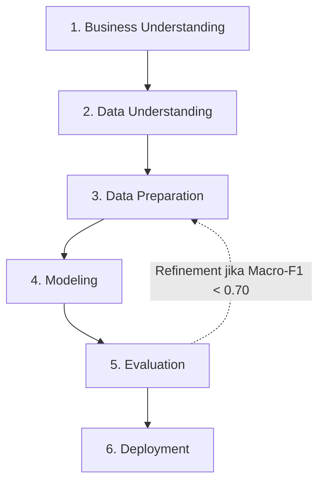

# 🗺️ SI-REKTA: Panduan Metodologi & Roadmap Pengembangan Model Berbasis CRISP-DM

> **Proyek:** Rancang Bangun Sistem Informasi Rekomendasi Dosen Pembimbing Tugas Akhir Berbasis Machine Learning Menggunakan Pendekatan Natural Language Processing (SI-REKTA)  
> **Mata Kuliah:** Machine Learning (Semester 5) — Departemen Sistem Informasi  
> **Dokumen Rujukan Teori:** [docs/SI-REKTA_SLR.md](SI-REKTA_SLR.md)  
> **Repository GitHub:** [https://github.com/accfd/SI-REKTA](https://github.com/accfd/SI-REKTA)  

---

## 📌 Pengantar & Penyelarasan Metodologi

Dokumen ini memetakan seluruh temuan ilmiah dari tinjauan pustaka sistematis (**PRISMA SLR pada `docs/SI-REKTA_SLR.md`**) ke dalam kerangka kerja standar industri **CRISP-DM (*Cross-Industry Standard Process for Data Mining*)**. 

Setiap tahap dirancang secara operasional untuk dieksekusi ke dalam file Jupyter Notebook (**`SI_REKTA_Modeling.ipynb`**) dengan pola **Self-Explaining Notebook**:
1. **Markdown Pra-Kode:** Menjelaskan *"Mengapa tahap ini dilakukan?"* berlandaskan teori dan bukti empiris SLR.
2. **Blok Kode Python:** Skrip eksekusi yang modular, terstruktur, dan efisien.
3. **Markdown Pasca-Kode:** Menyajikan *"Interpretasi Hasil Output"* dan konsekuensinya terhadap tahapan berikutnya.



---

# 📑 TAHAPAN KERJA LENGKAP & PANDUAN PROMPT CRISP-DM

---

## 🟢 FASE 1: BUSINESS UNDERSTANDING

### 1.1 Deskripsi & Masalah Bisnis
* **Latar Masalah:** Mahasiswa kesulitan menemukan dosen yang topik risetnya selaras dengan usulan tugas akhir, memicu risiko proposal ditolak. Di sisi prodi, penentuan pembimbing manual memakan waktu lama dan menimbulkan ketimpangan beban bimbingan dosen yang tajam.
* **Tujuan Proyek:** Membangun sistem pendukung keputusan yang merekomendasikan **Top-3 Dosen Pembimbing** paling relevan berdasarkan analisis semantik judul tugas akhir, yang terintegrasi ke dalam aplikasi web.
* **Kriteria Keberhasilan Bisnis:**
  * Rekomendasi memuat dosen yang tepat pada 3 pilihan teratas minimal 80% kasus uji (*Top-3 Hit Rate $\ge$ 80%*).
  * Menjamin seluruh dosen (termasuk kelas minoritas) memiliki peluang direkomendasikan secara adil (*Macro-F1 $\ge$ 0,70*).

---

## 🟡 FASE 2: DATA UNDERSTANDING

### 2.1 Deskripsi & Karakteristik Data
* **Sumber Data:** `docs/Judul_TA.csv` (625 arsip judul tugas akhir Departemen Sistem Informasi periode 2014–2026).
* **Kolom Mentah:** `no`, `judul_ta`, `nama_mahasiswa`, `nim`, `tahun`, `pembimbing_1`, `pembimbing_2`, `poster`.
* **Temuan Kritis EDA:**
  1. *Teks Pendek:* Rata-rata panjang judul adalah 16 kata (rentang 6–29 kata).
  2. *Extreme Class Imbalance:* Pak Ricky Akbar membimbing 145 mahasiswa, sementara dosen lain hanya membimbing 10–30 mahasiswa.
  3. *Inkonsistensi Entitas:* Variasi penulisan nama dan gelar dosen (misal: *Prof. Surya Afnarius, Ph.D* muncul dalam 5 format berbeda).
  4. *Missing & Placeholder Data:* Kolom `poster` bernilai '-' sebesar 86,88% dan `pembimbing_2` bernilai '-' sebesar 73,12%.

### 2.2 Prompt Eksekusi Fase 2 (Data Understanding)
```markdown
[ROLE] Senior Data Scientist & NLP Specialist.
[TASK]
Muat dataset "docs/Judul_TA.csv" (delimiter ';') menggunakan Pandas. Lakukan audit struktur data:
1. Tampilkan shape, info tipe data, cek missing value (null), dan hitung persentase placeholder '-'.
2. Buat visualisasi distribusi frekuensi bimbingan dosen pembimbing 1 (identifikasi ketimpangan kelas).
3. Analisis panjang judul (kata) dengan histogram dan identifikasi 20 kata kunci domain sistem informasi terbanyak.
4. Tampilkan daftar variasi penulisan nama dosen yang tidak konsisten.
[CONSTRAINT]
- Tuliskan Markdown "Mengapa tahap ini dilakukan" sebelum setiap blok kode.
- Tuliskan Markdown "Interpretasi Hasil Output" setelah visualisasi/tabel statistik muncul.
[OUTPUT] Sel notebook (.ipynb) lengkap dengan teks penjelasan akademis dan kode visualisasi.
[VALIDATE] Dataset terbaca tepat 625 baris, visualisasi ketimpangan muncul jelas, dan daftar variasi nama terpetakan.
```

---

## 🟠 FASE 3: DATA PREPARATION

### 3.1 Prosedur Teknis Prapengolahan Data
1. **Entity Canonicalization:** Menerapkan kamus alias (*alias dictionary*) untuk menyeragamkan seluruh format penulisan nama dan gelar dosen ke 1 entitas baku.
2. **Feature Selection:** Mengeliminasi kolom yang tidak memiliki korelasi komputasi dengan teks judul (drop kolom `no`, `poster`, `pembimbing_2`).
3. **Filtering Kelas Sangat Jarang:** Menetapkan ambang batas bimbingan minimum (misal dosen dengan bimbingan < 3 dikelompokkan atau difilter) agar partisi *Stratified Split* dapat dieksekusi secara valid.
4. **Text Preprocessing Pipeline (Bahasa Indonesia):**
   * *Case Folding:* Menyeragamkan seluruh huruf menjadi huruf kecil (*lowercase*).
   * *Regex Cleansing:* Menghapus angka, tanda baca, simbol non-alfanumerik, dan spasi berlebih.
   * *Stopwords Removal Khusus Akademik:* Menghilangkan kata umum bahasa Indonesia dan kata henti formal skripsi (seperti: *aplikasi, sistem, berbasis, rancang, bangun, pengembangan, analisis, implementasi, studi, kasus, pada, untuk, dengan*).
   * *Stemming:* Mengembalikan kata berimbuhan ke kata dasar menggunakan algoritma Nazief-Adriani (Sastrawi).
5. **Ekstraksi Fitur (TF-IDF N-Gram):**
   * *Word N-Gram (1–2):* Menangkap frasa teknis khas sistem informasi (*"decision support"*, *"business intelligence"*, *"geographic information"*).
   * *Character N-Gram (3–5):* Memberikan ketahanan terhadap saltik (*typo*) pada teks usulan mahasiswa.

### 3.2 Prompt Eksekusi Fase 3 (Data Preparation)
```markdown
[ROLE] Data Preprocessing & NLP Engineer.
[TASK]
Lakukan data preparation pada dataset tugas akhir:
1. Buat kamus pemetaan entitas nama dosen untuk normalisasi nama dosen yang tidak konsisten.
2. Drop kolom yang tidak relevan (no, poster).
3. Buat fungsi `clean_text(text)` yang memuat case folding, pembersihan tanda baca, filtering stopword umum & akademik, dan stemming.
4. Terapkan fungsi ke kolom 'judul_ta' menghasilkan kolom baru 'judul_clean'.
5. Ekstraksi fitur menggunakan TfidfVectorizer (Word n-gram 1-2 dan Char n-gram 3-5).
[CONSTRAINT]
- Jelaskan sebelum kode mengapa pembersihan stopword akademik sangat penting agar model tidak bias pada kata generik seperti 'aplikasi'.
- Jelaskan setelah kode contoh perbandingan teks sebelum vs sesudah diproses.
[OUTPUT] Sel notebook (.ipynb) lengkap dengan fungsi preprocessing dan pembentukan matriks fitur TF-IDF (X, y).
[VALIDATE] Kolom 'judul_clean' bebas tanda baca/stopword, nama dosen konsisten, dan matriks X memiliki dimensi yang valid.
```

---

## 🔵 FASE 4: MODELING

### 4.1 Desain Arsitektur Model & Penanganan Imbalance
* **Penolakan SMOTE Naif:** Berdasarkan bukti empiris IEEE Access (*Tarawneh et al., 2022*), pembentukan sampel sintetis pada teks pendek 16 kata menciptakan *noise* semantik dan menaikkan *false positive*.
* **Baseline Model:** **Multinomial Naive Bayes** (mengacu pada *Sinaga & Kurniawan, 2025* sebagai pembanding berbiaya komputasi rendah).
* **Main Model:** **Linear Support Vector Machine (Linear SVM)** yang dibungkus dengan `CalibratedClassifierCV` dan parameter `class_weight='balanced'` (mengacu pada *Bolshakov, 2025*).
* **Hybrid Similarity Profiling:** Membangun vektor profil riset untuk setiap dosen (gabungan seluruh judul historis bimbingannya), kemudian menghitung *Cosine Similarity* antara judul baru mahasiswa dengan vektor profil dosen sebagai *gate reranking* Top-3.

### 4.2 Prompt Eksekusi Fase 4 (Modeling)
```markdown
[ROLE] Machine Learning Engineer (Imbalanced Multiclass Specialist).
[TASK]
Latih model klasifikasi multi-kelas untuk sistem rekomendasi pembimbing:
1. Bagi data menggunakan Stratified Train-Test Split (80:20) dengan random_state=42.
2. Latih Model 1 (Baseline): Multinomial Naive Bayes.
3. Latih Model 2 (Main Model): LinearSVC dengan class_weight='balanced' yang dikalibrasi probabilitasnya menggunakan CalibratedClassifierCV.
4. Bangun fungsi Hybrid Cosine Similarity yang membandingkan teks judul baru terhadap vektor profil riset gabungan tiap dosen.
[CONSTRAINT]
- Tuliskan Markdown teoritis sebelum kode yang memaparkan rumusan matematis balanced class weighting.
- Pastikan model mampu mengeluarkan nilai probabilitas kalibrasi untuk perankingan Top-3.
[OUTPUT] Sel kode pelatihan model, pembentukan profil dosen, dan sel Markdown penjelasan logika hybrid.
[VALIDATE] Model Naive Bayes dan Linear SVM berhasil dilatih tanpa konvergensi error, serta probabilitas prediksi dapat diakses.
```

---

## 🟣 FASE 5: EVALUATION

### 5.1 Skema & Metrik Evaluasi
* **Skema Validasi:** *Stratified 5-Fold Cross Validation* dan evaluasi pada *Hold-Out Test Set (80:20)*.
* **Metrik Evaluasi Wajib:**
  1. **Top-1 Accuracy:** Akurasi prediksi tunggal konvensional.
  2. **Top-3 Accuracy (Hit Rate @ 3):** Persentase keberhasilan dosen riil masuk ke dalam Top-3 rekomendasi sistem.
  3. **Macro-Averaged F1-Score:** Rerata harmonis presisi dan recall seluruh kelas secara berimbang tanpa terdistorsi kelas mayoritas.
  4. **Mean Reciprocal Rank (MRR @ 3):** Kualitas posisi urutan rekomendasi ($1/1, 1/2, 1/3$).
* **Ambang Batas Kelayakan (Benchmark Minimum):**
  * **Top-3 Accuracy $\ge$ 80% (0,80)**
  * **Macro-F1 Score $\ge$ 70% (0,70)**
  * **MRR @ 3 $\ge$ 0,60**

### 5.2 Prompt Eksekusi Fase 5 (Evaluation)
```markdown
[ROLE] Machine Learning Evaluator & Quality Assurance Specialist.
[TASK]
Lakukan evaluasi komprehensif terhadap performa model pada data uji:
1. Hitung Top-1 Accuracy, Top-3 Accuracy (Hit@3), Macro-F1, Macro-Precision, Macro-Recall, dan MRR@3 untuk Baseline Naive Bayes dan Main Model Linear SVM.
2. Sajikan tabel komparasi performa antara kedua model secara berdampingan.
3. Tampilkan Classification Report per dosen dan plot Confusion Matrix.
4. Lakukan evaluasi keadilan beban: Bandingkan recall kelas dosen minoritas antara model tanpa class_weight vs dengan balanced class_weight.
[CONSTRAINT]
- Sajikan Markdown analisis "Mengapa Overall Accuracy Menyesatkan" dan buktikan dengan keunggulan Macro-F1.
- Berikan kesimpulan tegas apakah model telah melampaui ambang batas kelayakan (Top-3 Acc >= 80%, Macro-F1 >= 0.70).
[OUTPUT] Visualisasi confusion matrix, tabel metrik perbandingan, dan narasi evaluasi kelayakan sistem.
[VALIDATE] Seluruh metrik terhitung dengan benar, visualisasi terbaca jelas, dan analisis keadilan kelas tersaji.
```

---

## 🔴 FASE 6: DEPLOYMENT PREPARATION

### 6.1 Serialisasi & Fungsi Inferensi Mandiri
* Mengemas seluruh objek prapengolahan, kamus alias dosen, vectorizer TF-IDF, model Linear SVM terkalibrasi, dan matriks profil dosen ke dalam satu objek *pipeline* mandiri.
* Menyimpan pipeline ke dalam file biner **`si_rekta_pipeline.joblib`**.
* Membangun fungsi inferensi mandiri:
  ```python
  def predict_pembimbing(judul_baru: str, top_k: int = 3) -> dict:
      # Mengembalikan Top-3 Nama Dosen, Persentase Kecocokan %,
      # Kata Kunci Penentu (Explainable AI), dan Riwayat Judul Terkait
      pass
  ```

### 6.2 Prompt Eksekusi Fase 6 (Deployment Preparation)
```markdown
[ROLE] MLOps & Software Architecture Engineer.
[TASK]
Siapkan model untuk deployment sistem web:
1. Bungkus pipeline prapengolahan, TF-IDF vectorizer, kamus alias dosen, dan model Linear SVM ke dalam satu pipeline Scikit-Learn.
2. Serialisasi pipeline ke file `si_rekta_pipeline.joblib` menggunakan library joblib.
3. Buat fungsi inferensi `predict_pembimbing(judul_baru, top_k=3)` yang menerima string judul tugas akhir baru dan mengembalikan output JSON:
   - Peringkat 1, 2, 3 Nama Dosen Pembimbing.
   - Confidence Score (Persentase Kecocokan %).
   - Explainable Keywords (Kata kunci penentu dari bobot fitur).
   - Judul-judul tugas akhir serupa terdahulu sebagai bukti rekam jejak.
4. Lakukan pengujian fungsi dengan 3 contoh judul tugas akhir baru dari domain berbeda (GIS, Business Intelligence, dan SPK).
[CONSTRAINT]
- File joblib yang dihasilkan harus self-contained dan siap di-load oleh backend FastAPI.
- Output pengujian fungsi harus disajikan dalam format kartu visual yang mudah dipahami.
[OUTPUT] Sel kode penyimpanan model, fungsi inferensi mandiri, dan simulasi pengujian 3 studi kasus judul baru.
[VALIDATE] File `si_rekta_pipeline.joblib` terbentuk dengan ukuran wajar, dan fungsi inferensi berjalan dengan responsivitas sub-detik.
```

---

## 📋 Checklist Eksekusi Menuju Progress Report 2

- [x] Tinjauan Pustaka Sistematis (PRISMA SLR) selesai dan disinkronkan ([`docs/SI-REKTA_SLR.md`](SI-REKTA_SLR.md)).
- [x] Repositori GitHub terinisialisasi dan terhubung ([github.com/accfd/SI-REKTA](https://github.com/accfd/SI-REKTA)).
- [x] Framework & Roadmap CRISP-DM terdokumentasi lengkap ([`docs/SI-REKTA_CRISP_DM.md`](SI-REKTA_CRISP_DM.md)).
- [ ] Implementasi Notebook `SI_REKTA_Modeling.ipynb` (Fase 1 hingga Fase 6).
- [ ] Export file model serialisasi `si_rekta_pipeline.joblib`.
- [ ] Penyusunan Laporan Tertulis Progress Report 2 untuk Bu Aina.
