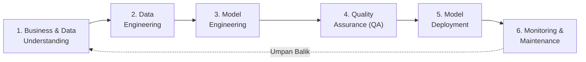

# 🎓 SI-REKTA: Kerangka Kerja & Metodologi Pengembangan Model Berbasis CRISP-ML(Q)

> **Mata Kuliah:** Machine Learning (Semester 5) — Departemen Sistem Informasi, Universitas Andalas  
> **Dosen Pengampu:** Aina Hubby Aziira, M.Eng. & Febby Apri Wenando, M.Eng., Ph.D.  
> **Standar Metodologi:** CRISP-ML(Q) (*Cross-Industry Standard Process for the Development of Machine Learning Applications with Quality Assurance Quality Model*, Studer et al., 2020)  
> **Repositori Proyek:** [https://github.com/accfd/SI-REKTA](https://github.com/accfd/SI-REKTA)

---

## 📌 Mengapa Memilih CRISP-ML(Q)?

Pengembangan sistem rekomendasi pembimbing tugas akhir pada lingkungan akademik memerlukan jaminan mutu (*quality assurance*) yang lebih ketat daripada proyek sains data biasa. Metodologi konvensional (seperti CRISP-DM standar) kerap berhenti setelah akurasi model dievaluasi di notebook, tanpa mengatur bagaimana model dikemas, dideploy, dan diaudit keadilannya bagi seluruh dosen.

SI-REKTA mengadopsi kerangka kerja **CRISP-ML(Q)** karena menyediakan enam tahapan siklus hidup ML terintegrasi yang menjamin:
1. **Penyelarasan Bisnis Nyata:** Menghubungkan algoritma langsung dengan struktur organisasi resmi 17 dosen tetap aktif dan 4 Kelompok Keahlian (KK) di Departemen Sistem Informasi Unand.
2. **Jaminan Kualitas Bertingkat (*Quality Gates*):** Menerapkan ambang batas evaluasi ilmiah (*Top-3 Accuracy*, *Macro-F1*, dan *Mean Reciprocal Rank*) untuk mencegah ilusi akurasi semu akibat dominasi data dosen tertentu.
3. **Kesiapan Penerapan (*Deployment Readiness*):** Mengemas seluruh rantai inferensi ke dalam satu file biner mandiri (`si_rekta_pipeline.joblib`) yang siap diintegrasikan ke antarmuka sistem informasi web berbasis FastAPI dan React.

---

## 🏛️ FASE 1: BUSINESS & DATA UNDERSTANDING

### 1.1 Pemahaman Kebutuhan Organisasi & Perumusan Masalah
Pada Departemen Sistem Informasi, penentuan dosen pembimbing tugas akhir secara manual kerap menghadapi kendala utama:
1. **Ketidakcocokan Topik (*Topic Mismatch*):** Mahasiswa kerap mengusulkan judul yang kurang selaras dengan bidang keahlian dosen, sehingga proposal berisiko ditolak atau memerlukan perombakan mendasar.
2. **Ketimpangan Beban Bimbingan (*Workload Imbalance*):** Penentuan pembimbing berbasis popularitas memicu penumpukan bimbingan pada sebagian kecil dosen senior, sementara dosen lainnya memperoleh alokasi minim.
3. **Dinamika Perubahan Dosen:** Dalam data historis jangka panjang (2014–2022), terdapat dosen luar fakultas yang pernah membimbing serta dosen yang sudah berpindah tugas. Sebaliknya, dosen aktif baru belum memiliki riwayat bimbingan historis (*cold-start problem*).

### 1.2 Struktur Resmi Organisasi: 17 Dosen Aktif & 4 Kelompok Keahlian (KK)
Sistem SI-REKTA secara resmi membatasi rekomendasi pada **17 Dosen Tetap Aktif** Departemen Sistem Informasi FTI Unand yang terbagi ke dalam **4 Kelompok Keahlian (KK)**:

1. **Kelompok Keahlian Rekayasa Data & Business Intelligence (RD-BI)**
   * Prof. Surya Afnarius, Ph.D. (Kepala Laboratorium RD-BI & Pakar GIS)
   * Febby Apri Wenando, M.Eng., Ph.D.
   * Rahmatika Pratama Santi, M.T.
   * Aina Hubby Aziira, M.Eng.
2. **Kelompok Keahlian System Development (SD)**
   * Nisa Dwi Angresti, M.Kom. (Kepala Laboratorium LSD)
   * Husnil Kamil, M.T.
   * Afriyanti Dwi Kartika, S.Pd., M.T.
   * Dwi Welly Sukma Nirad, M.T.
   * Hafzatin Nurlatifa, M.Eng.
3. **Kelompok Keahlian System Enterprise (SE)**
   * Hafizah Hanim, M.Kom. (Kepala Kelompok Keahlian / Lab SE)
   * Haris Suryamen, M.Sc.
   * Ricky Akbar, M.Kom.
   * Jefril Rahmadoni, M.Kom.
   * Ullya Mega Wahyuni, M.Kom.
4. **Kelompok Keahlian Tata Kelola & Infrastruktur TI (TK-ITI)**
   * Adi Arga Arifnur, M.Kom. (Kepala Kelompok Keahlian / Lab TK-ITI)
   * Fajril Akbar, M.Sc.
   * Hasdi Putra, M.T.

*(Catatan Resmi: Ibu Meza Silvana, M.T. sudah tidak bertugas di DSI dan posisinya digantikan oleh dosen baru Hafzatin Nurlatifa, M.Eng. dan Nisa Dwi Angresti, M.Kom.).*

### 1.3 Karakteristik Data Empiris (`docs/Judul_TA.csv`)
Audit dataset terhadap 625 baris riwayat judul tugas akhir (2014–2022) menghasilkan temuan penting:
* **Teks Pendek (*Short-Text*):** Panjang judul rata-rata hanya 16 kata (rentang 6–29 kata).
* **Ketimpangan Kelas Ekstrem:** Dosen mayoritas (Pak Ricky Akbar) tercatat membimbing 145 judul, sementara dosen minoritas tercatat membimbing 5 hingga 30 judul.
* **Kehadiran Dosen Luar Departemen:** Terdapat riwayat bimbingan lintas fakultas di masa lampau (seperti Alizar Hasan, Ph.D dan Difana Meilani, MISD dari Teknik Industri, serta Syafii, Ph.D dari Teknik Elektro).
* **Inkonsistensi Gelar:** Ditemukan variasi ejaan nama dan penulisan gelar dosen (contoh: *Prof. Surya Afnarius, Ph.D* tertulis dalam 5 ragam format berbeda).

### 1.4 Kriteria Keberhasilan & Quality Gates (KPI)
* **Kualitas Prediksi Rekomendasi:** *Top-3 Accuracy (Hit Rate @ 3)* minimal mencapai **80% (0,80)**.
* **Kualitas Peringkat Urutan:** *Mean Reciprocal Rank (MRR @ 3)* minimal mencapai **0,60**.
* **Kecepatan Inferensi:** Waktu pemrosesan rekomendasi berada di bawah 1 detik untuk integrasi web.
* **Keadilan Representasi:** Sistem harus mampu mengenali rumpun keahlian secara adil tanpa mengarahkan seluruh mahasiswa ke satu dosen mayoritas saja.

---

## 🛠️ FASE 2: DATA ENGINEERING

### 2.1 Penyeragaman Entitas Dosen (*Entity Canonicalization*)
Membangun kamus pemetaan resmi (*alias dictionary*) guna menormalisasi seluruh variasi ejaan, singkatan titik-koma, dan penulisan gelar dosen ke satu format baku resmi.

### 2.2 Penyaringan Berbasis Keaktifan Departemen (*Active Faculty Filtering*)
* Seluruh 600+ judul historis tetap dipertahankan untuk melatih perbendaharaan kata (*vocabulary*) dan pembobotan TF-IDF n-gram.
* Dosen yang sudah tidak aktif di DSI (Ibu Meza Silvana) serta dosen luar fakultas (Alizar Hasan, Difana Meilani, Syafii) disaring keluar dari daftar target rekomendasi dosen aktif.

### 2.3 Pemetaan Empiris Judul Historis ke 4 Kelompok Keahlian (KK)
Setiap judul tugas akhir di dataset lama secara otomatis dipetakan ke Kelompok Keahlian (KK) dari dosen pembimbingnya. Dengan cara ini, profil leksikal 4 KK terbentuk murni dari data historis nyata tanpa rekayasa data fiktif.

### 2.4 Pipeline Prapengolahan Teks Bahasa Indonesia
1. **Case Folding:** Menyeragamkan seluruh huruf menjadi huruf kecil (*lowercase*).
2. **Text Cleansing:** Menghapus tanda baca, angka, dan karakter khusus non-alfanumerik.
3. **Academic Stopwords Removal:** Menghapus kata umum akademis yang tidak membedakan bidang keilmuan (seperti *rancang, bangun, aplikasi, sistem, informasi, berbasis, web, mobile, studi kasus, universitas, andalas, padang*).
4. **Morphological Stemming:** Mengembalikan kata berimbuhan ke bentuk dasarnya menggunakan algoritma Nazief & Adriani melalui pustaka PySastrawi.

### 2.5 Ekstraksi Fitur Teks (TF-IDF N-Gram)
Menerapkan kombinasi **Word N-Gram (1–2 gram)** untuk menangkap istilah teknis multi-kata (seperti *machine learning*, *sistem informasi geografis*, *decision support system*) dan **Sublinear TF Scaling** untuk meredam dominasi istilah yang muncul berulang.

---

## 🧠 FASE 3: MACHINE LEARNING MODEL ENGINEERING

### 3.1 Penolakan Teknik SMOTE Naif
Sesuai bukti empiris IEEE Access (*Tarawneh et al., 2022*), pembangkitan data sintetis naif (SMOTE konvensional) pada teks pendek berisiko menghasilkan sampel tiruan yang menyimpang ke kelas mayoritas dan memicu lonjakan *false positive*. Oleh karena itu, penanganan ketimpangan dilakukan melalui pendekatan algoritmik.

### 3.2 Model Baseline vs Model Utama
1. **Model Baseline:** **Multinomial Naive Bayes** (sebagai pembanding probabilistik standar).
2. **Model Utama:** **Linear Support Vector Machine (Linear SVM)** yang dikalibrasi (*CalibratedClassifierCV*) dengan parameter bobot kelas seimbang (**`class_weight='balanced'`**).

### 3.3 Mekanisme Pembobotan Kelas Seimbang (*Balanced Class Weighting*)
Linear SVM menghitung bobot penalti kesalahan fungsi kerugian (*loss*) secara berbanding terbalik dengan frekuensi data kelas:
$$w_j = \frac{N}{K \times n_j}$$
Di mana $N$ adalah total data, $K$ jumlah kelas dosen, dan $n_j$ jumlah data dosen ke-$j$. Melalui pembobotan ini, kesalahan memprediksi dosen minoritas diberi sanksi matematis belasan kali lebih berat daripada dosen mayoritas.

### 3.4 Arsitektur Rekomendasi Berjenjang (*Two-Tier Recommender*)
Sistem beroperasi dalam dua tingkatan inferensi:
* **Tingkat 1 (Rekomendasi Kelompok Keahlian / KK):** Mengidentifikasi rumpun keahlian utama yang paling cocok dengan topik usulan judul mahasiswa berbasis kemiripan semantik korpus KK.
* **Tingkat 2 (Rekomendasi Dosen Pembimbing Aktif):** Menyajikan Top-3 rekomendasi dosen aktif di dalam KK tersebut. Untuk dosen yang memiliki rekam jejak historis, sistem memadukan skor probabilitas SVM dan *Cosine Similarity Gate* riwayat bimbingannya. Untuk dosen baru (seperti Bu Aina, Pak Febby, Bu Nisa, Bu Hafzatin, Pak Adi Arga), sistem menyajikan profil resmi keanggotaan KK beliau tanpa merekayasa data fiktif.

---

## 🔍 FASE 4: QUALITY ASSURANCE FOR MACHINE LEARNING APPLICATIONS

### 4.1 Skema Validasi Ilmiah
* **Stratified 5-Fold Cross Validation:** Membagi data menjadi 5 partisi seimbang untuk menguji kestabilan model di seluruh lipatan.
* **Hold-Out Test Evaluation (80:20):** Pengujian akhir pada data uji independen yang belum pernah dilihat saat pelatihan.

### 4.2 Matriks Pengujian Jaminan Kualitas (QA Gates)

| No | Metrik Jaminan Kualitas (QA Gate) | Nilai Ambang Batas Minimum | Rasional Metodologis |
|:--:|:---|:---:|:---|
| **1** | **Top-3 Accuracy (Hit Rate @ 3)** | **$\ge$ 80% (0,80)** | Menilai apakah dosen pembimbing yang tepat berada dalam daftar 3 kartu rekomendasi teratas sistem. |
| **2** | **Mean Reciprocal Rank (MRR @ 3)** | **$\ge$ 0,60** | Mengukur ketepatan urutan rekomendasi (posisi 1 bernilai $1,0$, posisi 2 bernilai $0,5$, posisi 3 bernilai $0,33$). |
| **3** | **Top-1 Accuracy** | **$> 50\%$** | Memastikan ketepatan peringkat pertama mutlak jauh melampaui peluang tebakan acak ($6,25\%$). |
| **4** | **Macro-Averaged F1-Score** | **Evaluasi Keadilan** | Mengevaluasi kesetaraan deteksi antar kelas dosen di tengah ketimpangan data historis ekstrem. |

---

## 🚀 FASE 5: MODEL DEPLOYMENT

### 5.1 Serialisasi Pipeline Mandiri (`si_rekta_pipeline.joblib`)
Seluruh komponen pemrosesan teks, objek TF-IDF n-gram, model SVM terkalibrasi, metadata 17 dosen aktif, profil 4 Kelompok Keahlian (KK), dan riwayat judul dosen dikemas ke dalam satu file biner mandiri berukuran ringkas (**kurang dari 1 MB**).

### 5.2 Arsitektur Sistem Informasi Web Tiga Tingkat (Three-Tier Architecture)
* **Presentation Layer (Frontend Web):** Dibangun menggunakan React / Vite dengan visualisasi kartu rekomendasi Kelompok Keahlian (KK), kartu Top-3 dosen pembimbing, persentase kecocokan, dan transparansi kata kunci penentu (*explainable AI*).
* **Application Layer (Backend REST API):** Dibangun menggunakan framework FastAPI (Python) yang memuat `si_rekta_pipeline.joblib` ke memori kerja dan melayani rute `/predict`, `/dosen`, dan `/stats` dengan latensi di bawah 1 detik.
* **Data Layer (Basis Data):** Basis data relasional untuk mencatat histori pengajuan mahasiswa, data keaktifan dosen, dan log evaluasi rekomendasi.

---

## 📈 FASE 6: MONITORING & MAINTENANCE

### 6.1 Mekanisme Umpan Balik Pengguna (*Feedback Loop*)
Antarmuka sistem informasi menyediakan tombol konfirmasi bagi mahasiswa dan komisi tugas akhir untuk mencatat apakah rekomendasi sistem disetujui atau diubah, sehingga menjadi data evaluasi operasional berkelanjutan.

### 6.2 Pemicu Pelatihan Ulang (*Retraining Triggers*)
Model dijadwalkan untuk dilatih ulang (*retraining*) secara otomatis setiap akhir semester akademik dengan menambahkan arsip judul skripsi mahasiswa yang baru lulus, sekaligus memperbarui status keanggotaan dan keaktifan dosen di departemen.
