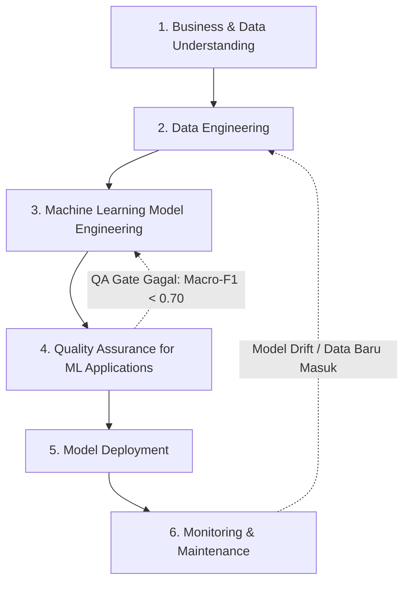

# 🗺️ SI-REKTA: Kerangka Kerja & Metodologi Pengembangan Model Berbasis CRISP-ML(Q)

> **Judul Proyek:** Rancang Bangun Sistem Informasi Rekomendasi Dosen Pembimbing Tugas Akhir Berbasis Machine Learning Menggunakan Pendekatan Natural Language Processing (SI-REKTA)  
> **Mata Kuliah:** Machine Learning (Semester 5) — Departemen Sistem Informasi  
> **Dokumen Rujukan Teori:** [`docs/SI-REKTA_SLR.md`](SI-REKTA_SLR.md)  
> **Repository GitHub:** [https://github.com/accfd/SI-REKTA](https://github.com/accfd/SI-REKTA)  
> **Standar Metodologi:** CRISP-ML(Q) (*Cross-Industry Standard Process for Machine Learning with Quality Assurance*, Studer et al., 2020)  

---

## 📌 Mengapa Memilih CRISP-ML(Q)?

Proyek SI-REKTA tidak sekadar berhenti pada analisis data tabel statis, melainkan menghasilkan **model pembelajaran mesin yang siap diintegrasikan langsung ke sistem informasi berbasis web**. 

Oleh karena itu, proyek ini mengadopsi standar internasional terbaru **CRISP-ML(Q)**. Berbeda dengan CRISP-DM konvensional (tahun 1999) yang berorientasi pada penggalian data tradisional, CRISP-ML(Q) (tahun 2020) mengintegrasikan siklus rekayasa *Machine Learning* modern dengan mekanisme **Jaminan Kualitas (*Quality Assurance / QA*)** pada setiap tahapannya, mulai dari mitigasi risiko data tidak seimbang hingga pemantauan model saat digunakan di aplikasi web.

---

## 🟢 FASE 1: BUSINESS & DATA UNDERSTANDING

### 1.1 Pemahaman Kebutuhan Organisasi & Perumusan Masalah
Pada program studi sistem informasi, penentuan dosen pembimbing skripsi kerap menimbulkan dua kendala utama:
1. **Ketidaksesuaian Topik (*Topic Mismatch*):** Mahasiswa sering memilih dosen pembimbing berdasarkan popularitas atau kedekatan personal, bukan keselarasan kepakaran riset. Akibatnya, usulan proposal berisiko ditolak atau memerlukan perombakan mendasar.
2. **Ketimpangan Beban Kerja Dosen (*Workload Imbalance*):** Penentuan pembimbing secara manual memicu penumpukan bimbingan pada sebagian kecil dosen senior, sementara dosen lainnya memperoleh alokasi minim.

### 1.2 Tujuan Sistem (Business & Machine Learning Goals)
* **Tujuan Pengguna:** Menyediakan sistem pendukung keputusan bagi mahasiswa untuk memperoleh rekomendasi Top-3 dosen pembimbing yang paling relevan secara mandiri, sekaligus memudahkan koordinator tugas akhir memverifikasi plotting pembimbing.
* **Tujuan Teknis:** Membangun pipeline pemrosesan teks alami (*Natural Language Processing*) dan model klasifikasi multi-kelas yang mampu memetakan teks usulan judul skripsi ke profil keahlian dosen secara akurat dan transparan.

### 1.3 Karakteristik Data Riil (`docs/Judul_TA.csv`)
Audit awal terhadap 625 arsip judul skripsi (2014–2026) menghasilkan temuan penting:
* **Teks Pendek (*Short-Text*):** Panjang judul rata-rata hanya 16 kata (rentang 6–29 kata).
* **Ketimpangan Kelas Ekstrem:** Terdapat satu dosen mayoritas (Pak Ricky Akbar) dengan 145 riwayat bimbingan, sementara dosen-dosen lain hanya memiliki 10 hingga 30 bimbingan.
* **Inkonsistensi Entitas:** Terdapat variasi penulisan gelar dosen (contoh: *Prof. Surya Afnarius, Ph.D* tertulis dalam 5 format berbeda).
* **Kolom Tidak Relevan:** Kolom `poster` bernilai kosong/placeholder '-' sebesar 86,88% dan `pembimbing_2` bernilai '-' sebesar 73,12%.

### 1.4 Kriteria Keberhasilan & Quality Gates (KPI)
* **Kualitas Prediksi:** *Top-3 Accuracy (Hit Rate @ 3)* minimal mencapai **80% (0,80)**.
* **Keadilan Prediksi:** *Macro-Averaged F1-Score* minimal mencapai **70% (0,70)** untuk memastikan dosen kelas minoritas tetap dapat direkomendasikan secara adil.
* **Kualitas Peringkat:** *Mean Reciprocal Rank (MRR @ 3)* minimal mencapai **0,60**.
* **Kelayakan Implementasi:** Waktu inferensi model berada di bawah 1 detik untuk kebutuhan integrasi antarmuka web.

---

## 🟡 FASE 2: DATA ENGINEERING

Fase ini berfokus pada penyiapan data mentah menjadi data yang bersih, terstruktur, dan siap dilatih oleh algoritma *machine learning*.

### 2.1 Penyeragaman Entitas Dosen (*Entity Canonicalization*)
Menyusun kamus pemetaan resmi (*alias dictionary*) guna menormalisasi seluruh variasi ejaan, singkatan, dan gelar dosen ke satu nama standar. Tahap ini krusial agar model tidak menganggap satu dosen yang sama sebagai kelas yang berbeda.

### 2.2 Seleksi Fitur & Penanganan Kelas Jarang
* Mengeliminasi kolom yang tidak memiliki korelasi dengan pemodelan teks (`no`, `poster`, dan `pembimbing_2`).
* Memfilter atau mengelompokkan dosen yang memiliki riwayat bimbingan di bawah ambang batas minimal validasi (misal minimal 3–5 sampel) agar pengujian validasi silang berstrata dapat berjalan tanpa eror pembagian partisi.

### 2.3 Pipeline Prapengolahan Teks Bahasa Indonesia
Teks judul usulan diproses melalui tahapan sistematis:
1. **Case Folding:** Menyeragamkan seluruh huruf menjadi huruf kecil (*lowercase*).
2. **Regex Cleansing:** Menghapus angka, tanda baca, simbol non-alfanumerik, dan spasi berlebih.
3. **Filtering Stopwords Akademik:** Membuang kata umum bahasa Indonesia serta kata formal tugas akhir yang tidak membedakan kepakaran (seperti: *aplikasi, sistem, berbasis, rancang, bangun, pengembangan, analisis, implementasi, studi, kasus, pada, untuk*).
4. **Stemming:** Menghilangkan imbuhan bahasa Indonesia menggunakan algoritma Nazief-Adriani (Sastrawi) untuk menyatukan variasi kata ke bentuk dasarnya.

### 2.4 Ekstraksi Fitur Teks (TF-IDF N-Gram)
Mentransformasikan teks bersih menjadi matriks numerik berdimensi tinggi menggunakan pembobotan *Term Frequency-Inverse Document Frequency* (TF-IDF):
* **Word N-Gram (1–2 gram):** Menangkap frasa teknis khas sistem informasi (contoh: *"decision support"*, *"business intelligence"*, *"geographic information"*).
* **Character N-Gram (3–5 gram):** Memberikan ketahanan terhadap saltik (*typo*) atau penyingkatan kata pada usulan mahasiswa.

---

## 🟠 FASE 3: MACHINE LEARNING MODEL ENGINEERING

Fase ini mencakup pemilihan algoritma, rekayasa model, serta mitigasi risiko ketimpangan kelas sesuai bukti ilmiah tinjauan pustaka PRISMA.

### 3.1 Penolakan SMOTE Naif
Berdasarkan bukti empiris tinjauan IEEE Access (*Tarawneh et al., 2022*), pembangkitan data sintetis naif (seperti SMOTE biasa) pada teks pendek berisiko merusak batas keputusan (*decision boundary*) dan menghasilkan sampel tiruan yang condong menyerupai kelas mayoritas. Oleh karena itu, penanganan data tidak seimbang difokuskan pada level algoritma (*algorithmic level*).

### 3.2 Model Baseline vs Model Utama
1. **Model Baseline:** **Multinomial Naive Bayes**. Digunakan sebagai tolok ukur awal berbiaya komputasi rendah (mengacu pada *Sinaga & Kurniawan, 2025* dengan capaian akurasi 87,3%).
2. **Model Utama:** **Linear Support Vector Machine (Linear SVM)** yang dibungkus kalibrasi probabilitas (*CalibratedClassifierCV*) dengan parameter pembobotan seimbang (**`class_weight='balanced'`**).

### 3.3 Mekanisme Pembobotan Kelas Seimbang (*Balanced Class Weighting*)
Algoritma Linear SVM secara matematis memperbesar penalti kesalahan fungsi kerugian (*loss*) secara berbanding terbalik dengan frekuensi kemunculan kelas dosen:
$$w_j = rac{N}{K 	imes n_j}$$
*(di mana $N$ adalah total data, $K$ jumlah kelas dosen, dan $n_j$ jumlah bimbingan dosen ke-$j$)*. Melalui rumus ini, kesalahan salah memprediksi dosen minoritas berbobot belasan kali lebih berat daripada dosen mayoritas, sehingga model terbebas dari bias kelas populer.

### 3.4 Hybrid Cosine Similarity Profiling
Membangun kumpulan seluruh judul tugas akhir yang pernah dibimbing oleh masing-masing dosen. Sistem menghitung derajat kemiripan kosinus (*Cosine Similarity*) antara judul baru mahasiswa dengan vektor profil dosen sebagai penyaring peringkat (*similarity gate*) sebelum rekomendasi Top-3 disajikan.

---

## 🟣 FASE 4: QUALITY ASSURANCE FOR MACHINE LEARNING APPLICATIONS

Fase ini merupakan inti pembeda CRISP-ML(Q), yaitu pengujian jaminan kualitas model secara ketat sebelum diizinkan masuk ke tahap deployment.

### 4.1 Skema Validasi Model
* **Stratified 5-Fold Cross Validation:** Memastikan setiap lipatan (*fold*) pengujian mempertahankan proporsi sebaran dosen yang identik dengan populasi asli.
* **Hold-Out Test Evaluation (80:20):** Pengujian akhir pada data independen yang belum pernah dilihat model saat pelatihan.

### 4.2 Matriks Pengujian Kualitas & Ambang Batas Kelayakan (Q-Gates)
Model dinyatakan **LULUS UJI KUALITAS** jika memenuhi seluruh kriteria berikut secara simultan:

| No | Metrik Jaminan Kualitas (QA Gate) | Nilai Ambang Batas Minimum | Rasional Metodologis |
|:--:|:---|:---:|:---|
| **1** | **Top-3 Accuracy (Hit Rate @ 3)** | **$\ge$ 80% (0,80)** | Menilai apakah dosen yang tepat berada dalam daftar Top-3 rekomendasi sistem. |
| **2** | **Macro-Averaged F1-Score** | **$\ge$ 70% (0,70)** | Mengukur keadilan performa model pada seluruh kelas dosen tanpa terdistorsi kelas mayoritas. |
| **3** | **Mean Reciprocal Rank (MRR @ 3)** | **$\ge$ 0,60** | Mengukur ketepatan urutan posisi peringkat rekomendasi (peringkat 1 bernilai $1$, peringkat 2 bernilai $0,5$, peringkat 3 bernilai $0,33$). |
| **4** | **Minority Class Recall** | **$\ge$ 60% (0,60)** | Memastikan dosen dengan jumlah bimbingan sedikit tetap berhasil terdeteksi saat topik relevan masuk. |

> ⚠️ **Catatan Penting:** Akurasi tunggal (*Overall Accuracy*) dilarang dijadikan tolok ukur tunggal kelayakan karena bersifat menyesatkan (*misleading*) pada data tidak seimbang.

---

## 🔵 FASE 5: MODEL DEPLOYMENT

Fase ini memastikan model pembelajaran mesin dapat dipaketkan dan diakses secara mudah melalui antarmuka sistem informasi web.

### 5.1 Serialisasi Pipeline Mandiri
Seluruh komponen prapengolahan teks, kamus entitas dosen, objek *TfidfVectorizer*, dan model Linear SVM terkalibrasi dikemas ke dalam satu objek utuh (*Scikit-Learn Pipeline*) dan disimpan menjadi file biner **`si_rekta_pipeline.joblib`**.

### 5.2 Arsitektur Sistem Informasi Web Tiga Tingkat (Three-Tier Architecture)
* **Frontend Layer (Antarmuka Web):** Dibangun menggunakan React / Vite dengan antarmuka yang bersih dan intuitif. Menyediakan form input judul tugas akhir, visualisasi kartu Top-3 rekomendasi pembimbing, persentase kecocokan semantik, dan daftar kata kunci penentu (*explainable terms*).
* **Backend Layer (RESTful API):** Dibangun menggunakan framework FastAPI (Python) yang menyediakan endpoint `/predict` berlatensi rendah (di bawah 500 milidetik).
* **Data Layer (Basis Data):** Menggunakan SQLite atau PostgreSQL untuk menyimpan riwayat usulan mahasiswa, data profil dosen, kamus alias nama, dan log audit sistem.

---

## 🔴 FASE 6: MONITORING & MAINTENANCE

Fase penutup yang menjamin sistem informasi dan model machine learning tetap beroperasi secara optimal dan relevan seiring waktu.

### 6.1 Mekanisme Umpan Balik Pengguna (*Feedback Loop*)
Antarmuka web menyediakan tombol konfirmasi bagi mahasiswa dan komisi tugas akhir: apakah dosen yang direkomendasikan diterima atau diubah ke dosen lain. Catatan ini tersimpan sebagai data evaluasi berkelanjutan.

### 6.2 Pemicu Pelatihan Ulang (*Retraining Triggers*)
Model dijadwalkan untuk dilatih ulang (*retraining*) secara berkala setiap akhir semester akademik dengan menambahkan arsip tugas akhir mahasiswa yang baru lulus, sehingga rekam jejak riset dosen yang berkembang dapat diperbarui secara otomatis.
