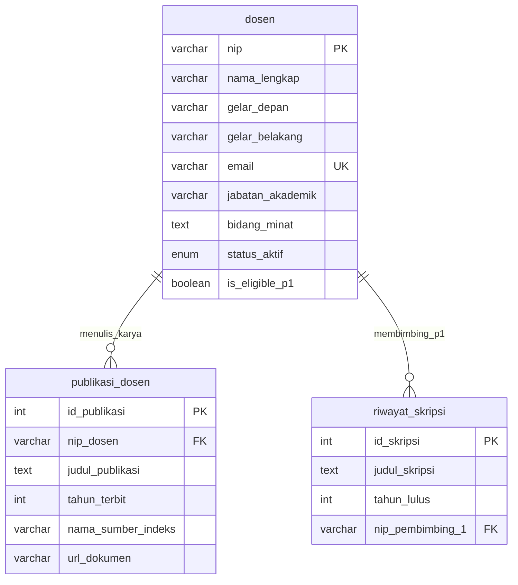
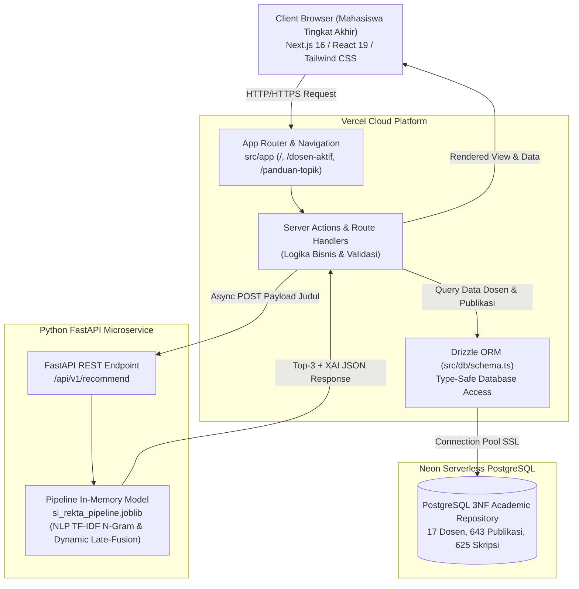

# PROJECT PRD
## Product Requirements Document: SI-REKTA

Project Name: SI-REKTA (Sistem Informasi Rekomendasi Dosen Pembimbing Tugas Akhir Dwisumber)  
Team: Tim Proyek SI-REKTA  
Course: Machine Learning (DSI61133) — Semester 5 (Tahun Akademik 2025/2026)  
Institution: Departemen Sistem Informasi, Fakultas Teknologi Informasi, Universitas Andalas  
Dosen Pengampu: Febby Apri Wenando, M.Eng., Ph.D. & Aina Hubby Aziira, M.Eng.  
Version: 1.0  
Date: 28 Oktober 2026  

# Tujuan Dokumen
Dokumen Product Requirements Document (PRD) ini disusun untuk menjelaskan secara lugas apa yang akan dibangun, siapa target penggunanya, mengapa sistem ini sangat dibutuhkan, dan apa saja kebutuhan fungsional serta kualitas yang harus dipenuhi oleh SI-REKTA. Dokumen ini berfokus pada kebutuhan produk dan alur kerja pengguna tanpa membahas detail kode pemrograman.

# 1. Problem & Users

## 1.1 Problem Statement
Mahasiswa tingkat akhir di Departemen Sistem Informasi FTI Universitas Andalas kerap mengalami kebingungan besar dalam menentukan calon dosen Pembimbing 1 yang tepat untuk tugas akhir mereka. Kebingungan ini berpotensi memicu fenomena penolakan proposal berulang kali akibat ketidaksesuaian bidang (*topic mismatch*), memperpanjang masa penyelesaian studi mahasiswa, menimbulkan demotivasi riset, serta mengakibatkan ketimpangan distribusi beban bimbingan tugas akhir yang hanya menumpuk pada segelintir dosen senior populer, padahal seluruh 17 Dosen Tetap Aktif memiliki kepakaran riset yang sah melalui publikasi ilmiah mereka. Ketiadaan media kepakaran yang terpusat dan objektif membuat mahasiswa kesulitan menemukan rujukan ilmiah untuk mendukung usulan topik mereka saat melengkapi Formulir TA-01 dan TA-02.

## 1.2 Target Users
Target pengguna aplikasi SI-REKTA adalah:
* **Pengguna Tunggal (Single Primary User): Mahasiswa Tingkat Akhir Departemen Sistem Informasi (DSI) FTI Universitas Andalas** yang sedang menyusun draf ide/rencana tugas akhir dan membutuhkan panduan rekomendasi calon dosen Pembimbing 1 secara objektif untuk pengisian Formulir TA-01 (Pengajuan Judul) dan Formulir TA-02 (Pendaftaran Judul).  
*(Catatan: Dosen pembimbing dan koordinator tugas akhir bertindak sebagai pihak penerima berkas/stakeholder pasif yang menerima lembar lampiran cetak PDF hasil rekomendasi yang dibawa oleh mahasiswa, bukan pengguna operasional web).*

## 1.3 User Needs / Pain Points
1. **Kebingungan Menentukan Calon Pembimbing 1:** Mahasiswa kesulitan mengetahui siapa dosen yang benar-benar memiliki fokus riset dan kepakaran yang sejalan dengan ide topik skripsi yang ingin diteliti.
2. **Kekhawatiran Penolakan Judul (*Topic Mismatch*):** Mahasiswa merasa cemas dan ragu usulan proposalnya akan ditolak oleh komisi tugas akhir karena tidak selaras dengan bidang keilmuan dosen yang diajukan.
3. **Ketidaktahuan terhadap Kepakaran Riset Dosen:** Mahasiswa hanya mengenal dosen-dosen senior yang populer, sehingga tidak mengetahui bahwa dosen tetap aktif lainnya (termasuk yang belum memiliki riwayat membimbing P1 sebelumnya) memiliki publikasi ilmiah yang sangat cocok dengan usulannya.
4. **Kebutuhan Dasar Argumen saat Mengisi Formulir TA-01/TA-02:** Mahasiswa membutuhkan bukti nyata dan alasan objektif (kata kunci keselarasan topik dan rujukan artikel ilmiah dosen) agar percaya diri saat berkonsultasi dan mengisi formulir pengajuan judul ke departemen.

## 1.4 Project Goal
Membangun sistem informasi rekomendasi pembimbing tugas akhir berbasis web satu pintu bagi mahasiswa DSI Unand yang mampu memetakan draf judul usulan ke Kelompok Keahlian yang tepat dan menyajikan rekomendasi Top-3 calon dosen Pembimbing 1 secara adil, cepat (di bawah 1 detik), serta transparan berbasis bukti karya ilmiah nyata (*Explainable AI*) sebagai pendukung resmi pengisian Formulir TA-01 dan TA-02.

# 2. Product Requirements
## 2.1 Dekomposisi 3 Modul Utama Sistem (Three Core Modules)
Untuk menjamin keteraturan arsitektur dan kemudahan penggunaan oleh mahasiswa, sistem SI-REKTA dipecah secara modular menjadi **3 Modul Fungsional Utama**:

1. **Modul 1: Modul Rekomendasi Cerdas Dosen & Explainable AI (*Smart Recommendation & XAI Module*)**  
   Modul inti sistem yang melayani pencarian rekomendasi pembimbing: mahasiswa memasukkan draf kalimat judul skripsi, sistem menjalankan ekstraksi fitur NLP dan pencocokan langsung ke 17 Dosen Tetap Aktif menggunakan formula *Dynamic Late-Fusion Ranking* (kombinasi bimbingan lampau dan publikasi riset), menyajikan kartu penjelasan transparansi (persentase kecocokan, kata kunci, artikel rujukan), serta fasilitas unduh/cetak lampiran resmi Formulir TA-01/TA-02.

2. **Modul 2: Modul Direktori & Rekam Jejak Riset Dosen (*Faculty Directory & Research Explorer Module*)**  
   Modul direktori akademik yang memungkinkan mahasiswa menelusuri profil lengkap ke-17 Dosen Tetap Aktif DSI Unand: menampilkan biodata akademik, bidang minat, riwayat judul skripsi yang pernah dibimbing sebagai Pembimbing 1 (Dataset 1: 625 skripsi), serta seluruh arsip judul artikel publikasi ilmiah terverifikasi (Dataset 2: 643 paper). Modul ini membantu mahasiswa melakukan *cross-check* topik secara mandiri.

3. **Modul 3: Modul Panduan & Kebijakan Topik Tugas Akhir (*Thesis Topic Guidelines & Policy Module*)**  
   Modul pusat referensi akademik berbasis dokumen resmi *Pedoman Topik Tugas Akhir DSI 2025*: menyajikan panduan 5 Kategori Topik Resmi Departemen (Sistem Pendukung Keputusan, Business Intelligence, Enterprise Application, Machine Learning, dan Enterprise System), indikator kelulusan, contoh judul acuan, serta 2 batasan wajib departemen (kewajiban adanya Organisasi pengguna dan keterlibatan Proses Bisnis/BPM).

---

## 2.2 Functional Requirements (Kebutuhan Fungsional)
Kebutuhan fungsional mendefinisikan apa saja kemampuan dan perilaku yang wajib dijalankan oleh sistem dari sudut pandang mahasiswa:

* **FR-01 (Input Usulan Judul Tugas Akhir):** Mahasiswa memasukkan draf kalimat judul tugas akhir yang diajukan melalui formulir web yang sederhana dan intuitif.
* **FR-02 (Pembersihan Teks Otomatis):** Sistem secara otomatis membersihkan tanda baca, menyeragamkan huruf kecil, dan menyaring kata-kata template formal skripsi (seperti "rancang bangun", "berbasis web", "pada pt").
* **FR-03 (Pencocokan Langsung Kepakaran Dosen):** Sistem menghitung keselarasan semantik antara usulan judul mahasiswa dengan profil bimbingan lampau dan publikasi riset 17 Dosen Tetap Aktif menggunakan representasi vektor TF-IDF N-Gram dan kemiripan kosinus (*Cosine Similarity*).
* **FR-04 (Penyajian Rekomendasi Top-3 Dosen Pembimbing 1):** Sistem menyajikan 3 kartu nama calon dosen pembimbing teratas yang paling relevan dan proporsional untuk diajukan pada Formulir TA-01/TA-02.
* **FR-05 (Fitur Transparansi / Explainable AI Card):** Setiap kartu rekomendasi dosen wajib menampilkan persentase kecocokan topik, daftar 3–5 kata kunci penentu keselarasan, serta 2–3 rujukan judul artikel publikasi asli karya dosen bersangkutan.
* **FR-06 (Penanganan Dosen Tanpa Riwayat P1 yang Adil):** Sistem secara otomatis menghitung skor kecocokan dosen yang belum memiliki riwayat bimbingan Pembimbing 1 secara murni 100% dari data publikasi karya ilmiahnya, sehingga mereka tetap berpeluang adil masuk rekomendasi Top-3.
* **FR-07 (Penyaringan Dosen Tetap Aktif / Whitelist):** Sistem membatasi ruang rekomendasi hanya pada 17 Dosen Tetap Aktif DSI Unand dan secara otomatis mengeluarkan dosen yang sedang cuti, tugas belajar, atau berasal dari luar departemen.
* **FR-08 (Ekspor / Cetak Rekomendasi Mandiri):** Mahasiswa dapat mengunduh atau mencetak ringkasan hasil rekomendasi dalam format dokumen/PDF rapi sebagai lampiran resmi pengajuan Formulir TA-01 dan TA-02.
* **FR-09 (Eksplorasi Profil & Rekam Jejak Riset Dosen):** Mahasiswa dapat melihat halaman direktori dan profil lengkap setiap dosen tetap aktif yang menyajikan daftar riwayat skripsi yang pernah dibimbing sebagai Pembimbing 1 (Dataset 1) serta daftar artikel publikasi ilmiah terverifikasi dosen (Dataset 2).
* **FR-10 (Eksplorasi Kebijakan Topik Tugas Akhir DSI 2025):** Mahasiswa dapat mengakses informasi 5 kategori topik tugas akhir resmi (SPK, BI, Enterprise Application, ML, Enterprise System) dan 2 batasan wajib departemen (organisasi dan proses bisnis) untuk memastikan usulan judul memenuhi syarat sebelum diajukan.

---

## 2.3 Non-Functional Requirements (Kebutuhan Kualitas & Batasan Sistem)
Kebutuhan non-fungsional mendefinisikan standar mutu, performa, dan batasan operasional sistem:

* **NFR-01 (Kecepatan Respons / Latensi):** Hasil rekomendasi Top-3 dan kartu penjelasannya wajib tampil di layar pengguna dalam waktu kurang dari 1 detik (target inferensi model di bawah 0,5 detik).
* **NFR-02 (Akurasi Peringkat Model):** Kinerja rekomendasi model wajib memenuhi standar kelayakan ilmiah: Akurasi Top-3 (Hit@3) minimal 80%, skor urutan peringkat (MRR @ 3) minimal 0,60, dan keadilan distribusi (Macro-F1) minimal 70%.
* **NFR-03 (Ketersediaan & Aksesibilitas Web):** Antarmuka web dapat diakses dengan lancar melalui peramban web modern di perangkat laptop maupun ponsel pintar (mobile-friendly).
* **NFR-04 (Kemudahan Penggunaan / Usability):** Antarmuka dirancang bersih, intuitif, dan bebas dari istilah teknis rumit sehingga mudah dipahami oleh mahasiswa secara mandiri.
* **NFR-05 (Keamanan & Integritas Data):** Sistem tidak mengubah basis data riwayat akademik dan hanya menggunakan koneksi aman (HTTPS) serta membatasi akses konfigurasi backend.
* **NFR-06 (Modularitas Arsitektur):** Logika model kecerdasan buatan terpisah secara independen dari tampilan antarmuka web melalui perantara REST API terstruktur.

---

## 2.4 Core Features (Fitur Utama Produk)

| No | Modul Terkait | Fitur Utama | Manfaat dan Nilai bagi Mahasiswa |
|:--:|:---|:---|:---|
| 1 | Modul 1 | **Smart Title Input & Preprocessing** | Mahasiswa cukup mengetik draf kalimat judul usulan; sistem otomatis memilah kata kunci penting tanpa terganggu kata umum formal skripsi. |
| 2 | Modul 1 | **Direct Dual-Source Lecturer Matching** | Mencocokkan langsung kalimat judul ke profil riset 17 Dosen Tetap Aktif secara presisi tanpa distorsi birokrasi perantara. |
| 3 | Modul 1 | **Dual-Source Dynamic Late-Fusion** | Menghasilkan penilaian yang adil dan akurat dengan memadukan rekam jejak bimbingan masa lalu dan karya publikasi riset terkini dosen. |
| 4 | Modul 1 | **Zero-History Cold-Start Resolver** | Memberikan kesempatan yang setara bagi 5 dosen tetap aktif yang belum pernah menjadi Pembimbing 1 untuk direkomendasikan berdasarkan kepakaran karya ilmiah aslinya. |
| 5 | Modul 1 | **Explainable AI (XAI) Justification Cards** | Memberikan rasa percaya bagi mahasiswa karena rekomendasi disertai bukti kata kunci dan rujukan judul paper asli dosen. |
| 6 | Modul 1 | **Administrative Summary Export** | Memudahkan mahasiswa mencetak lembar rekomendasi sebagai lampiran pendukung resmi pengisian Formulir TA-01 dan TA-02 ke Departemen. |
| 7 | Modul 2 | **Faculty Directory & Research Portfolio Explorer** | Mahasiswa dapat menelusuri profil 17 dosen aktif, melihat riwayat skripsi yang pernah dibimbing (Dataset 1), dan publikasi ilmiah aslinya (Dataset 2). |
| 8 | Modul 3 | **Thesis Topic Guidelines & Policy Center** | Mahasiswa dapat memvalidasi apakah ide judulnya memenuhi 5 bidang topik DSI 2025 serta syarat organisasi dan proses bisnis. |

---

## 2.5 User Flow (Alur Perjalanan Pengguna)
Alur interaksi mahasiswa dari awal hingga selesai:

1. **Akses Sistem:** Mahasiswa membuka laman web aplikasi SI-REKTA secara publik tanpa hambatan login melalui laptop atau ponsel pintar.
2. **Eksplorasi Kebijakan & Dosen (Opsional):** Mahasiswa dapat membuka menu Direktori Dosen atau Panduan Topik untuk melihat profil 17 dosen dan ketentuan 5 bidang topik tugas akhir DSI 2025.
3. **Input Usulan Judul:** Mahasiswa memasukkan draf kalimat judul skripsi yang ingin diajukan ke dalam kolom formulir di halaman utama.
4. **Proses Inferensi Cerdas (Sistem Otomatis):**  
   * Sistem membersihkan teks usulan melalui pipeline NLP (Case Folding, Cleansing, Academic Stopword Removal, N-Gram).
   * Sistem menghitung kemiripan kosinus usulan terhadap profil skripsi lampau ($S_{skripsi}$) dan publikasi riset ($S_{publikasi}$) untuk seluruh 17 Dosen Tetap Aktif.
   * Sistem menghitung skor akhir menggunakan formula *Dynamic Late-Fusion* adaptif dan mengurutkan peringkat dosen.
5. **Penyajian Hasil (Tampilan XAI):** Mahasiswa melihat 3 kartu calon dosen pembimbing teratas lengkap dengan persentase kecocokan, kata kunci topik, dan bukti judul artikel ilmiah dosen rujukan.
6. **Tindak Lanjut Administratif:** Mahasiswa mengunduh atau mencetak kartu rekomendasi tersebut sebagai dasar diskusi pra-proposal bersama dosen untuk pengisian Formulir TA-01 atau TA-02 ke Departemen.temen.

---

## 2.6 Data Requirements (Kebutuhan Data Utama & Skema Relasional 3NF)

Untuk menjamin integritas data dan kemudahan pemeliharaan sistem, kebutuhan data akademik dimodelkan ke dalam **3 entitas master repositori akademik** yang telah dinormalisasi secara ketat hingga **Third Normal Form (3NF)**. Karena SI-REKTA dirancang sebagai utilitas publik terbuka tanpa autentikasi (*public no-auth web utility*) dan proses inferensi rekomendasi dijalankan secara *stateless in-memory*, sistem tidak memerlukan tabel transaksi pengajuan atau akun mahasiswa. Seluruh data di basis data difungsikan sebagai repositori pengetahuan resmi untuk melayani Modul Direktori Dosen, arsip karya ilmiah, serta penyediaan rujukan artikel ilmiah asli pada kartu *Explainable AI*. Standar penamaan entitas dan atribut menggunakan konvensi `snake_case` yang baku, eksplisit, dan siap digunakan langsung untuk *Data Definition Language* (DDL).

### 2.6.1 Tabel Spesifikasi Entitas dan Atribut Relasional (Database-Ready 3NF)

| Nama Entitas (Tabel) | Kolom Atribut & Tipe Data | Constraint & Kunci | Deskripsi & Peran bagi Sistem |
| :--- | :--- | :--- | :--- |
| **`dosen`** | `nip` (VARCHAR(18)) `nama_lengkap` (VARCHAR(150)) `gelar_depan` (VARCHAR(20)) `gelar_belakang` (VARCHAR(50)) `email` (VARCHAR(100)) `jabatan_akademik` (VARCHAR(100)) `bidang_minat` (TEXT) `status_aktif` (ENUM('aktif','cuti','tugas_belajar')) `is_eligible_p1` (BOOLEAN) | **PK:** `nip` **UNIQUE:** `email` **NOT NULL:** `nip`, `nama_lengkap`, `gelar_belakang`, `status_aktif`, `is_eligible_p1` | Tabel master 17 Dosen Tetap Aktif DSI Unand yang berfungsi sebagai filter resmi (*whitelist*). Memisahkan status dosen tanpa riwayat P1 secara atomik untuk Modul 2. |
| **`publikasi_dosen`** | `id_publikasi` (INT AUTO_INCREMENT) `nip_dosen` (VARCHAR(18)) `judul_publikasi` (TEXT) `tahun_terbit` (INT) `nama_sumber_indeks` (VARCHAR(100)) `url_dokumen` (VARCHAR(255)) | **PK:** `id_publikasi` **FK:** `nip_dosen` $\rightarrow$ `dosen.nip` **NOT NULL:** `id_publikasi`, `nip_dosen`, `judul_publikasi`, `tahun_terbit` | Korpus Dataset 2 (643 artikel ilmiah terverifikasi) untuk menghitung kemiripan riset aktual dosen, mengatasi *cold-start*, dan bukti rujukan XAI di Modul 1 & 2. |
| **`riwayat_skripsi`** | `id_skripsi` (INT AUTO_INCREMENT) `judul_skripsi` (TEXT) `tahun_lulus` (INT) `nip_pembimbing_1` (VARCHAR(18)) | **PK:** `id_skripsi` **FK:** `nip_pembimbing_1` $\rightarrow$ `dosen.nip` **NOT NULL:** `id_skripsi`, `judul_skripsi`, `tahun_lulus`, `nip_pembimbing_1` | Korpus Dataset 1 (625 riwayat skripsi lampau DSI) untuk melatih model probabilitas Pembimbing 1 (*prior likelihood*) dan eksplorasi bimbingan di Modul 2. |

### 2.6.2 Diagram Relasi Entitas (Entity-Relationship Diagram / ERD)

### 2.6.3 Pembuktian Pemenuhan Third Normal Form (3NF)

1. **Pemenuhan 1NF (Bentuk Normal Pertama):**  
   Seluruh nilai atribut bersifat atomik (tidak ada atribut bernilai jamak / *multivalued attributes* maupun kelompok berulang / *repeating groups*). Setiap baris tabel mewakili tepat satu entitas tunggal (satu Dosen, satu Artikel Publikasi, atau satu Riwayat Judul Skripsi).
2. **Pemenuhan 2NF (Bentuk Normal Kedua):**  
   Skema telah memenuhi 1NF dan seluruh Primary Key berupa *single-column key* (`nip`, `id_publikasi`, `id_skripsi`). Hal ini memastikan tidak ada ketergantungan fungsional sebagian (*partial functional dependency*) dari atribut non-kunci terhadap kunci utama.
3. **Pemenuhan 3NF (Bentuk Normal Ketiga):**  
   Skema telah memenuhi 2NF dan tidak memiliki ketergantungan transitif (*transitive dependency*) di antara atribut non-kunci. Seluruh atribut non-kunci hanya bergantung langsung pada Primary Key tabelnya:
   * Data dosen penulis tidak diduplikasi di tabel `publikasi_dosen` maupun `riwayat_skripsi`, melainkan ditautkan melalui kunci asing `nip_dosen` dan `nip_pembimbing_1`.
   * Karena sistem bersifat utilitas terbuka (*stateless*), hasil kalkulasi rekomendasi tidak disimpan sebagai baris transaksi baru, melainkan dirender langsung di antarmuka pengguna sehingga skema database tetap bersih, bebas anomali modifikasi, dan berkinerja tinggi.

## 2.7 Constraints & Assumptions (Batasan dan Asumsi)
* **Sistem Publik Tanpa Autentikasi (Public No-Auth Web Application):** Sistem dirancang sebagai utilitas publik terbuka (*open web utility*) bagi sivitas akademika Departemen Sistem Informasi FTI Unand tanpa mewajibkan mekanisme login/registrasi akun, guna memangkas friksi mahasiswa dalam mencari rekomendasi topik skripsi secara instan.
* **Model Komputasi Statis (Stateless Frozen Inference Pipeline):** Pipeline Machine Learning beroperasi secara deterministik dan statis (*frozen model* `.joblib`) saat sistem web berjalan. Model tidak melakukan pelatihan ulang dinamis (*online continuous retraining*) setiap kali mahasiswa mengirimkan judul baru, melainkan hanya menjalankan inferensi inferensial searah berlatensi rendah (<0,5 detik). Pembaruan bobot model dikelola secara terpisah melalui prosedur *offline batch retraining*.
* **Batasan Entitas Dosen:** Ruang rekomendasi dibatasi disiplin hanya untuk 17 Dosen Tetap Aktif Departemen Sistem Informasi FTI Unand sesuai rujukan dokumen resmi `Dosen_Tetap_Aktif_DSI.md`.
* **Batasan Sumber Data:** Korpus riset dosen bersumber dari judul artikel ilmiah yang terindeks resmi di Google Scholar dan Sinta.
* **Karakteristik Teks:** Sistem dioptimalkan untuk masukan kalimat pendek (*short-text* berkisar 10–30 kata) berbahasa Indonesia yang memuat istilah komputasi bahasa Inggris.
* **Asumsi Operasional:** Mahasiswa mengajukan judul tugas akhir yang berorientasi pada konteks organisasi nyata sesuai Pedoman Topik Tugas Akhir DSI 2025.
* **Batasan Infrastruktur:** Model machine learning dikemas dalam bentuk berkas serialisasi mandiri (`.joblib`) yang dimuat secara *in-memory* pada microservice FastAPI untuk menjamin kecepatan inferensi di bawah 0,5 detik.

## 2.8 Success Criteria (Kriteria Keberhasilan Produk)
1. **Penyelesaian Masalah Cold-Start 100%:** Seluruh dosen tetap aktif yang belum memiliki riwayat bimbingan Pembimbing 1 (5 dosen dengan 0 riwayat skripsi P1) berhasil memiliki profil kepakaran dan berpeluang direkomendasikan secara proporsional.
2. **Kualitas Peringkat Rekomendasi Teruji:** Sistem meraih Akurasi Top-3 (Hit@3) $\ge 80\%$ dan MRR $\ge 0,60$ pada data uji independen.
3. **Keadilan Distribusi Bimbingan Terjamin:** Model mencapai nilai Macro-Averaged F1-Score $\ge 70\%$ pada evaluasi kelas bimbingan aktif tanpa terdistorsi oleh tingginya data dosen senior.
4. **Kepuasan Pengguna Tinggi:** Kartu Explainable AI dinilai transparan, jelas, dan mempermudah mahasiswa dalam memilih calon pembimbing serta melengkapi draf Formulir TA-01 dan TA-02.
5. **Kecepatan Inferensi Optimal:** Sistem memberikan respon hasil rekomendasi secara stabil di bawah 1 detik per pencarian pada lingkungan web.

# 3. Scope (Ruang Lingkup Proyek)

## 3.1 In Scope (Termasuk dalam Pekerjaan Proyek)
* Analisis data eksploratif (EDA) terhadap dataset ganda (riwayat skripsi dan publikasi dosen).
* Pembangunan pipeline prapengolahan NLP bertahap (cleansing, case folding, academic stopwords, n-gram).
* Pengembangan model pencocokan kemiripan teks langsung dan Dynamic Late-Fusion perankingan 17 dosen tetap aktif.
* Pengujian metrik performa ilmiah (Top-3 Accuracy, MRR, Macro-F1, Stratified 5-Fold Cross Validation).
* Serialisasi model mandiri ke format berkas `.joblib`.
* Perancangan arsitektur berorientasi layanan web (REST API backend FastAPI dan antarmuka web).
* Penyajian kartu penjelasan rekomendasi transparan berbasis Explainable AI (skor, kata kunci, dan bukti judul paper dosen).

## 3.2 Out of Scope (Tidak Termasuk dalam Pekerjaan Proyek)
* Sistem tidak mengambil alih kewenangan administratif formal Ketua Departemen dalam menerbitkan SK pembimbing (sistem hanya bertindak sebagai alat bantu rekomendasi mandiri bagi mahasiswa).
* Sistem tidak mengelola bimbingan mingguan, presensi, logbook skripsi, atau pendaftaran sidang sarjana.
* Sistem tidak melakukan pemrosesan dokumen naskah proposal skripsi utuh ratusan halaman (sistem berfokus murni pada analisis teks kalimat judul tugas akhir sesuai karakteristik korpus dataset).
* Sistem tidak menyediakan portal multi-role atau panel admin dinamis (retraining model dikelola secara offline batch).
* Sistem tidak melayani rekomendasi untuk mahasiswa atau dosen di luar Departemen Sistem Informasi FTI Universitas Andalas.

# 4. Arsitektur Sistem & Spesifikasi Teknologi (System Architecture)

### 4.1 Penyesuaian Naskah Arsitektur SI-REKTA yang Benar (Bisa Langsung Dipakai)

Sistem Informasi Rekomendasi Dosen Pembimbing Tugas Akhir (SI-REKTA) mengadopsi arsitektur terdistribusi berbasis layanan mikro (*microservice*) modern yang memisahkan aplikasi web interaktif, lapisan akses data relasional, dan modul komputasi cerdas *machine learning*:

1. **Frontend Layer (UI/Client):** Menggunakan **Next.js 16 (App Router)**, **React 19**, **TypeScript**, dan **Tailwind CSS** untuk antarmuka pengguna yang responsif, modular (komponen kartu rekomendasi di `src/components`), dan *mobile-friendly* (formulir pengajuan judul mahasiswa, pratinjau kartu XAI, dan cetak lampiran Formulir TA-01/TA-02).
2. **Routing & State Management:** Sistem navigasi berbasis berkas di `src/app` (seperti `/` untuk formulir rekomendasi, `/dosen-aktif` untuk direktori 17 dosen, dan `/panduan-topik` untuk panduan resmi topik tugas akhir DSI 2025), memanfaatkan **Server Components** untuk render cepat dan **Client Components** untuk interaktivitas dinamis (input teks judul, modal detail paper dosen, dan eksplorasi syarat organisasi/proses bisnis).
3. **Application & API Layer (Backend/Serverless):** **Next.js Server Actions** dan **Route Handlers** yang memproses logika bisnis web (validasi input judul tugas akhir mahasiswa, query data direktori 17 dosen via Drizzle ORM, serta meneruskan kueri inferensi judul ke service machine learning Python).
4. **Machine Learning Service Layer (FastAPI Microservice):** Layanan API independen berbasis **Python FastAPI** yang memuat pipeline model `si_rekta_pipeline.joblib` secara *in-memory* untuk mengeksekusi normalisasi NLP, representasi TF-IDF N-Gram, dan kalkulasi skor *Dynamic Late-Fusion* langsung ke 17 Dosen Tetap Aktif dengan latensi di bawah 0,5 detik.
5. **Data Access Layer (ORM):** **Drizzle ORM** (`drizzle-orm` & `drizzle-kit`) sebagai penghubung kode dengan database, mengelola skema relasional di `src/db/schema.ts`, migrasi database aman, serta query bertipe data ketat (*type-safe*).
6. **Database Layer (Storage):** **Neon Serverless PostgreSQL** (`@neondatabase/serverless`) untuk menyimpan repositori akademik terstruktur (master 17 Dosen Tetap Aktif, korpus 643 artikel publikasi riset dosen, dan arsip 625 riwayat skripsi lampau DSI Unand).
7. **Security & Environment Config:** Mengamankan kredensial (`DATABASE_URL`, API key endpoint ML) melalui berkas `.env.local` saat *development* dan *Environment Variables* terenkripsi saat *production*.
8. **Build, Testing & Deployment:** Pengujian kode menggunakan `npm run lint` dan `npm run build`. Frontend di-deploy secara otomatis ke **Vercel** via *CI/CD GitHub*, terhubung ke Neon PostgreSQL dan API service model ML.
9. **Model Lifecycle & Maintenance (Batch Offline Retraining):** Model Machine Learning tidak dilatih ulang secara langsung dari antarmuka web untuk menjaga stabilitas dan kecepatan sistem. Pembaruan model dilakukan secara terjadwal pada akhir semester oleh tim pengembang melalui pipeline offline (Jupyter Notebook / script pelatihan) saat ada lulusan skripsi baru yang telah terverifikasi, lalu berkas `.joblib` baru di-deploy ke service FastAPI.

### 4.2 Diagram Blok Arsitektur SI-REKTA

# 5. AI Prompt Context
Bagian ini dapat dijadikan konteks instruksi ringkas saat meminta bantuan kecerdasan buatan untuk pengembangan teknis:

> SI-REKTA adalah sistem pendukung keputusan cerdas berbasis Machine Learning dan Natural Language Processing (NLP) untuk merekomendasikan Top-3 Dosen Pembimbing Tugas Akhir di Departemen Sistem Informasi FTI Universitas Andalas. Target pengguna utamanya adalah mahasiswa tingkat akhir untuk pengisian draf rekomendasi pada Formulir TA-01 (Pengajuan Judul) dan Formulir TA-02 (Pendaftaran Judul). Masalah inti yang diselesaikan adalah kebingungan mahasiswa memilih calon pembimbing, kekhawatiran topik ditolak (topic mismatch), dan masalah dosen tanpa riwayat Pembimbing 1 (cold-start problem). Sistem menggunakan pendekatan Dual-Source Dataset (625 riwayat skripsi dan 643 publikasi riset dosen) yang diproses melalui pencocokan langsung kemiripan teks menggunakan representasi TF-IDF N-Gram dan Dynamic Late-Fusion (menggabungkan kemiripan publikasi dan riwayat skripsi secara proporsional). Sistem dibatasi secara disiplin hanya untuk 17 Dosen Tetap Aktif DSI Unand. Kriteria keberhasilan mencakup Top-3 Accuracy minimal 80%, MRR minimal 0,60, Macro-F1 minimal 70%, latensi di bawah 0,5 detik, serta penyajian kartu Explainable AI yang memuat persentase kecocokan, kata kunci keselarasan topik, dan bukti judul artikel ilmiah asli dosen.

# PRD Checklist
* [x] Problem statement jelas dan berfokus pada kebingungan mahasiswa tingkat akhir di kampus.
* [x] Target user spesifik (Mahasiswa Tingkat Akhir DSI Unand sebagai Single Primary User).
* [x] Project goal menjawab langsung masalah penentuan pembimbing dan cold-start.
* [x] Core features terbagi rapi ke dalam 3 Modul Utama (Rekomendasi Cerdas & XAI, Direktori & Eksplorasi Dosen, dan Panduan Kebijakan Topik DSI 2025).
* [x] User flow utama tertulis runtut dari input judul hingga cetak mandiri Form TA-01/02.
* [x] Data utama teridentifikasi secara lengkap (Judul_TA, Publikasi_Dosen, 17 Dosen) dengan skema 3NF (3 Tabel Master Repositori).
* [x] Constraints dan assumptions tercatat jelas mengacu pada regulasi DSI Unand 2025 serta sistem publik tanpa login (*stateless frozen model*).
* [x] Success criteria memiliki tolok ukur kuantitatif baku (Hit@3 >= 80%, MRR >= 0,60, Macro-F1 >= 70%).
* [x] In Scope dan Out of Scope terdefinisi dengan batas yang tegas (tanpa multi-role admin).
* [x] Functional requirements (FR-01 s.d. FR-10) menjelaskan perilaku fungsional mandiri mahasiswa yang terkelompok dalam 3 modul.
* [x] Non-functional requirements (NFR-01 s.d. NFR-06) terukur dan realistis.
* [x] Arsitektur sistem (Next.js 16, React 19, FastAPI, Drizzle ORM, Neon PostgreSQL) terdefinisi lengkap.
* [x] Functional requirements selaras dengan core features.
* [x] Non-functional requirements tidak ditulis sebagai fitur baru.
